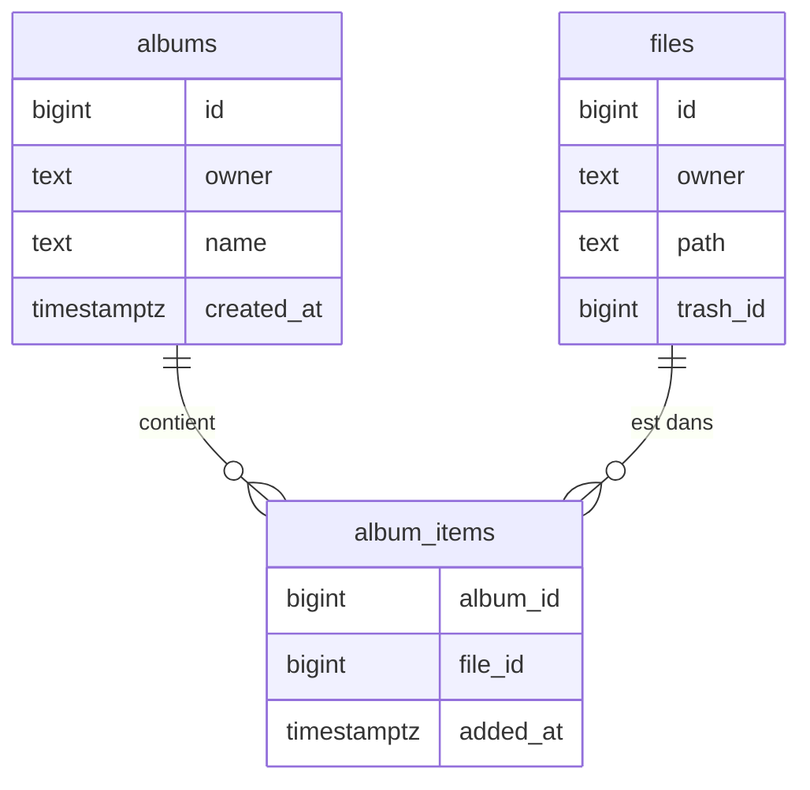

# Albums

Un album regroupe des photos et vidéos d'un compte sous un nom, pour retrouver un voyage ou un événement d'un coup. Il ne contient que des références : jamais une copie, jamais un fichier.
Issue : #39.

## Données

- `albums` (migration `0016_albums.sql`) : nom de 1 à 200 caractères, unique par compte sans tenir compte de la casse (`albums_owner_name_ci`).
- `album_items` : clé `(album_id, file_id)`, clés étrangères `ON DELETE CASCADE` vers `albums` et `files`.
- **Un fichier garde son id** quand on le renomme, le déplace, le met à la corbeille ou le restaure : l'album le suit. Toutes les requêtes d'un album filtrent `trash_id IS NULL` : une photo à la corbeille sort de ses albums (et de leur compte) et y revient à sa restauration. La purge de la corbeille supprime la ligne de `files`, et la clé étrangère retire la photo de ses albums.
- **Supprimer un album** ne supprime que l'album et ses références : `internal/albums` n'appelle jamais une écriture de `storage`.

## Code et API

`core/internal/albums` (le service), `core/internal/httpapi/albums.go` (les routes), `storage.AlbumTimeline` (les photos d'un album, avec la même requête que la timeline). Toutes les routes exigent une session et ne voient que les albums du compte connecté ; un album d'un autre compte répond 404.

| Route | Effet |
|---|---|
| `GET /api/albums` | Les albums, par nom, avec leur nombre de fichiers vivants et leur couverture (le plus récent, `cover`, une `Entry`) |
| `POST /api/albums` `{name}` | Crée un album vide (409 si le nom est pris) |
| `GET /api/albums/{id}` | Un album |
| `PATCH /api/albums/{id}` `{name}` | Le renomme |
| `DELETE /api/albums/{id}` | Le supprime, sans toucher à ses fichiers (204) |
| `GET /api/albums/{id}/items` | Ses fichiers vivants, du plus récent au plus ancien, par date de prise de vue, paginés comme `GET /api/timeline` (`tz`, `limit`, `before_at`, `before_path`) |
| `POST /api/albums/{id}/items` `{paths}` | Ajoute des fichiers (1 000 au plus) ; un fichier déjà là n'est compté qu'une fois |
| `POST /api/albums/{id}/items/remove` `{paths}` | Retire des fichiers de l'album ; ils restent dans le drive |

Les chemins sont résolus dans l'espace du compte connecté : le fichier d'un autre compte, un dossier ou un chemin absent répondent 404.

## Web et mobile

- **Web** : l'app Photos a deux vues, Photos (`/photos`) et Albums (`/photos/albums`, `Albums.tsx`). Un album (`/photos/albums/{id}`) s'affiche comme la timeline (`Timeline` avec `album`), avec sa visionneuse, « Renommer » et « Supprimer l'album ». Dans Photos, « Sélectionner » permet de choisir des photos puis « Ajouter à un album… » (un album existant ou un nouveau, `AlbumPicker`) ; dans un album, « Retirer de l'album ».
- **Mobile** : l'onglet Photos a un sélecteur « Tout / Albums » ; la liste des albums (`AlbumList`) ouvre un album dans la même grille que la timeline (`PhotoGrid`), avec la visionneuse. Créer un album et y ajouter des photos se fait sur le web.
