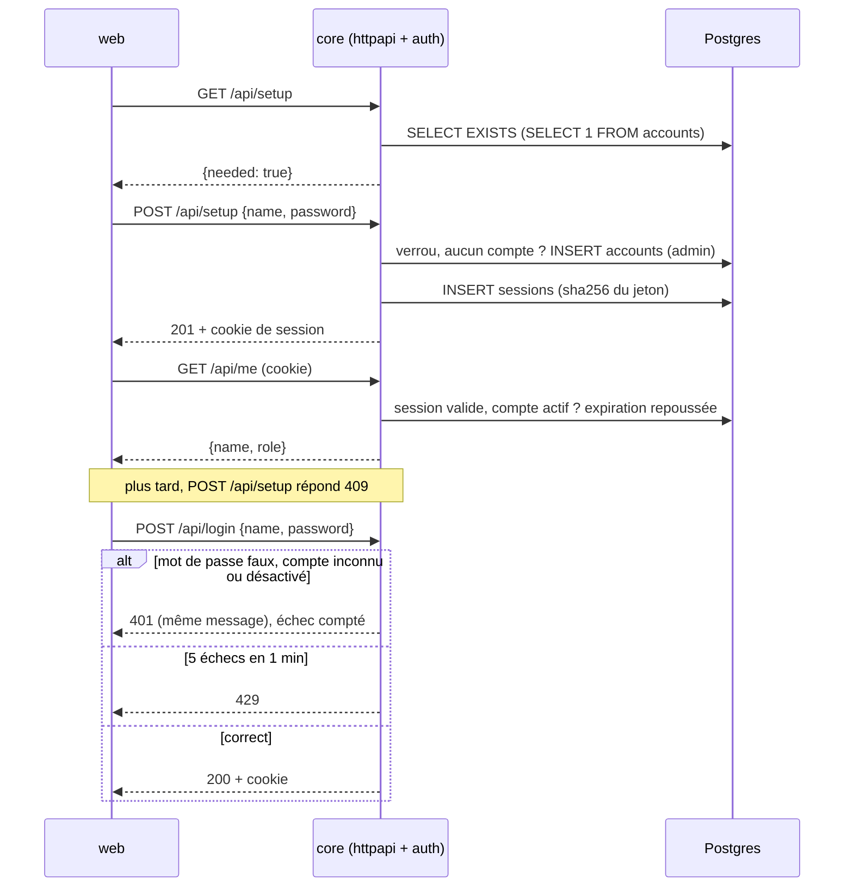
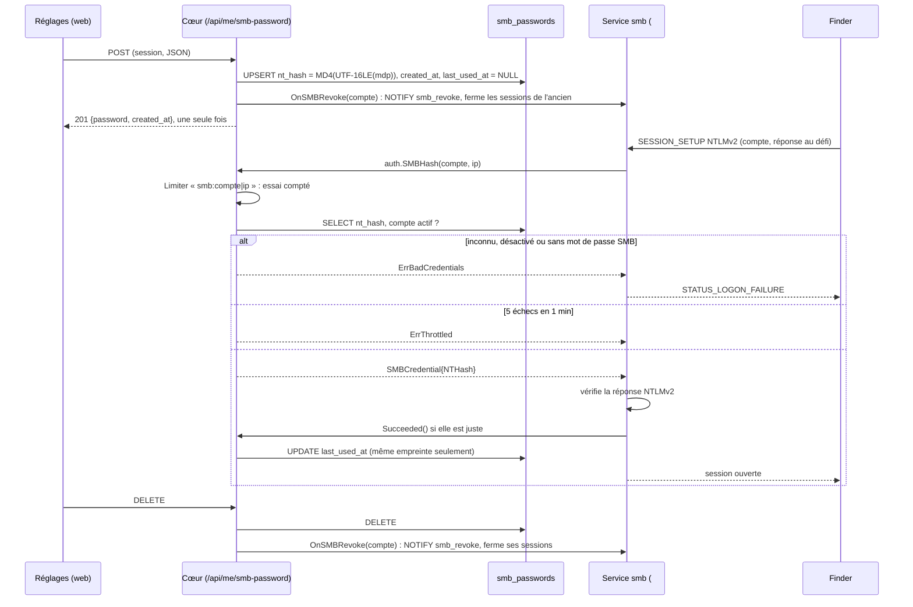

# Comptes, sessions et accès

Qui peut se connecter, comment une session est tenue, et quelles routes sont accessibles à qui : `core/internal/auth` et la table des routes de `core/internal/httpapi`.
Issue : #6.

## Ce qui est garanti

- **Mots de passe :** ils sont hachés en argon2id (`golang.org/x/crypto/argon2`), avec les paramètres stockés dans chaque hash et une comparaison en temps constant.
- **Sessions :** une copie de la base n'ouvre aucune session, parce que seul le SHA-256 d'un jeton est stocké.
- **Connexion :**
  - **Message d'erreur :** il est le même que le compte n'existe pas, que le mot de passe soit faux ou que le compte soit désactivé. Un compte inconnu coûte le même temps de calcul.
  - **Limitation :** 5 échecs par minute pour un même compte depuis une même IP, puis 429. Le compteur vit en mémoire et repart à zéro au redémarrage du cœur.
- **Routes :** aucune n'est accessible sans session, sauf celles marquées `public` (voir « Routes »). Les seules routes publiques qui donnent accès à des fichiers sont celles d'un lien de partage, en lecture seule et derrière son jeton (voir [share.md](share.md)).
- **Dernier admin :** il y a toujours un admin actif ; le dernier ne peut être ni rétrogradé ni désactivé.

## Tables

- `accounts` : `name` (aussi le nom du dossier de l'utilisateur, même règle que `storage.CleanOwner`), `display_name`, `password_hash`, `role` (`admin` ou `member`), `disabled_at`, `created_at`.
- `sessions` : `token_hash` (SHA-256), `account`, `created_at`, `last_seen_at`, `expires_at`. L'expiration est glissante : 30 jours après le dernier usage. Désactiver un compte ou réinitialiser son mot de passe supprime ses sessions.
- `smb_passwords` : `account` (clé, supprimée avec le compte), `nt_hash` (16 octets), `created_at`, `last_used_at`. Voir « Mot de passe SMB ».

## Premier démarrage et connexion



L'assistant tourne sous un verrou consultatif : deux installations lancées en même temps ne créent qu'un seul admin.

## Session et cookie

- **Cookie :** `cloudos_session`, en `HttpOnly` et `SameSite=Lax`. Il devient `Secure` quand la box s'ouvre en HTTPS (`edge.Secure`) : `CLOUDOS_PUBLIC_URL` en https, ou `X-Forwarded-Proto: https` venu du proxy de confiance, le service `tailscale` ([box.md](box.md), « Accès »). L'en-tête d'un autre client ne décide de rien. En HTTP sur le réseau local, un cookie `Secure` ne serait jamais renvoyé.
- **L'adresse du client**, par laquelle comptent les limites d'essais, est `edge.ClientIP` : le `X-Forwarded-For` du proxy de confiance, sinon l'adresse de la connexion.
- **Clients sans cookie :** l'app mobile envoie le même jeton en `Authorization: Bearer`.
- **CSRF :** toute requête qui modifie quelque chose doit être en JSON, ou porter l'en-tête `X-Cloudos-Client` (cas d'un envoi de fichier brut). Un navigateur ne peut envoyer ni l'un ni l'autre depuis un autre site sans vérification préalable CORS, que le cœur n'accorde jamais.

## Routes

La table `routes()` de `core/internal/httpapi/httpapi.go` donne à chaque route son niveau d'accès. `NewHandler` enveloppe les routes `member` dans `RequireSession`, et les routes `admin` dans `RequireSession` puis `RequireAdmin`.

| Niveau | Routes |
|---|---|
| `public` | `GET /api/health`, `GET` et `POST /api/setup`, `POST /api/login`, `POST /api/logout`, et les routes de l'invité d'un lien de partage : `GET /api/s/{token}`, `POST /api/s/{token}/unlock`, `GET /api/s/{token}/files`, `/content` et `/zip` (voir [share.md](share.md)) |
| `member` | `GET /api/me`, `GET`, `POST` et `DELETE /api/me/smb-password` (voir « Mot de passe SMB »), toutes les routes `/api/files…` (voir [storage.md](storage.md)), `/api/trash…`, `/api/uploads…`, et `POST`, `GET /api/shares`, `DELETE /api/shares/{id}` |
| `admin` | `GET` et `POST /api/accounts`, `PATCH /api/accounts/{name}` (rôle, désactivé) |

`TestEveryRouteIsProtected` parcourt cette table :
- **Sans session :** chaque route qui n'est pas publique doit répondre 401.
- **En membre :** chaque route admin doit répondre 403.
- **Liste publique :** elle est figée dans le test, donc ajouter une route publique oblige à modifier le test.

## Mot de passe perdu

```bash
printf '%s\n' '<nouveau mot de passe>' | docker compose run --rm -T core reset-password <compte>
```

Cette commande se lance depuis le terminal de la box, pas depuis l'API. Elle change le mot de passe et ferme toutes les sessions du compte.

## Mot de passe SMB

Issue : #91, sous-issue de #15 (monter le drive en SMB). Le code est dans `core/internal/auth/smb.go` et `core/internal/httpapi/smbpassword.go`, l'écran dans `web/src/settings/Settings.tsx`.

**Pourquoi un mot de passe à part.** SMB authentifie en NTLMv2, qui demande au serveur l'empreinte NT du mot de passe : le MD4 de son UTF-16LE, sans sel. Le mot de passe du compte n'est gardé qu'en argon2id et n'a pas d'empreinte NT. En garder une affaiblirait tout le compte, car elle suffit à se connecter sans casser le mot de passe. Chaque compte peut donc tirer un mot de passe réservé à SMB, dont une fuite de la base n'expose que l'accès SMB, et qui se révoque.

**Ce qui est garanti.**
- **Seule l'empreinte NT est gardée.** `NewSMBPassword` tire 24 caractères parmi 56 (sans I, O, l, o, 0 ni 1), environ 139 bits, avec `crypto/rand`, et ne stocke que `NTHash` (`golang.org/x/crypto/md4`). La réponse de `POST /api/me/smb-password` est la seule fois où le mot de passe sort du cœur, en `Cache-Control: no-store`. Avec 139 bits, chercher le mot de passe depuis son empreinte non salée est hors de portée.
- **Deux secrets séparés.** Le mot de passe SMB n'est lu ni par `Login`, ni par `CheckCredentials`, ni par `BasicAuth` (WebDAV), qui ne regardent que `accounts.password_hash`. `SMBHash` ne lit que `smb_passwords` : le mot de passe du compte n'ouvre pas SMB.
- **Régénérer remplace.** Un nouveau tirage écrase l'empreinte (`ON CONFLICT … DO UPDATE`), remet `created_at` et efface `last_used_at`.
- **Révoquer coupe les sessions.** `RevokeSMBPassword`, un nouveau tirage et la désactivation du compte appellent le crochet `Service.OnSMBRevoke(compte)`. Le cœur y branche `smbfs.NotifyRevoke`, qui prévient le service `smb` par Postgres, et ce dernier ferme les sessions ouvertes du compte (#95, [smb.md](smb.md)).
- **Compte désactivé refusé.** `SMBHash` et `NewSMBPassword` ignorent un compte désactivé ; le réactiver rend l'accès avec le même mot de passe.
- **Essais limités** comme pour la connexion web : 5 échecs par minute, sous la clé `smb:<compte>|<ip>`, à part de celle du web. Ce `Limiter` vit dans le processus du service `smb`, qui a son propre `auth.Service`. Un essai compte comme un échec dès que `SMBHash` rend l'empreinte, et `SMBCredential.Succeeded` l'efface quand le serveur a vérifié la réponse NTLMv2 : un client qui coupe la connexion en route consomme quand même un essai. Un nom inconnu ou un compte sans mot de passe SMB consomme aussi un essai et reçoit le même `ErrBadCredentials`.
- **Chaque compte ne voit que le sien.** Les routes ne prennent pas de nom : le compte est celui de la session.



**Routes** (membre, session, JSON pour les changements) :
- `GET /api/me/smb-password` : `{exists, created_at, last_used_at}`, jamais le mot de passe.
- `POST /api/me/smb-password` : tire un mot de passe, en remplace un éventuel, et répond 201 avec le statut et `password`.
- `DELETE /api/me/smb-password` : révoque, 204. Révoquer deux fois n'est pas une erreur.

**Réglages.** Une fenêtre du dock pour chaque membre (`/reglages`), avec la section « Accès SMB » : générer le mot de passe, montré une fois avec un bouton Copier et la phrase qui dit qu'il ne sera plus affiché ; le régénérer ou le révoquer, chacun après une confirmation parce qu'il coupe les sessions SMB ouvertes ; les dates de création et de dernière utilisation.

**Risque restant.** Une copie de la base donne l'empreinte NT, qui suffit à ouvrir une session SMB du compte (pas l'interface web, pas WebDAV) tant que le mot de passe n'est pas révoqué ou régénéré.
