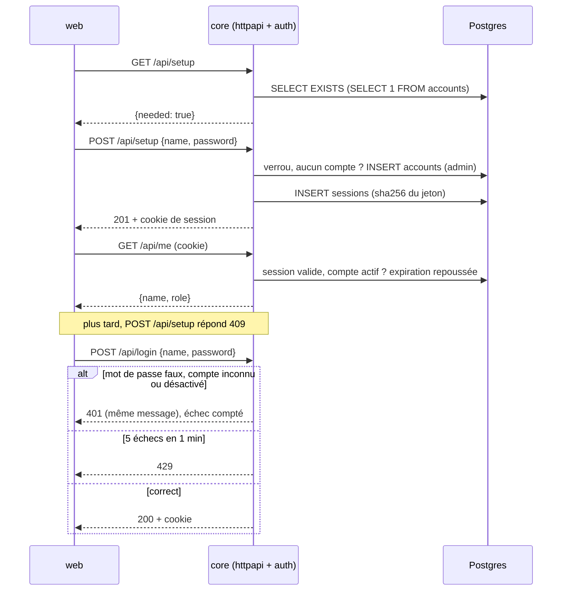

# Comptes, sessions et accès

Qui peut se connecter, comment une session est tenue, et quelles routes sont accessibles à qui : `core/internal/auth` et la table des routes de `core/internal/httpapi`.
Issue : #6.

## Ce qui est garanti

- **Mots de passe :** ils sont hachés en argon2id (`golang.org/x/crypto/argon2`), avec les paramètres stockés dans chaque hash et une comparaison en temps constant.
- **Sessions :** une copie de la base n'ouvre aucune session, parce que seul le SHA-256 d'un jeton est stocké.
- **Connexion :**
  - **Message d'erreur :** il est le même que le compte n'existe pas, que le mot de passe soit faux ou que le compte soit désactivé. Un compte inconnu coûte le même temps de calcul.
  - **Limitation :** 5 échecs par minute pour un même compte depuis une même IP, puis 429. Le compteur vit en mémoire et repart à zéro au redémarrage du cœur.
- **Routes :** aucune n'est accessible sans session, sauf celles marquées `public` (voir « Routes »). Les seules routes publiques qui donnent accès à des fichiers sont celles d'un lien de partage, en lecture seule et derrière son jeton (voir [share.md](share.md)).
- **Dernier admin :** il y a toujours un admin actif ; le dernier ne peut être ni rétrogradé ni désactivé.

## Tables

- `accounts` : `name` (aussi le nom du dossier de l'utilisateur, même règle que `storage.CleanOwner`), `display_name`, `password_hash`, `role` (`admin` ou `member`), `disabled_at`, `created_at`.
- `sessions` : `token_hash` (SHA-256), `account`, `created_at`, `last_seen_at`, `expires_at`. L'expiration est glissante : 30 jours après le dernier usage. Désactiver un compte ou réinitialiser son mot de passe supprime ses sessions.

## Premier démarrage et connexion



L'assistant tourne sous un verrou consultatif : deux installations lancées en même temps ne créent qu'un seul admin.

## Session et cookie

- **Cookie :** `cloudos_session`, en `HttpOnly` et `SameSite=Lax`. Il devient `Secure` dès que la requête arrive en HTTPS, directement ou derrière un proxy (`X-Forwarded-Proto`). En HTTP sur le réseau local, un cookie `Secure` ne serait jamais renvoyé.
- **Clients sans cookie :** l'app mobile envoie le même jeton en `Authorization: Bearer`.
- **CSRF :** toute requête qui modifie quelque chose doit être en JSON, ou porter l'en-tête `X-Cloudos-Client` (cas d'un envoi de fichier brut). Un navigateur ne peut envoyer ni l'un ni l'autre depuis un autre site sans vérification préalable CORS, que le cœur n'accorde jamais.

## Routes

La table `routes()` de `core/internal/httpapi/httpapi.go` donne à chaque route son niveau d'accès. `NewHandler` enveloppe les routes `member` dans `RequireSession`, et les routes `admin` dans `RequireSession` puis `RequireAdmin`.

| Niveau | Routes |
|---|---|
| `public` | `GET /api/health`, `GET` et `POST /api/setup`, `POST /api/login`, `POST /api/logout`, et les routes de l'invité d'un lien de partage : `GET /api/s/{token}`, `POST /api/s/{token}/unlock`, `GET /api/s/{token}/files`, `/content` et `/zip` (voir [share.md](share.md)) |
| `member` | `GET /api/me`, toutes les routes `/api/files…` (voir [storage.md](storage.md)), `/api/trash…`, `/api/uploads…`, et `POST`, `GET /api/shares`, `DELETE /api/shares/{id}` |
| `admin` | `GET` et `POST /api/accounts`, `PATCH /api/accounts/{name}` (rôle, désactivé) |

`TestEveryRouteIsProtected` parcourt cette table :
- **Sans session :** chaque route qui n'est pas publique doit répondre 401.
- **En membre :** chaque route admin doit répondre 403.
- **Liste publique :** elle est figée dans le test, donc ajouter une route publique oblige à modifier le test.

## Mot de passe perdu

```bash
printf '%s\n' '<nouveau mot de passe>' | docker compose run --rm -T core reset-password <compte>
```

Cette commande se lance depuis le terminal de la box, pas depuis l'API. Elle change le mot de passe et ferme toutes les sessions du compte.
