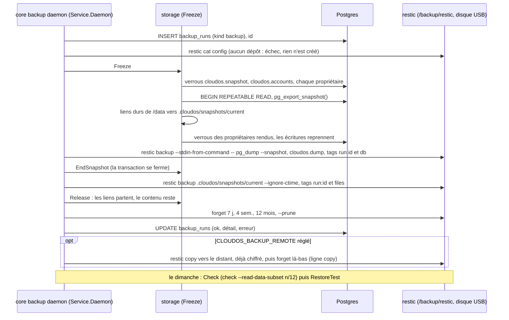

# La sauvegarde de la box

Chaque nuit, la box se sauvegarde, chiffrée, dans un dépôt restic sur un disque USB, sans s'arrêter. Chaque semaine, une partie du dépôt est relue et une restauration test vérifie la base et un échantillon de fichiers. La restauration complète sur une box neuve est une commande. Issue : #101 (Feature #98).

restic (BSD-2) chiffre, déduplique, et écrit aussi bien sur un disque que sur un dépôt distant.

## Ce qui est sauvegardé

- **La base** : un `pg_dump --format=custom`, nommé `cloudos.dump` dans le dépôt.
- **Les fichiers** : tout `CLOUDOS_DATA_DIR`, versions (`.cloudos/versions`), corbeille (`.cloudos/trash`), envois en cours (`.cloudos/uploads`) et fichiers du Finder (`.cloudos/appledouble`) compris. Seuls `.cloudos/tmp` (écritures en cours, dont celles de SMB) et `.cloudos/snapshots` (la photo elle-même) en sont exclus.
- **La rétention** : 7 jours, 4 semaines et 12 mois (`restic forget --keep-daily 7 --keep-weekly 4 --keep-monthly 12 --prune`). Restic garde les bases et les fichiers à part (il groupe par chemin), chacun avec cette règle.

`box.env` n'est pas dans la sauvegarde : il porte la clé du dépôt. La restauration le recrée.

Le disque de sauvegarde se formate en ext4 : la restauration test y lance un Postgres, qui exige les droits Unix (0700) que FAT et exFAT n'ont pas. Le dossier appartient à l'uid 65532, celui du cœur.


## Une photo cohérente, sans arrêter la box

`storage` ne modifie jamais un fichier stocké sur place (`CLAUDE.md`, règles non négociables) : un envoi écrit un fichier temporaire puis le lie, un remplacement garde l'ancien contenu en version, une suppression déplace vers la corbeille. Un lien dur pris à un instant garde donc le contenu de cet instant. `Store.Freeze` (`core/internal/storage/freeze.go`) s'en sert :

1. Elle prend le verrou `cloudos.snapshot` : une seule photo à la fois, de `Freeze` à `Release`. Une deuxième sauvegarde lancée en même temps reçoit `ErrFrozen`.
2. Elle retire une photo laissée par un passage interrompu (`removeSnapshot`).
3. Elle prend le verrou des comptes (`cloudos.accounts`), puis le verrou de chaque propriétaire, dans l'ordre alphabétique : les comptes, les propriétaires de l'index et les dossiers de propriétaires sur le disque. Ce sont les verrous que prend toute écriture de `storage`, dans le cœur comme dans le service `smb`. Aucune écriture n'est donc à moitié faite.
4. Elle ouvre une transaction `REPEATABLE READ` en lecture seule et exporte son instantané (`pg_export_snapshot()`). Elle compte les lignes de fichiers de l'index (`indexed_files`).
5. Elle crée un lien dur de chaque fichier de la racine dans `.cloudos/snapshots/current`, recrée les dossiers et les liens symboliques, et remet les dates des dossiers.
6. Elle rend les verrous : les écritures reprennent. `LockHeld` mesure l'attente, écrite dans `backup_runs` (`lock_ms`).

`pg_dump --snapshot` lit la base de cet instant, et restic lit les fichiers de la photo à son rythme. Une écriture qui arrive pendant la création des liens attend, sans erreur (`TestFreezeHoldsWritesThenLetsThemThrough`). Il y a environ un millier de fichiers par fraction de seconde (`TestFreezeLockTime`), à 3 h du matin.

`SetModTime` (#92) change seulement la date d'un fichier. Comme le lien partage l'inode, une date changée après `Freeze` se voit aussi dans la photo : c'est une métadonnée, jamais le contenu.

`Frozen.Release` retire les liens de `.cloudos/snapshots/current`, et seulement là : chaque fichier y est un second nom d'un fichier gardé ailleurs. `removeSnapshot` est dans la liste `allowedErasers` de `guard`. Elle refuse si `.cloudos`, `.cloudos/snapshots` ou `current` n'est pas un vrai dossier, car un lien symbolique pourrait la pointer vers les fichiers des utilisateurs.

## Un passage



- **`--stdin-from-command`** : si `pg_dump` échoue, restic n'enregistre rien.
- **`--ignore-ctime`** : créer un lien change le ctime d'un fichier, jamais son contenu. Sans cette option, chaque nuit relirait tout. Avec elle, un deuxième passage n'ajoute presque rien (`TestBackupTwiceAddsAlmostNothing`).
- **`--host cloudos`** : le nom du conteneur change à chaque démarrage. restic trouve l'instantané précédent et applique la rétention par hôte.
- **Un passage incomplet.** Si les fichiers échouent après la base, l'instantané de base de ce passage est oublié (`discarded_db_snapshot`), pour que la rétention garde des paires base et fichiers alignées. La restauration ne prend que des passages complets, qui ont les deux étiquettes `db` et `files` sous le même `run:<id>`.
- **Les verrous restic** : chaque commande attend jusqu'à 10 minutes celui d'une autre (`--retry-lock 10m`).

## Vérifier, chaque dimanche

- **`Check`** : `restic check --read-data-subset=n/12`, avec `n` tiré de la semaine ISO. La relecture couvre tout le dépôt en 12 semaines.
- **`RestoreTest`** (`core/internal/backup/restoretest.go`) :
  1. Elle prend le passage complet le plus récent.
  2. Elle lance un Postgres temporaire dans le conteneur : `initdb` dans `/backup/restore-test`, sur le disque de sauvegarde, et un socket, sans port, dans le dossier temporaire du conteneur (un socket ne se crée pas sur tous les disques, et son chemin ne doit pas dépasser une centaine d'octets).
  3. Elle y restaure `cloudos.dump` (`pg_restore --single-transaction --no-owner --no-acl`), puis compare le nombre de fichiers indexés à celui que le passage a compté.
  4. Elle tire 200 fichiers au hasard dans la base restaurée, les extrait du même passage (`restic dump`) et compare leur SHA-256 à l'index.
  5. Elle arrête le serveur et efface `/backup/restore-test` (`removeScratch`, dans `allowedErasers`, confinée à ce dossier).

  Elle échoue sur un dépôt abîmé et sur un fichier qui diffère de l'index (`TestRestoreTest`).

Une restauration complète chaque semaine demanderait la place de toutes les données : `core verify` sert à la restauration complète, pas au test hebdomadaire.

## `backup_runs`

Migration `0028_backup.sql`. Une ligne par passage, écrite au départ (`finished_at` et `ok` vides) et complétée à la fin : une ligne restée ouverte est un passage coupé.

| Colonne | |
|---|---|
| `kind` | `backup`, `copy`, `check`, `restore_test` |
| `started_at`, `finished_at` | |
| `ok` | vide tant que le passage tourne |
| `detail` | `backup` : `db_snapshot`, `files_snapshot`, `files`, `bytes`, `indexed_files`, `owners`, `lock_ms`, `files_new`, `files_changed`, `files_unmodified`, `data_added`, `duration_ms` ; `check` : `subset` ; `restore_test` : `run`, `indexed_files`, `sample`, `mismatches` ; `copy` : `remote` sans identifiants |
| `error` | le message, avec la fin de la sortie d'erreur de restic ou de `pg_dump` |

Le panneau d'état (#102) lit cette table. `core backup status` (ou `scripts/box backup-status`) en montre les 20 dernières lignes.

## Le rôle `cloudos_backup`

Le service se connecte avec son propre rôle, comme `smb` :

- **Ses droits.** `NOLOGIN`, `INHERIT`, `CONNECTION LIMIT 8`, membre de `pg_read_all_data` pour `pg_dump`. Il lit donc toute la base, empreintes de mots de passe comprises, comme toute sauvegarde de base. Parmi elles, `smb_passwords.nt_hash` suffit à se connecter en SMB sans le mot de passe : le dépôt chiffré et sa clé se gardent comme les mots de passe eux-mêmes. Il n'écrit que `backup_runs` : `INSERT (kind, detail)`, `UPDATE (finished_at, ok, detail, error)` (`TestBackupMigration`).
- **Son mot de passe.** Le cœur le pose à chaque démarrage depuis `CLOUDOS_BACKUP_DB_PASSWORD` (`db.SetLoginPassword`). Vide, le rôle ne peut pas se connecter.
- **Son contrôle.** `core backup` refuse de tourner avec un rôle qui a plus que la lecture : superutilisateur, `CREATEROLE`, `CREATEDB`, `BYPASSRLS`, membre de `pg_write_all_data`, ou qui peut écrire `files` (`backup.CheckRole`). Seule `restore` y échappe, car elle crée la base.
- **Son adresse.** `DATABASE_URL` ne porte pas de mot de passe, sinon `core backup` refuse de tourner : `pg_dump` et `pg_restore` reçoivent l'adresse sur leur ligne de commande, que tout processus de la machine peut lire. Le mot de passe passe par `PGPASSWORD`.
- **Les fichiers.** `/data` est monté en lecture-écriture pour les liens durs de `storage` seulement : rien dans `core/internal/backup` n'écrit la racine des données.
- **Le cœur.** Il lit `backup_runs`, dont il est propriétaire.

## Le service et l'image

- **`backup/Dockerfile`.**
  - **La base de l'image :** `pgvector/pgvector:0.8.1-pg17`, celle de la base. `pg_dump`, `pg_restore` et le serveur temporaire sont donc de sa version, avec pgvector.
  - **restic** est une version épinglée (`backup/fetch-restic.sh`, 0.19.1), vérifiée par SHA-256 à la construction.
  - **`/core`** est compilé dans une étape Go.
  - **L'utilisateur** est l'uid 65532, celui du cœur : les liens et les fichiers restaurés restent les siens.
  - **L'étape `test`** lance les tests du paquet avec ces outils (`make test-backup`).
- **Le service `backup` de `compose.yaml`, profil `backup` :**
  - **sa commande :** `backup daemon` ;
  - **la base :** `DATABASE_URL` avec `cloudos_backup` et `PGPASSWORD` ;
  - **les volumes :** `/data`, `${CLOUDOS_BACKUP_DIR}` sur `/backup`, et le cache de restic dans le volume `backup_cache` ;
  - **les limites :** `mem_limit: 1g` et `pids_limit: 256`.

  En production, il redémarre (`unless-stopped`) et ses journaux sont plafonnés.
- **La priorité.** Le démon lance restic, `pg_dump` et le serveur temporaire sous `nice -n 10 ionice -c 2 -n 7`. Les liens de `Freeze` se font à priorité normale, pour tenir les verrous le moins longtemps possible.
- **L'heure.** `CLOUDOS_BACKUP_AT` (03:00 par défaut) est lue dans le fuseau `CLOUDOS_TZ` (`Europe/Paris` par défaut). Le binaire embarque les fuseaux (`time/tzdata`). Une nuit où la box était éteinte n'est pas rattrapée : le passage suivant a lieu la nuit d'après.

| Variable | Rôle |
|---|---|
| `CLOUDOS_BACKUP_DIR` | le dossier du disque de sauvegarde, monté sur `/backup` ; le dépôt est `/backup/restic` |
| `RESTIC_PASSWORD` | la clé du dépôt (et du dépôt distant) |
| `CLOUDOS_BACKUP_DB_PASSWORD` | le mot de passe du rôle `cloudos_backup` |
| `CLOUDOS_BACKUP_AT` | l'heure du passage, `HH:MM` |
| `CLOUDOS_TZ` | le fuseau de cette heure |
| `CLOUDOS_BACKUP_REMOTE` | un dépôt distant chiffré (`s3:…`, `sftp:…`), vide par défaut |
| `AWS_ACCESS_KEY_ID`, `AWS_SECRET_ACCESS_KEY`, `AWS_DEFAULT_REGION` | les accès d'un dépôt S3 compatible |

En développement, `CLOUDOS_BACKUP=1 make up` lance le service, avec un dépôt dans `./.data/backup` et des mots de passe de développement. Il faut d'abord créer le dépôt : `docker compose run --rm backup backup init`.

## Sur la box : `scripts/box`

```bash
scripts/box backup-init /media/usb/cloudos-backup   # une fois : dépôt, clé montrée une seule fois, service lancé
scripts/box backup                                  # une sauvegarde tout de suite
scripts/box backup-status                           # les derniers passages
scripts/box update                                  # git pull, sauvegarde, puis up --build
scripts/box restore /media/usb/cloudos-backup       # sur une box neuve
scripts/box backup-remote-init                      # le dépôt distant, si CLOUDOS_BACKUP_REMOTE est réglé
```

- **`backup-init DIR`.**
  - **Ce qu'il refuse :** un dossier relatif, absent, ou non vide qui n'est pas un dépôt, ainsi que le dossier des données, un dossier qui s'y trouve ou qui le contient. Il ignore le `lost+found` d'un disque formaté. Il refuse aussi un dossier qui porte déjà une sauvegarde quand `box.env` n'a pas sa clé : c'est alors une restauration.
  - **`box.env` :** il y ajoute `RESTIC_PASSWORD`, `CLOUDOS_BACKUP_DB_PASSWORD` et `CLOUDOS_BACKUP_DIR`, sans jamais réécrire une ligne.
  - **Le dépôt :** il donne le dossier à l'uid 65532 et crée le dépôt (`core backup init`).
  - **La clé :** il l'affiche une seule fois, avec l'avertissement de la garder hors de la box.
  - **La fin :** il lance `up`. Le profil `backup` est alors actif à chaque `up`, et `up` refuse une clé vide ou de développement.

  Relancé sur le même dossier, il ne fait rien et ne montre rien.
- **Le dépôt vu de l'hôte.** restic ne laisse entrer dans le dépôt que son propriétaire, l'uid 65532. Sur Linux, `scripts/box` y regarde donc avec `sudo` quand il le faut (`backup-init`, `restore`). S'il ne le peut pas, un dossier `restic` compte comme un dépôt : `backup-init` n'écrit rien par-dessus, et `restore` laisse restic trancher.
- **`update`.** Une mise à jour commence par une sauvegarde : `git pull --ff-only`, puis `backup` avec les images en place, puis `up --build`. Si la sauvegarde échoue, la mise à jour s'arrête et la box tourne comme avant. Sans sauvegarde configurée, `update` refuse.
- **`backup-remote-init`.** Le dépôt distant se crée avec `restic init --from-repo --copy-chunker-params` : il déduplique comme le dépôt local, et il a la même clé.

## La clé

Elle est tirée par `backup-init` (32 caractères alphanumériques, `/dev/urandom`) et gardée dans `box.env`, en mode 0600, pour les passages de nuit. Elle est montrée une seule fois, et `scripts/box` ne l'affiche plus jamais. Sans elle, le disque de sauvegarde est illisible, et personne ne peut la retrouver : elle se garde hors de la box, sur papier ou dans un gestionnaire de mots de passe.

## Restaurer sur une box neuve, pas à pas

Le cas : la box ou son disque de données est mort, il reste le disque de sauvegarde et la clé.

1. **La box neuve.** Installer Docker et le dépôt Git, comme pour une première installation ([box.md](box.md)).
2. **Les secrets.** Lancer `scripts/box init`. Il crée `box.env` (de nouveaux mots de passe pour la base) et un `CLOUDOS_DATA_DIR` vide. Ne pas lancer `up` : la base doit rester vide.
3. **Le disque.** Brancher et monter le disque de sauvegarde, par exemple sur `/media/usb`.
4. **La restauration.** Lancer `scripts/box restore /media/usb/cloudos-backup` :
   - il vérifie que le dossier porte un dépôt et que `CLOUDOS_DATA_DIR` est vide ;
   - il demande la clé (rien ne s'affiche à la frappe) et l'ajoute à `box.env`, avec un mot de passe pour `cloudos_backup` ;
   - il démarre la base seule ;
   - il lance `core backup restore` dans le service `backup`, connecté comme propriétaire de la base. Le passage complet le plus récent est choisi, ou celui qu'on donne : `scripts/box restore DIR <run>`, numéro lu dans `backup-status`.
   - **D'abord les fichiers**, dans `CLOUDOS_DATA_DIR` (`restic restore <id>:<dossier de la photo> --target /data`).
   - **Puis les rôles** `cloudos_smb` et `cloudos_backup`, s'ils manquent : un rôle appartient au serveur, pas à la base, et le dump leur donne des droits.
   - **Puis la base**, dans une seule transaction (`pg_restore --single-transaction --no-owner`).
   - **Enfin la box :** `up`, puis `core verify`, qui compare chaque fichier à l'index restauré. Il ne doit rien signaler.
5. **La suite.** Le service `backup` reprend dans le même dépôt : le passage suivant est incrémental.

**Si la restauration échoue au milieu**, elle n'a rien écrasé : elle refuse un dossier ou une base déjà utilisés. Pour recommencer, vider `CLOUDOS_DATA_DIR`, puis supprimer la base neuve avec `scripts/box down -v`, et seulement sur cette box neuve.

**`TestRestoreOntoANewBox`** joue ce chemin dans les tests : une racine et une base vides reçoivent un passage, `Verify` ne trouve aucun écart et le rôle `smb` garde ses droits. L'étape 7 de #101 l'a joué sur le Mac avec `scripts/box`, un dossier tenant lieu de disque USB : `backup-init`, deux sauvegardes, la restauration complète dans une box neuve, puis `core verify` sans écart et le compte qui se connecte avec son mot de passe d'origine.

## Ce qui peut mal tourner

- **Le disque est absent ou plein.** Le dépôt manque, donc le passage échoue avant toute photo (`ErrNoRepository`, « is the backup disk plugged in? »). L'échec est écrit dans `backup_runs`, et aucun dépôt n'est recréé ailleurs. Un disque plein fait échouer restic, et l'erreur va dans la même ligne.
- **Un arrêt en plein passage.** La photo reste dans `.cloudos/snapshots/current`, et la ligne reste ouverte. Le prochain `Freeze` retire la photo. Restic garde un verrou périmé, qu'il ignore au bout de 30 minutes.
- **La clé est perdue.** La sauvegarde est illisible. On ne peut que la refaire : `backup-init` sur un dossier vide, avec une nouvelle clé.
- **Ce qui sort de la box.** Rien sans `CLOUDOS_BACKUP_REMOTE`. Avec lui, des données déjà chiffrées par restic.
- **Des secrets dans une erreur.** La sortie d'erreur de restic nomme le dépôt qu'il n'a pas pu ouvrir. Avant d'aller dans `backup_runs` et les journaux, elle perd l'utilisateur et le mot de passe de l'adresse distante, ainsi que les clés et mots de passe de l'environnement. Les commandes autres que restic ne reçoivent ni la clé ni les identifiants du dépôt distant.
- **Le dossier de sauvegarde dans les données.** `backup-init` refuse le dossier des données, un dossier qui s'y trouve, et un dossier qui le contient. De son côté, la restauration test compare les dossiers sur le disque, pas par leur chemin : dans le conteneur, un même dossier de l'hôte peut être monté à la fois en `/data` et en `/backup`. Elle refuse alors d'effacer ou de créer `restore-test` si le dossier de sauvegarde n'a pas de dépôt, s'il ressemble à une racine de données (`.cloudos`), ou si l'un contient l'autre.

## Les tests

- `core/internal/storage/freeze_test.go` vérifie :
  - que la photo et la base correspondent, versions et corbeille comprises, sans `.cloudos/tmp` ;
  - qu'une écriture pendant `Freeze` attend puis passe ;
  - qu'une photo laissée par un arrêt est reprise, et qu'une deuxième `Freeze` est refusée ;
  - que `removeSnapshot` refuse un lien symbolique ;
  - que tout `/data` est intact après `Release` ;
  - le temps de verrou pour 1 000 fichiers.
- `core/internal/backup/backup_test.go`, dans l'image (`make test-backup`), vérifie :
  - qu'un deuxième passage n'ajoute presque rien ;
  - que la rétention garde les bons instantanés, sur des dates choisies ;
  - que `RestoreTest` passe sur un dépôt sain, et échoue sur un dépôt abîmé et sur un fichier qui diffère ;
  - la restauration sur une box neuve ;
  - le disque absent ;
  - la copie distante, et `Check`.
- `core/internal/migrate/migrate_test.go` (`TestBackupMigration`) : la migration monte, est défaite puis remonte, et le rôle n'écrit que `backup_runs`.
- `scripts/test-box.sh` (`make test-box`), avec un faux `docker` : `backup-init` refuse un dossier non vide ou pris dans les données, et montre la clé une seule fois, et `update` s'arrête si la sauvegarde échoue.
- La CI `images` fait, sur amd64 et arm64 :
  - `backup-init`, `backup` et `restore-test` sur la pile de production ;
  - puis elle contrôle `backup-status`.
