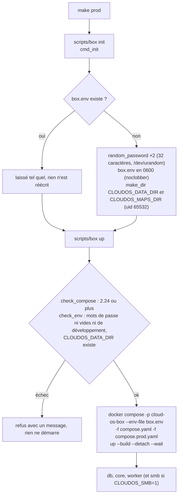
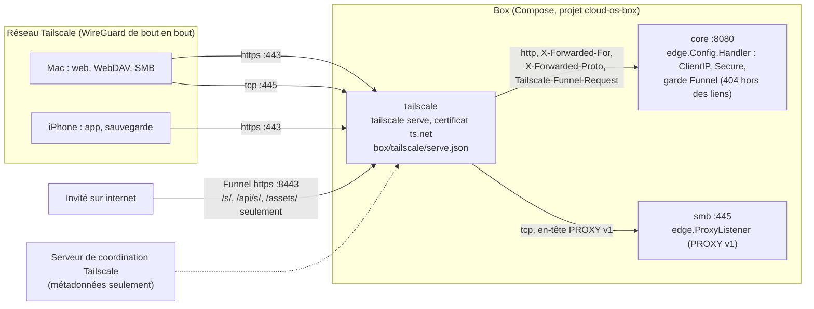

# La box en production

Comment la pile se lance en production, d'une seule commande, et ce qui la distingue de la pile de développement. Puis comment on l'ouvre en HTTPS, chez soi comme dehors, par Tailscale (« Accès »). Issues : #99, #100 (Feature #98).

La production est une surcouche de `compose.yaml` : `compose.prod.yaml`. La pile de développement ne change pas.

## Lancer

```bash
make prod        # scripts/box init (une fois), puis scripts/box up
make prod-logs   # suivre les journaux
make prod-down   # arrêter, en gardant la base
```

`scripts/box` est le seul point d'entrée. Il porte le projet `cloud-os-box`, `box.env` et les deux fichiers Compose, pour que la production ne se mélange jamais à la pile d'un worktree (autre projet, autre volume de base). Toute autre commande est passée à Compose avec les mêmes drapeaux : `scripts/box run --rm core verify`, `scripts/box logs --follow`, `scripts/box down -v`.



## Ce que la surcouche change

| | Développement (`compose.yaml`) | Production (`compose.prod.yaml`) |
|---|---|---|
| Mots de passe | `cloudos` / `cloudos-smb` | `CLOUDOS_DB_PASSWORD` et `CLOUDOS_SMB_DB_PASSWORD` de `box.env`, sans valeur par défaut (`${VAR:?}`) |
| `db` | port publié (54320) | aucun port : seul le cœur s'y connecte, par le réseau Compose |
| `worker`, `smb` | `smb` publié sur 1445 | aucun port publié ; `smb` n'est joignable que par le service `tailscale` |
| `core` | `127.0.0.1:8480` | idem : le seul port ouvert |
| `web` (Vite) | lancé | profil `dev`, jamais lancé |
| Redémarrage | `smb` seulement | `db`, `core` et `worker` : `unless-stopped` |
| Journaux | illimités | pilote `local`, 10 Mo × 5 fichiers, pour tous les services |

La surcouche retire des ports avec `!reset`, qui demande Compose 2.24 ou plus : `scripts/box up` refuse un Compose plus ancien.

## `box.env`

Un fichier à la racine du dépôt, en mode 0600, ignoré par Git et par Docker (`.gitignore`, `.dockerignore`) :

| Clé | Rôle |
|---|---|
| `CLOUDOS_DB_PASSWORD` | mot de passe du rôle `cloudos` de Postgres |
| `CLOUDOS_SMB_DB_PASSWORD` | mot de passe du rôle `cloudos_smb`, posé par le cœur à chaque démarrage ([smb.md](smb.md), « Rôle en base ») |
| `CLOUDOS_DATA_DIR` | les fichiers des utilisateurs, `/srv/cloudos/files` par défaut |
| `CLOUDOS_MAPS_DIR` | le fichier `.pmtiles` de la carte, `/srv/cloudos/maps` par défaut |

On peut y ajouter `CLOUDOS_CORE_PORT`, ainsi que les réglages de l'accès (« Accès » ci-dessous) :

| Clé | Rôle |
|---|---|
| `CLOUDOS_SMB` | `1` lance le service `smb` |
| `CLOUDOS_TAILSCALE` | `1` lance le service `tailscale` |
| `TS_AUTHKEY` | la clé d'authentification de Tailscale, pour la première connexion seulement |
| `TS_HOSTNAME` | le nom de la box dans le réseau Tailscale, `cloudos` par défaut |
| `CLOUDOS_FUNNEL` | `1` ouvre les liens de partage à internet par Funnel |
| `CLOUDOS_PUBLIC_URL`, `CLOUDOS_SHARE_ORIGIN` | écrites par `scripts/box tailscale`, jamais à la main |

`CLOUDOS_SMB`, `CLOUDOS_TAILSCALE` et `CLOUDOS_FUNNEL` peuvent aussi venir du shell, qui l'emporte alors sur le fichier. `scripts/box` ignore les variables `CLOUDOS_DB_PASSWORD`, `CLOUDOS_SMB_DB_PASSWORD`, `CLOUDOS_DATA_DIR`, `CLOUDOS_MAPS_DIR`, `TS_AUTHKEY`, `TS_HOSTNAME`, `CLOUDOS_PUBLIC_URL`, `CLOUDOS_SHARE_ORIGIN` et `CLOUDOS_TRUSTED_PROXIES` du shell, pour qu'un réglage de développement ne passe jamais devant le fichier.

`init` ne réécrit jamais un `box.env` qui existe : Postgres ne lit `POSTGRES_PASSWORD` qu'à la création du volume, et un nouveau mot de passe fermerait la porte de la base. `CLOUDOS_DATA_DIR=… CLOUDOS_MAPS_DIR=… scripts/box init` choisit d'autres dossiers (le fichier lui-même se choisit avec `CLOUDOS_BOX_ENV`, comme le fait la CI).

Les dossiers sont donnés à l'uid 65532, celui du cœur (distroless `nonroot`) ; le worker, `nobody`, y lit en lecture seule. `init` utilise `sudo` seulement si elle ne peut pas créer ou changer un dossier elle-même, et sans terminal elle ne l'attend pas : elle dit alors la commande à lancer. Docker Desktop masque ce sujet sur le Mac, pas Linux.

## Reprendre

- **`box.env` perdu.** Aucune donnée n'est perdue, mais le cœur ne peut plus se connecter. Dans le conteneur `db`, la connexion locale ne demande pas de mot de passe : `scripts/box exec db psql -U cloudos -c "ALTER ROLE cloudos PASSWORD '<nouveau>'"`, puis `CLOUDOS_DB_PASSWORD=<nouveau>` dans un nouveau `box.env` (le mot de passe de `cloudos_smb` est reposé par le cœur au démarrage).
- **Disque de données absent.** `up` refuse un `CLOUDOS_DATA_DIR` qui n'existe pas, sans jamais le créer, pour que le cœur n'écrive pas sur la carte SD à la place d'un disque non monté. Un point de montage vide existe pourtant toujours : ce cas revient avec l'installation (#103).
- **Mettre à jour.** `git pull`, puis `make prod` : les images se reconstruisent sur la box, les migrations passent au démarrage du cœur.

## Accès

La box s'ouvre en HTTPS à `https://cloudos.<tailnet>.ts.net`, chez soi comme dehors, sans ouvrir aucun port sur la box internet. Un service Compose, `tailscale`, la relie au réseau Tailscale du foyer. Le guide de l'utilisateur, du compte Tailscale au retrait d'un appareil, est [`docs/access.md`](../access.md). Issue : #100.



### Le service `tailscale`

- **Éteint par défaut.** Il est sous le profil Compose `tailscale`, que `scripts/box` n'allume qu'avec `CLOUDOS_TAILSCALE=1` (et `make up` de même en développement). Si on l'éteint, `scripts/box up` arrête le conteneur.
- **L'image** est `tailscale/tailscale` à une version épinglée (v1.104.7, licence BSD-3).
- **Le réseau est en mode « userspace »** (`TS_USERSPACE`) : ni `NET_ADMIN` ni `/dev/net/tun`. Le service ne publie aucun port : il sort vers les serveurs de Tailscale, et les appareils du réseau Tailscale entrent par là.
- **Son identité** vit dans le volume `tailscale-state`. `TS_AUTHKEY` ne sert qu'à la première connexion (`TS_AUTH_ONCE`) : `scripts/box up` la demande tant que le volume n'existe pas.
- **`TS_SERVE_CONFIG`** pointe vers `box/tailscale/serve.json`, ou vers `serve-funnel.json` avec `CLOUDOS_FUNNEL=1`. `tailscale serve` y remplace `${TS_CERT_DOMAIN}` par le nom de la box.

`tailscale serve` (vérifié dans son code source, v1.104.7) :

- termine HTTPS avec le certificat `ts.net` de la box, puis relaie à `http://core:8080` par le réseau Compose. Il joint une cible hors localhost, `core` ou `smb`, par le DNS de Compose ;
- pose `X-Forwarded-For` (l'adresse de l'appareil ou de l'invité, qui remplace celle d'un client), `X-Forwarded-Proto: https` et, sur une requête venue par Funnel, `Tailscale-Funnel-Request: ?1`. Il efface les `Tailscale-*` envoyés par le client ;
- relaie SMB en TCP avec un en-tête PROXY v1 (`"ProxyProtocol": 1`), qui nomme l'appareil ;
- retire le point de montage avant de relayer : la cible de `/s/` est donc `http://core:8080/s`.

### Deux portes

| Port | Qui | Mène à |
|---|---|---|
| `:443` (HTTPS) | les appareils du réseau Tailscale | tout le cœur : web, API, WebDAV (`serve.json`) |
| `:445` (TCP) | les appareils du réseau Tailscale | `smb:445`, quand SMB est allumé |
| `:8443` (HTTPS, Funnel) | tout internet, avec `CLOUDOS_FUNNEL=1` seulement | `/s/`, `/api/s/` et `/assets/` du cœur, rien d'autre (`serve-funnel.json`) |

Funnel n'ouvre que les ports 443, 8443 et 10000, et `AllowFunnel` ne vaut que pour `:8443`. SMB n'est jamais public.

### Ce que le cœur croit de sa porte : `core/internal/edge`

- **Le proxy de confiance.** `CLOUDOS_TRUSTED_PROXIES` liste des adresses, des préfixes ou des noms. Avec `CLOUDOS_TAILSCALE=1`, `scripts/box` (et `make`) y met `tailscale`, que `edge.Proxies` résout au démarrage puis toutes les 30 s (`RefreshEvery`), car le conteneur peut changer d'adresse en redémarrant sans le cœur. Un nom qui ne se résout pas garde ses dernières adresses. Sans Tailscale, la liste est vide : aucun en-tête n'est cru, et aucun nom n'est cherché, car le DNS de Docker poserait la question d'un nom inconnu au DNS du réseau de la maison.
- **`edge.ClientIP`.** L'adresse du client est le dernier `X-Forwarded-For` quand la connexion vient du proxy de confiance, sinon l'adresse de la connexion. Les limites d'essais comptent par elle : connexion (`httpapi.clientIP`), WebDAV (`auth/basic.go`) et mot de passe d'un lien. Un client qui écrit lui-même `X-Forwarded-For` reste compté à sa propre adresse.
- **`edge.Secure`.** Les cookies de session et d'accès à un lien sont `Secure` quand `CLOUDOS_PUBLIC_URL` est en https, ou quand le proxy de confiance envoie `X-Forwarded-Proto: https`. Un en-tête d'un autre client ne décide plus de ce drapeau.
- **La garde Funnel** (`edge.Config.Handler`). Une requête qui porte `Tailscale-Funnel-Request` n'atteint que `/s/…`, `/api/s/…` et `/assets/…`, chemin nettoyé (`/s/../api/me` reste dehors). Tout le reste répond 404 : connexion, `/api/me`, `/api/files`, `/dav/`, `/`. La garde vaut quelle que soit l'adresse d'où vient la requête : un client qui envoie l'en-tête lui-même ne fait que se fermer la porte. C'est la seconde barrière, après les chemins de `serve-funnel.json`.
- **`GET /api/config`** (route de session) rend `share_origin`, `CLOUDOS_SHARE_ORIGIN`. Le web construit les liens de partage sur cette adresse quand elle existe (`shareOrigin`, `shareURL` dans `web/src/share/shares.ts`), sinon sur sa propre adresse.
- **SMB.** `smbfs.Config.Proxies` enveloppe l'écoute d'un `edge.ProxyListener`. Une connexion du proxy de confiance doit commencer par un en-tête PROXY v1, sinon elle est fermée. Son en-tête est lu hors de la boucle d'acceptation, en 5 s au plus. La connexion d'un autre client est prise telle quelle. `smbsrv` reçoit l'écoute par `Config.Listener` (`PATCHES.md`, 8). Ses limites par adresse et `auth.SMBHash` voient donc l'appareil, et `allowed` admet les adresses Tailscale (100.64.0.0/10) mais refuse toujours une adresse publique, même nommée par le proxy.

### Les adresses : `scripts/box tailscale`

Après la première connexion, `scripts/box tailscale` lit le nom de la box dans `tailscale status --json`. Il refuse si MagicDNS ou les certificats HTTPS sont éteints dans le réseau Tailscale. Il écrit ensuite dans `box.env`, en gardant le mode 0600 :

- `CLOUDOS_PUBLIC_URL=https://cloudos.<tailnet>.ts.net` ;
- `CLOUDOS_SHARE_ORIGIN=https://cloudos.<tailnet>.ts.net:8443` avec Funnel, vide sinon.

Puis il relance la pile, pour que le cœur prenne les nouvelles valeurs. Le cœur refuse de démarrer si l'une d'elles n'est pas une origine `http(s)://hôte[:port]` (`frontDoor`, `originOf` dans `core/cmd/core/main.go`).

L'app mobile prend `https://` par défaut pour une adresse en `.ts.net` (`normalizeBox`).

## Ce qui sort de la box

Construire les images télécharge les images de base, les paquets et les modèles, à l'installation et à la mise à jour. À l'exécution, sans `CLOUDOS_TAILSCALE=1`, rien ne sort.

Avec Tailscale :

- **Le serveur de coordination** de Tailscale voit les métadonnées : les appareils, leurs adresses et leurs clés publiques. Il ne voit pas le trafic, chiffré en WireGuard de bout en bout entre les appareils.
- **Le nom de la box** (`cloudos.<tailnet>.ts.net`) est publié dans les journaux publics des certificats, quand la box demande son certificat.
- **Avec Funnel**, le trafic des invités passe par les relais de Tailscale. Il reste chiffré jusqu'à la box, qui termine elle-même TLS.

## La CI

`.github/workflows/images.yml` tourne à chaque push sur `main` et sur les PR qui touchent une entrée des images, sur des runners natifs `ubuntu-24.04` (amd64) et `ubuntu-24.04-arm` (arm64), avec le cache des couches (le worker compile ffmpeg et récupère environ 1 Go de modèles). Dans l'ordre :

1. `scripts/box init` dans un dossier temporaire : `box.env` en 0600, dossiers à l'uid 65532, un second `init` qui le laisse intact.
2. `docker compose config` : aucun port pour `db`, `worker` et `smb`, un seul pour le cœur sur `127.0.0.1`, pas de service `web`, `restart` et journaux plafonnés. Pas de service `tailscale` sans `CLOUDOS_TAILSCALE=1`. Avec lui : aucun port ni privilège, réseau en userspace, `serve-funnel.json` seulement avec Funnel. Funnel ne vaut que pour `:8443` et les chemins des liens.
3. `up` refuse `cloudos`, `cloudos-smb`, un dossier de données absent, Funnel sans Tailscale et Tailscale sans `TS_AUTHKEY`.
4. Les images se construisent, `up` démarre la pile, `/api/health` répond 200, `scripts/box run --rm core verify` passe, puis `down -v`.

Publier les images dans un registre se décidera dans #103.
