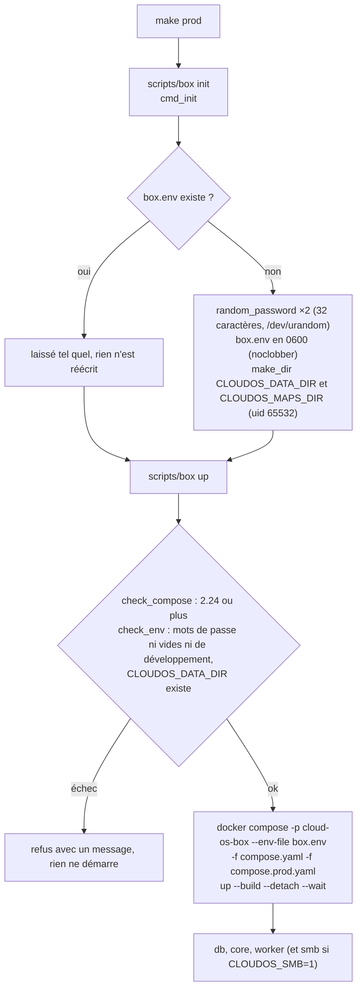

# La box en production

Comment la pile se lance en production, d'une seule commande, et ce qui la distingue de la pile de développement. Issue : #99 (Feature #98).

La production est une surcouche de `compose.yaml` : `compose.prod.yaml`. La pile de développement ne change pas.

## Lancer

```bash
make prod        # scripts/box init (une fois), puis scripts/box up
make prod-logs   # suivre les journaux
make prod-down   # arrêter, en gardant la base
```

`scripts/box` est le seul point d'entrée. Il porte le projet `cloud-os-box`, `box.env` et les deux fichiers Compose, pour que la production ne se mélange jamais à la pile d'un worktree (autre projet, autre volume de base). Toute autre commande est passée à Compose avec les mêmes drapeaux : `scripts/box run --rm core verify`, `scripts/box logs --follow`, `scripts/box down -v`.



## Ce que la surcouche change

| | Développement (`compose.yaml`) | Production (`compose.prod.yaml`) |
|---|---|---|
| Mots de passe | `cloudos` / `cloudos-smb` | `CLOUDOS_DB_PASSWORD` et `CLOUDOS_SMB_DB_PASSWORD` de `box.env`, sans valeur par défaut (`${VAR:?}`) |
| `db` | port publié (54320) | aucun port : seul le cœur s'y connecte, par le réseau Compose |
| `worker`, `smb` | `smb` publié sur 1445 | aucun port publié ; `smb` n'est joignable qu'à partir de #100 |
| `core` | `127.0.0.1:8480` | idem : le seul port ouvert |
| `web` (Vite) | lancé | profil `dev`, jamais lancé |
| Redémarrage | `smb` seulement | `db`, `core` et `worker` : `unless-stopped` |
| Journaux | illimités | pilote `local`, 10 Mo × 5 fichiers, pour tous les services |

La surcouche retire des ports avec `!reset`, qui demande Compose 2.24 ou plus : `scripts/box up` refuse un Compose plus ancien.

## `box.env`

Un fichier à la racine du dépôt, en mode 0600, ignoré par Git et par Docker (`.gitignore`, `.dockerignore`) :

| Clé | Rôle |
|---|---|
| `CLOUDOS_DB_PASSWORD` | mot de passe du rôle `cloudos` de Postgres |
| `CLOUDOS_SMB_DB_PASSWORD` | mot de passe du rôle `cloudos_smb`, posé par le cœur à chaque démarrage ([smb.md](smb.md), « Rôle en base ») |
| `CLOUDOS_DATA_DIR` | les fichiers des utilisateurs, `/srv/cloudos/files` par défaut |
| `CLOUDOS_MAPS_DIR` | le fichier `.pmtiles` de la carte, `/srv/cloudos/maps` par défaut |
| `RESTIC_PASSWORD`, `CLOUDOS_BACKUP_DB_PASSWORD`, `CLOUDOS_BACKUP_DIR` | la sauvegarde, ajoutés par `scripts/box backup-init` ([backup.md](backup.md)) |

On peut y ajouter `CLOUDOS_CORE_PORT`. `scripts/box` ignore les variables `CLOUDOS_DB_PASSWORD`, `CLOUDOS_SMB_DB_PASSWORD`, `CLOUDOS_DATA_DIR` et `CLOUDOS_MAPS_DIR` du shell, pour qu'un réglage de développement ne passe jamais devant le fichier.

`init` ne réécrit jamais un `box.env` qui existe : Postgres ne lit `POSTGRES_PASSWORD` qu'à la création du volume, et un nouveau mot de passe fermerait la porte de la base. `CLOUDOS_DATA_DIR=… CLOUDOS_MAPS_DIR=… scripts/box init` choisit d'autres dossiers (le fichier lui-même se choisit avec `CLOUDOS_BOX_ENV`, comme le fait la CI, et le projet Compose avec `CLOUDOS_BOX_PROJECT`, pour une box de test à côté de la vraie).

Les dossiers sont donnés à l'uid 65532, celui du cœur (distroless `nonroot`) ; le worker, `nobody`, y lit en lecture seule. `init` utilise `sudo` seulement si elle ne peut pas créer ou changer un dossier elle-même, et sans terminal elle ne l'attend pas : elle dit alors la commande à lancer. Docker Desktop masque ce sujet sur le Mac, pas Linux.

## Reprendre

- **`box.env` perdu.** Aucune donnée n'est perdue, mais le cœur ne peut plus se connecter. Dans le conteneur `db`, la connexion locale ne demande pas de mot de passe : `scripts/box exec db psql -U cloudos -c "ALTER ROLE cloudos PASSWORD '<nouveau>'"`, puis `CLOUDOS_DB_PASSWORD=<nouveau>` dans un nouveau `box.env` (le mot de passe de `cloudos_smb` est reposé par le cœur au démarrage).
- **Disque de données absent.** `up` refuse un `CLOUDOS_DATA_DIR` qui n'existe pas, sans jamais le créer, pour que le cœur n'écrive pas sur la carte SD à la place d'un disque non monté. Un point de montage vide existe pourtant toujours : ce cas revient avec l'installation (#103).
- **Mettre à jour.** `scripts/box update` : `git pull --ff-only`, une sauvegarde, puis les images se reconstruisent sur la box et les migrations passent au démarrage du cœur. Une mise à jour commence par une sauvegarde : si elle échoue, la mise à jour s'arrête ([backup.md](backup.md)).
- **La box ou son disque meurt.** La restauration complète depuis le disque de sauvegarde : [backup.md](backup.md), « Restaurer sur une box neuve, pas à pas ».

## Ce qui sort de la box

Construire les images télécharge les images de base, les paquets et les modèles, à l'installation et à la mise à jour. À l'exécution, rien ne sort.

## La CI

`.github/workflows/images.yml` tourne à chaque push sur `main` et sur les PR qui touchent une entrée des images, sur des runners natifs `ubuntu-24.04` (amd64) et `ubuntu-24.04-arm` (arm64), avec le cache des couches (le worker compile ffmpeg et récupère environ 1 Go de modèles). Dans l'ordre :

1. `scripts/box init` dans un dossier temporaire : `box.env` en 0600, dossiers à l'uid 65532, un second `init` qui le laisse intact.
2. `docker compose config` : aucun port pour `db`, `worker` et `smb`, un seul pour le cœur sur `127.0.0.1`, pas de service `web`, `restart` et journaux plafonnés.
3. `up` refuse `cloudos`, `cloudos-smb` et un dossier de données absent.
4. Les images se construisent, `up` démarre la pile, `/api/health` répond 200, `scripts/box run --rm core verify` passe.
5. La sauvegarde : `backup-init` sur un dossier temporaire, `backup`, la restauration test, puis `backup-status` sans échec ; enfin `down -v`.

Publier les images dans un registre se décidera dans #103.
