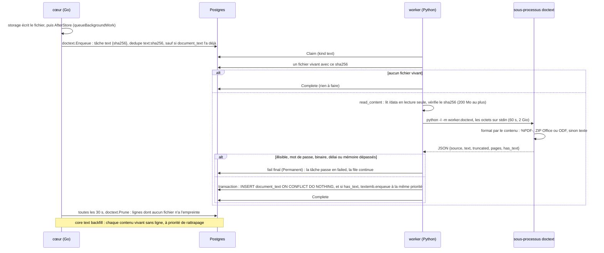
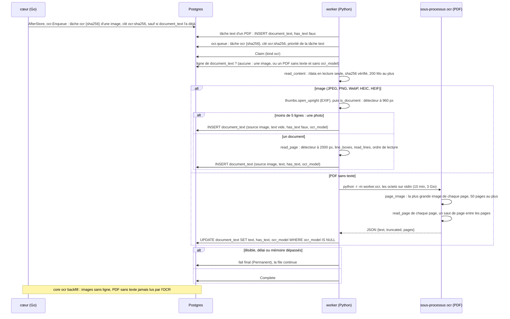
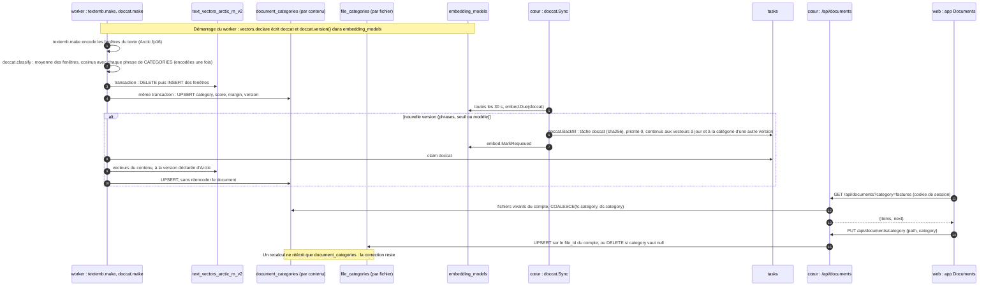

# Texte des documents

Le texte des PDF, des fichiers Office (docx, xlsx, pptx), OpenDocument (odt, ods, odp) et des textes (txt, md, csv, tsv) est extrait par les workers, en tâche de fond, et rangé en base par contenu. Celui des documents photographiés ou scannés (images, PDF « sans texte ») est lu par l'OCR et rangé au même endroit. Les originaux ne sont jamais modifiés. Ce texte sert la recherche dans le contenu (#69), les embeddings texte (#70) et le classement par catégorie, que montre l'app Documents (#73, plus bas).
Issues : #67 (extraction), #68 (OCR), #73 (classement).

## Parcours

## Mise en file

- **Quand :** le crochet `AfterStore` du cœur (`queueBackgroundWork` dans `core/cmd/core/main.go`) met en file le texte de chaque document enregistré : envoi, envoi reprenable, WebDAV, import, remplacement, version restaurée.
- **Formats :** `doctext.IsDocument` regarde le type MIME que `storage` a donné au fichier, sans ses paramètres (`; charset=utf-8`) : `application/pdf`, les trois types OOXML (docx, xlsx, pptx), les trois types OpenDocument (odt, ods, odp), `text/plain`, `text/markdown`, `text/csv`, `text/tab-separated-values`. Le type vient de l'extension, ou des premiers octets si elle est inconnue : un texte ou un PDF sans extension compte, un docx sans extension (vu comme `application/zip`) non. `storage` connaît `.md`, `.markdown`, `.tsv`, `.odt`, `.ods` et `.odp`, absents de la table de Go et de l'image du cœur, qui n'a pas de `mime.types`.
- **Exclus :** les anciens `.doc`, `.xls`, `.ppt` (binaire OLE), RTF, HTML, EPUB, les archives ZIP.
- **Doublons :** rien n'est mis en file si le contenu a déjà sa ligne, ou si une tâche est en attente pour lui (`dedupe_key`).
- **Priorités :** `PriorityNew` pour un envoi, `PriorityBackfill` pour un import.
- **Rattrapage :** `core text backfill` met en file, à priorité de rattrapage, chaque contenu vivant sans texte : fonds stocké avant #67, tâche perdue ou échouée (retentée à chaque rattrapage).

## Extraction (worker)

`worker/src/worker/doctext.py`. Le fichier est lu par `worker/src/worker/content.py`, commun avec les miniatures et les métadonnées : un fichier vivant avec cette empreinte, lu depuis `/data` **en lecture seule**, vérifié par son SHA-256, 200 Mo au plus.

**Isolation.** L'extraction tourne dans un sous-processus, `python -I -m worker.doctext`, qui reçoit les octets sur son entrée standard (aucun chemin) et rend du JSON. Il est borné à 60 s (`TIMEOUT`) et, sous Linux, à 2 Gio d'espace d'adressage (`MEMORY`, `RLIMIT_AS` posé par l'enfant lui-même). Un PDF piégé qui boucle ou gonfle échoue pour de bon au lieu de garder la tâche et son bail sans fin. Passé 45 s (`SOFT_DEADLINE`), l'enfant s'arrête de lire et garde ce qu'il a lu, marqué `truncated`.

**Format, par le contenu et non par le nom :**

| Contenu | `source` | Lecture |
|---|---|---|
| `%PDF-` au début, ou dans les 1024 premiers octets avec `%%EOF` à la fin | `pdf` | `pypdf` (BSD-3-Clause, pur Python), page par page. Un PDF chiffré en AES sans mot de passe d'ouverture (facture ou relevé « protégé ») est ouvert grâce à `cryptography` (Apache-2.0 OR BSD-3-Clause ; `cffi` MIT-0, `pycparser` BSD-3-Clause) |
| ZIP dont `_rels/.rels` désigne un document Word, Excel ou PowerPoint (type de contenu de `[Content_Types].xml`) | `docx`, `xlsx`, `pptx` | Bibliothèque standard : `zipfile` et `xml.etree.ElementTree.iterparse`, en flux |
| ZIP dont l'entrée `mimetype` est un type OpenDocument | `odt`, `ods`, `odp` | Bibliothèque standard, `content.xml` en flux |
| Tout le reste | `text` | UTF-8 (avec ou sans BOM), UTF-16 avec BOM, sinon Windows-1252 |

Pas de python-docx, openpyxl, python-pptx, odfpy ni lxml : aucune dépendance de plus, une lecture en flux qui s'arrête au plafond et oublie ce qu'elle a lu, et expat (2.7 et plus) refuse les bombes d'entités. Écartés : PyMuPDF (AGPL), pypdfium2 (il embarque FreeType, sous licence FTL, hors de la liste de `CLAUDE.md`).

**Ce qui est lu :**

- **docx :** les paragraphes du corps, un par ligne, zones de texte comprises (une seule fois : la copie `mc:Fallback` est ignorée) ; les cellules d'un tableau séparées par des tabulations, les lignes par des retours. Le texte supprimé en suivi des modifications (`w:delText`) et les codes de champ n'en font pas partie. Les en-têtes, pieds de page et notes non plus.
- **xlsx :** chaque feuille dans l'ordre du classeur : son nom, puis une ligne par rangée, cellules séparées par des tabulations. Une cellule texte vient des chaînes partagées (sans guide phonétique), un nombre ou une formule tels qu'ils sont stockés (`62.5`), un booléen en `TRUE` ou `FALSE`, une erreur vide.
- **pptx :** chaque diapositive dans l'ordre de la présentation, ses paragraphes un par ligne.
- **odt, ods, odp :** les paragraphes et titres un par ligne ; les blancs du XML repliés en une espace, `text:s`, `text:tab` et `text:line-break` gardés (ODF 1.3, 6.1.2) ; les cellules séparées par des tabulations ; le nom de chaque feuille d'un classeur. Le texte supprimé (`text:tracked-changes`) et les commentaires (`office:annotation`) n'en font pas partie.
- **Pages :** les pages d'un PDF, les diapositives et les feuilles sont séparées par un saut de page (`\f`) seul sur sa ligne.

**Nettoyage :** sans octet nul (Postgres le refuse) ni demi-paire UTF-16, fins de ligne Unix, sans espaces en fin de ligne, au plus une ligne vide de suite, coupé à 1 000 000 caractères (`MAX_CHARS`, environ 400 pages) avec `truncated` vrai.

**« Pas de texte » (`has_text` faux) :** un PDF dont le texte compte moins de 32 caractères visibles par page lue, en moyenne (`MIN_PAGE_CHARS`) : un scan, même avec le filigrane de son scanner, ou une page blanche ; un autre document sans aucun caractère visible. La ligne est écrite quand même, puis la tâche met en file l'OCR du PDF (`ocr.queue`, à sa propre priorité), qui remplit la ligne (section OCR).

- **Erreurs définitives (`Permanent`, la tâche passe en `failed` au premier essai, la file continue) :** document illisible ou tronqué, quelle que soit l'erreur de son lecteur ; PDF qui demande un mot de passe ; ZIP qui n'est pas un document (archive, EPUB) ; « texte » avec des octets nuls (binaire) ; XML qui dépasse les limites d'expat ; lecture de plus de 60 s ; mémoire épuisée ou sous-processus tué ; fichier de plus de 200 Mo.
- **Erreurs passagères (nouvel essai avec le délai de la file) :** le fichier a bougé ou changé pendant la lecture ; le sous-processus ne démarre pas (image mal construite).
- **Rien à faire (`done`) :** aucun fichier vivant n'a plus ce contenu.

## Stockage

Table `document_text` (migrations `0017_document_text.sql` et `0019_document_ocr.sql`), clé `sha256` : deux fichiers identiques partagent leur ligne, une nouvelle version a la sienne. **Une ligne peut changer une fois** : l'OCR remplit celle d'un PDF scanné par un `UPDATE` (`text`, `chars`, `truncated`, `has_text`, `ocr_model`). Ce qui se calcule à partir du texte (recherche, embeddings) suit cet `UPDATE`, et ne se fie qu'à `has_text` : une photo a sa ligne, sans texte.

| Colonne | |
|---|---|
| `source` | `pdf`, `docx`, `xlsx`, `pptx`, `odt`, `ods`, `odp` ou `text`, le format lu ; `image` pour une image lue par l'OCR |
| `text` | Le texte nettoyé ; `''` pour un document sans texte |
| `chars` | Sa longueur en caractères, de 0 à 1 000 000 |
| `truncated` | Le document en avait plus : plafond ou délai atteint |
| `pages` | Pages d'un PDF, diapositives, feuilles ; NULL pour un texte, un docx, un odt, ou un classeur ODF coupé avant la fin |
| `has_text` | Faux pour un scan ou un document vide (ci-dessus) ; après l'OCR, vrai à partir de 32 caractères visibles par page lue ; faux pour une photo |
| `ocr_model` | Le modèle qui a lu le texte (`pp-ocrv5-latin`, `worker.models.OCR_MODEL`) ; NULL quand le texte vient du fichier. Toujours posé pour une `image` (contrainte `document_text_image_ocr`) |
| `tsv` | Le `tsvector` du texte (`cloudos_doc_tsv`, configuration `cloudos_fr`), colonne générée pour la recherche dans le contenu ([search.md](search.md)) |

Postgres compresse le texte (TOAST) : 10 000 documents d'une vingtaine de pages font environ 200 Mo avant compression.

Pas de clé étrangère vers `files` : toutes les 30 s, avec `Reap`, `thumbs.Prune` et `meta.Prune`, le cœur fait `doctext.Prune`, qui supprime les lignes dont aucun fichier (vivant ou en corbeille) n'a l'empreinte. Un document restauré de la corbeille retrouve donc la sienne. Les vecteurs du texte (#70) partent avec la ligne, en cascade.

Un texte avec des mots (`has_text`) met en file ses vecteurs (tâche `textemb`) dans la transaction qui l'écrit, à la priorité de la tâche qui l'a écrit : `text`, ou `ocr` pour une image lue ou un scan lu en place. Voir [search-ai.md](search-ai.md).

## OCR : images et PDF scannés

Le texte des documents qui ne sont qu'une image : une facture photographiée ou scannée (JPEG, PNG, WebP, HEIC, HEIF) et un PDF « sans texte » (un scan). `core/internal/ocr` met en file, `worker/src/worker/ocr.py` lit, avec PP-OCRv5 (détecteur mobile et reconnaissance latine, [models.md](models.md), ADR 005), numpy et Pillow, sans OpenCV. Issue : #68.

### Mise en file

- **Images :** le crochet `AfterStore` (`queueBackgroundWork`) appelle `ocr.Enqueue` pour chaque image enregistrée, aux types des miniatures sans les vidéos (`ocr.IsImage`, par le type MIME ou les premiers octets). Rien n'est mis en file si le contenu a déjà sa ligne, lu ou vu comme une photo.
- **PDF :** le cœur ne sait pas qu'un PDF est un scan. C'est la tâche `text` qui, après avoir écrit un PDF « sans texte », met en file sa tâche `ocr` (`ocr.queue`), à sa propre priorité.
- **Doublons :** clé `ocr:<sha256>`, une tâche en attente par contenu.
- **Rattrapage :** `core ocr backfill` met en file, à priorité de rattrapage, chaque image vivante sans ligne et chaque PDF vivant `source = 'pdf' AND NOT has_text AND ocr_model IS NULL` : fonds stocké avant #68, tâche perdue ou échouée (retentée à chaque rattrapage). Un PDF dont la tâche `text` n'a pas encore tourné attend `core text backfill`.

### Document ou photo

Toutes les photos passent par la file : le tri doit coûter peu. `is_document` fait tourner le détecteur seul, sur l'image ramenée à 960 px de grand côté (`TRIAGE_SIDE`) : 35 ms sur un Mac M4, environ 0,2 s estimée sur un Pi 5. L'image est un document à partir de 5 lignes de texte (`MIN_LINES`), des zones au moins 3 fois plus larges que hautes (`LINE_RATIO`). Sur le banc d'essai, chaque page scannée ou photographiée en a de 11 à 32, chacune des 17 photos 0 ou 1. Une photo reçoit quand même sa ligne, sans texte, pour n'être regardée qu'une fois. Une capture d'écran pleine de texte est un document, ce qui est voulu.

L'image est ouverte par `thumbs.open_upright` : redressée selon son EXIF (libheif redresse un HEIC lui-même), décodée à une échelle réduite quand c'est un JPEG plus grand que 2 000 px (`DECODE_SIDE`, l'entrée du détecteur). Une image transparente (capture d'écran) est posée sur du blanc (`rgb`). Les images sont lues dans le worker, comme les miniatures, sans sous-processus : importer numpy et ONNX Runtime coûte 0,24 s sur un M4, plus que le tri lui-même.

### Lire une page

`read_page`, sur la page à 2 000 px au plus :

1. **Carte du détecteur** (`OcrModel.text_map`) : la probabilité que chaque pixel soit du texte. Les pixels au-dessus de 0,3 (`THRESHOLD`) sont du texte.
2. **Composantes connexes** (`line_boxes`) : les plages de chaque rangée (`_runs`), jointes d'une rangée à la suivante quand elles se touchent, même par un coin (`_label`, union-find).
3. **Un rectangle orienté par ligne** : le centre et l'axe de la composante viennent de ses moments (sommes calculées plage par plage), sa longueur et sa hauteur de la projection des bouts de ses plages. Le rectangle est agrandi comme le fait PaddleOCR (surface × 1,5 / périmètre de chaque côté, `UNCLIP`), parce que le détecteur dessine des lignes rétrécies. Une zone de moins de 3 px de haut sur la carte (`MIN_BOX`), ou de probabilité moyenne sous 0,6 (`BOX_THRESHOLD`), est écartée. Une page garde ses 400 plus grandes zones (`MAX_LINES`), pour que du bruit lu comme des milliers de lignes ne bloque pas le worker.
4. **Découpe redressée** : `Image.transform` (QUAD) découpe la ligne dans l'image d'origine et la remet à plat, ce qui rattrape l'inclinaison d'un scan et la perspective d'une photo. Une zone plus haute que large est tournée, comme PaddleOCR le fait.
5. **Lecture** (`OcrModel.read_lines`), 8 lignes à la fois. Une ligne lue avec une probabilité moyenne sous 0,5 (`MIN_SCORE`) est du bruit (tampon, logo) et n'est pas gardée.
6. **Ordre de lecture** : les lignes sont rangées de haut en bas ; deux lignes dont les milieux sont à moins d'une demi-hauteur l'une de l'autre font une rangée, lue de gauche à droite (« Montant : » et « 128,40 € » au bout de la même rangée). Deux colonnes de texte se mêlent rangée par rangée.

Sur les 60 pages du banc d'essai (30 documents, scannés puis photographiés) : 0,08 % d'erreurs de caractères pour les scans, 0,12 % pour les photos, comme le pipeline de RapidOCR mesuré par l'ADR 005, en 0,4 à 0,5 s par page sur un M4 sous macOS (environ 3 s estimées sur un Pi 5). Le tri les donne toutes pour des documents. Le texte est nettoyé par `doctext.clean`, comme celui de #67.

### PDF scannés

Sans moteur de rendu : pypdfium2 (FreeType, licence FTL) et les moteurs GPL ou AGPL sont exclus. `page_image` prend, avec pypdf, l'image la plus grande de chaque page qui se décode (JPEG, Flate, CCITT, JPEG 2000, par Pillow), tournée selon le `/Rotate` de la page. Un scanner pose une image par page ; un PDF à contenu mixte (MRC) en pose deux, et la plus grande est le texte. Une page sans image décodable (JBIG2, que Pillow ne lit pas, ou des tracés) compte comme vide. pypdf ne décode pas plus de 75 Mo par image de lui-même ; `PDF_LIMITS` le monte à 300 Mo (`MAX_IMAGE_BYTES`, 100 millions de pixels en RVB, le plafond des miniatures), pour une page A4 scannée en couleur à 600 dpi (139 Mo), et lui interdit de lancer un `jbig2dec` trouvé sur la machine : une page JBIG2 se lit pareil partout.

La lecture tourne dans un sous-processus, `python -I -m worker.ocr`, qui reçoit les octets sur son entrée standard et rend du JSON, comme celui de #67 : 50 pages au plus (`MAX_PAGES`), 10 min (`TIMEOUT`), 3 Gio d'espace d'adressage sous Linux (`MEMORY` : 2,5 Gio au pic pour trois pages, fils et réserves d'ONNX Runtime compris, mesuré dans l'image du worker ; 2 Gio ne suffisent pas). Passé 9 min (`SOFT_DEADLINE`) ou 50 pages, ce qui est lu est gardé, marqué `truncated`. Les pages sont séparées comme dans #67 ; une page vide ne laisse pas de ligne, ses sauts se fondent en un. `has_text` suit la règle de #67 : au moins 32 caractères visibles par page lue.

### Erreurs

- **Définitives (`Permanent`) :** image illisible, tronquée ou de plus de 100 millions de pixels ; PDF illisible ou qui demande un mot de passe ; sous-processus hors délai ou tué (mémoire) ; fichier de plus de 200 Mo.
- **Passagères :** le fichier a bougé ou changé pendant la lecture ; le sous-processus ne démarre pas.
- **Rien à faire (`done`) :** aucun fichier vivant n'a plus ce contenu ; la ligne est déjà lue par l'OCR, ou c'est un document avec son propre texte.

### Ce qui n'est pas lu

Un PDF qui mêle pages de texte et pages scannées (« avec texte » pour #67, en moyenne) ; le texte d'un PDF dessiné en tracés, sans image ; les images JBIG2 ; une page à l'envers ou tournée sans `/Rotate`, faute de classifieur d'orientation ; l'écriture manuscrite ; les TIFF ; le texte des vidéos.

## Classement : factures, contrats et autres

Chaque document avec du texte reçoit une catégorie : Factures, Contrats, Impôts, Santé, Banque, Travail, Administratif ou Autre. Les workers la calculent avec les vecteurs Arctic de son texte ([search-ai.md](search-ai.md)), sans modèle de langage ni mot-clé ; l'app Documents les montre par catégorie, et un membre corrige celle d'un de ses fichiers. Issue : #73.

| Pièce | Où | Rôle |
|---|---|---|
| Catégories, phrases, règle, tâche `doccat` | `worker/src/worker/doccat.py` | `CATEGORIES`, `classify`, `version`, `make` |
| Classement à l'indexation | `worker/src/worker/textemb.py` | dans la transaction des vecteurs |
| Tables | `core/migrations/0022_document_categories.sql` | `document_categories` (par contenu), `file_categories` (la correction, par fichier) |
| Rattrapage, listes, corrections | `core/internal/doccat` | `Backfill`, `Sync`, `Summary`, `List`, `Get`, `Set` |
| Routes | `core/internal/httpapi/documents.go` | `/api/documents…` (session exigée) |
| App Documents | `web/src/documents/` | [web.md](web.md) |

### La règle

- **Des phrases par catégorie.** Chaque catégorie est décrite par 3 ou 4 phrases en français (`CATEGORIES`), Autre comprise : billets de voyage, recettes, lettres, comptes rendus de réunion. Le worker les encode une fois par processus avec Arctic et son préfixe de requête « query: », comme des recherches, une phrase à la fois (27 phrases, une demi-seconde).
- **Le document** est la moyenne des vecteurs de ses fenêtres, ramenée à la longueur 1. Une seule fenêtre (une annexe, une liste de charges) ne décide pas du type d'un long document.
- **Le score d'une catégorie** est le cosinus de sa phrase la plus proche. La plus haute l'emporte ; sous 0,15 (`THRESHOLD`), le document est Autre.
- **Pas de marge minimale.** Le banc a des documents justes à très peu d'écart de la deuxième catégorie (l'attestation CAF à 0,003, la facture internet à 0,011, celle du vétérinaire à 0,016) : en exiger une les enverrait dans Autre. `score` et `margin` (premier moins deuxième) sont gardés en base, pour un « à vérifier » plus tard.
- **Pourquoi huit catégories.** Avec les six de départ (sans Travail ni Administratif), la fiche de paie, l'attestation CAF, la carte grise et le certificat de scolarité finissaient dans Autre, et le banc plafonnait à 27 sur 30, pour un seul seuil.

Mesures sur les 30 documents du banc, avec les phrases de `doccat.py` (prototype puis tests) :

| Variante | Bien classés |
|---|---|
| 6 catégories, meilleur seuil | 27 / 30 (seuil 0,215 seulement) |
| 8 catégories, Autre décrite, centre des phrases | 26 / 30 |
| **8 catégories, Autre décrite, phrase la plus proche (retenu)** | **30 / 30, pour tout seuil de 0 à 0,20** |

Trois phrases ont été ajoutées après les premiers essais (factures de vétérinaire, prescriptions de kiné, billets de voyage) : le banc mesure surtout la couverture des phrases. Un second jeu de 12 documents, écrits après le réglage et mesurés une fois sans retoucher les phrases (`worker/tests/fixtures/doccat/`), en classe **11 sur 12** : la notice d'une cafetière tombe dans Factures.

### Quand

- **À l'indexation.** `textemb.make` classe le document avec les vecteurs qu'il vient de calculer et écrit sa catégorie dans la transaction de ses vecteurs : un document n'a jamais de vecteurs sans catégorie. Un texte sans fenêtre perd la sienne.
- **Quand le classement change.** `doccat.version()` est `textemb.version()` suivi de `-c` et des 8 premiers caractères hexadécimaux du SHA-256 des phrases et du seuil (`95c2741-fp16-w512-o64-n64-c501271e4`). `vectors.declare` la déclare dans `embedding_models` sous le nom `doccat`, à côté des modèles ([embeddings.md](embeddings.md)). Au tour de 30 s, `doccat.Sync` lit `embed.Due` ; pour une version nouvelle, `Backfill` met en file, à priorité de rattrapage, une tâche `doccat` (clé `doccat:<sha256>`) pour chaque contenu vivant qui a des vecteurs de la version déclarée d'Arctic et pas de catégorie de la version déclarée du classement, puis `embed.MarkRequeued`.
- **La tâche `doccat`** relit les vecteurs stockés (`halfvec`) et classe de nouveau, sans réencoder le document ni lire de fichier. Elle ne fait rien quand la catégorie est à jour, ou quand les vecteurs ne sont pas encore à la version d'Arctic : `textemb.make` la classera en les écrivant.
- **Un autre modèle** change `textemb.version()`, donc la version du classement : les documents sont reclassés à mesure qu'ils sont réencodés.
- **`core doccat backfill`** fait le rattrapage à la main.

### Stockage

| Table | Clé | Colonnes |
|---|---|---|
| `document_categories` | `sha256`, clé étrangère vers `document_text`, en cascade | `category`, `score`, `margin`, `version`, `classified_at` |
| `file_categories` | `file_id`, clé étrangère vers `files`, en cascade | `category`, `set_at` |

- **La catégorie automatique est par contenu**, comme le texte et les vecteurs : partagée par deux fichiers identiques, partie avec le texte quand plus aucun fichier n'a le contenu (`doctext.Prune`).
- **La correction est par fichier.** Elle appartient au compte du fichier, donc ne passe jamais à un autre compte qui a le même contenu. Elle suit le fichier, qui garde son id quand il est déplacé, renommé, mis à la corbeille, restauré ou remplacé (une nouvelle version d'une facture reste une facture), et part avec la purge. Un recalcul ne réécrit que `document_categories` : elle reste.
- **La catégorie montrée** est `COALESCE(fc.category, dc.category)`.
- **Les deux tables refusent une catégorie inconnue** (`CHECK`). Les mêmes identifiants sont dans `doccat.CATEGORIES`, `doccat.Categories` et `web/src/documents/documents.ts` ; un test du worker les compare à la migration.
- **La migration inverse** efface les corrections (des métadonnées, aucun fichier) ; les catégories automatiques se recalculent.

## API

- **Texte :** il n'a pas de route à lui : il sert la recherche dans le contenu, `GET /api/search/content` (#69). La migration 0018 lui ajoute la colonne générée `tsv` et son index GIN ; tout est dans [search.md](search.md).
- **Catégories** (session exigée, fichiers vivants du compte de la session seulement, jamais d'un paramètre ; `core/internal/httpapi/documents.go`) :
  - `GET /api/documents/categories` → `{categories: [{id, count}], pending}` : chaque catégorie dans l'ordre, 0 comprise, et `pending`, les documents avec du texte pas encore classés ;
  - `GET /api/documents?category=&limit=&before_at=&before_path=` → `{items, next}` : les documents de la catégorie, du plus récemment modifié au plus ancien (`modified_at`, puis le chemin), 60 par page, 200 au plus. `next` (`{at, path}`) se renvoie en `before_at` et `before_path`. 400 pour une catégorie inconnue ou absente ;
  - `PUT /api/documents/category` en JSON `{path, category}` : `category` vaut l'une des huit, ou `null` pour revenir au classement automatique ; la réponse est l'entrée. 400 pour une catégorie inconnue, 404 pour un chemin qui n'est pas un document vivant du compte (photo, archive, dossier, corbeille, autre compte).
  - Chaque entrée (`DocumentEntry`, `shared/api-types.ts`) est l'`Entry` du fichier avec `category` (celle montrée), `auto` (l'automatique, `null` avant le classement) et `corrected`.

## Tests du classement

- **Worker** (`worker/tests/test_doccat.py`) : les identifiants comparés à la migration ; la version (phrases, seuil, vecteurs) ; la déclaration ; la règle avec des vecteurs posés à la main (phrase la plus proche, moyenne des fenêtres, seuil, Autre décrite) ; la catégorie écrite avec les vecteurs ; la tâche qui reclasse sans réencoder et ne fait rien à jour ou sans vecteurs à la version ; la cascade. Avec les modèles, les 30 documents du banc (`fixtures/bench/categories.toml`, au moins 28 exigés, 30 mesurés) et les 12 du second jeu (au moins 9 exigés, 11 mesurés) passent par `textemb.make` ; le test affiche le tableau des catégories trouvées.
- **Cœur** (`core/internal/doccat`, `httpapi/documents_test.go`, `migrate`) : les listes et les nombres par catégorie, les documents en attente, ni photo ni archive ; les pages ; la correction gardée quand les workers reclassent, et défaite ; le même contenu dans deux comptes ; la correction qui suit le renommage, sort avec la corbeille, revient avec la restauration et part avec la purge ; les refus ; `Backfill`, `Sync` une fois par version ; les routes ; la migration montée, défaite et remontée avec des données.
- **Web** (`web/src/documents/documents.test.tsx`).
