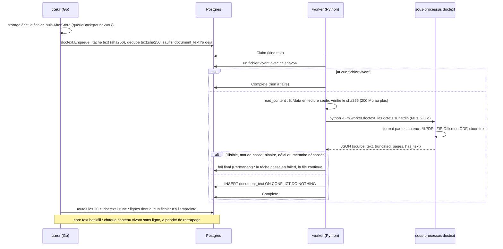

# Texte des documents

Le texte des PDF, des fichiers Office (docx, xlsx, pptx), OpenDocument (odt, ods, odp) et des textes (txt, md, csv, tsv) est extrait par les workers, en tâche de fond, et rangé en base par contenu. Les originaux ne sont jamais modifiés. Il servira la recherche dans le contenu (#69), les embeddings texte (#70) et le classement (#73) ; un PDF scanné est marqué « sans texte » pour l'OCR (#68).
Issue : #67.

## Parcours

## Mise en file

- **Quand :** le crochet `AfterStore` du cœur (`queueBackgroundWork` dans `core/cmd/core/main.go`) met en file le texte de chaque document enregistré : envoi, envoi reprenable, WebDAV, import, remplacement, version restaurée.
- **Formats :** `doctext.IsDocument` regarde le type MIME que `storage` a donné au fichier, sans ses paramètres (`; charset=utf-8`) : `application/pdf`, les trois types OOXML (docx, xlsx, pptx), les trois types OpenDocument (odt, ods, odp), `text/plain`, `text/markdown`, `text/csv`, `text/tab-separated-values`. Le type vient de l'extension, ou des premiers octets si elle est inconnue : un texte ou un PDF sans extension compte, un docx sans extension (vu comme `application/zip`) non. `storage` connaît `.md`, `.markdown`, `.tsv`, `.odt`, `.ods` et `.odp`, absents de la table de Go et de l'image du cœur, qui n'a pas de `mime.types`.
- **Exclus :** les anciens `.doc`, `.xls`, `.ppt` (binaire OLE), RTF, HTML, EPUB, les archives ZIP.
- **Doublons :** rien n'est mis en file si le contenu a déjà sa ligne, ou si une tâche est en attente pour lui (`dedupe_key`).
- **Priorités :** `PriorityNew` pour un envoi, `PriorityBackfill` pour un import.
- **Rattrapage :** `core text backfill` met en file, à priorité de rattrapage, chaque contenu vivant sans texte : fonds stocké avant #67, tâche perdue ou échouée (retentée à chaque rattrapage).

## Extraction (worker)

`worker/src/worker/doctext.py`. Le fichier est lu par `worker/src/worker/content.py`, commun avec les miniatures et les métadonnées : un fichier vivant avec cette empreinte, lu depuis `/data` **en lecture seule**, vérifié par son SHA-256, 200 Mo au plus.

**Isolation.** L'extraction tourne dans un sous-processus, `python -I -m worker.doctext`, qui reçoit les octets sur son entrée standard (aucun chemin) et rend du JSON. Il est borné à 60 s (`TIMEOUT`) et, sous Linux, à 2 Gio d'espace d'adressage (`MEMORY`, `RLIMIT_AS` posé par l'enfant lui-même). Un PDF piégé qui boucle ou gonfle échoue pour de bon au lieu de garder la tâche et son bail sans fin. Passé 45 s (`SOFT_DEADLINE`), l'enfant s'arrête de lire et garde ce qu'il a lu, marqué `truncated`.

**Format, par le contenu et non par le nom :**

| Contenu | `source` | Lecture |
|---|---|---|
| `%PDF-` au début, ou dans les 1024 premiers octets avec `%%EOF` à la fin | `pdf` | `pypdf` (BSD-3-Clause, pur Python), page par page. Un PDF chiffré en AES sans mot de passe d'ouverture (facture ou relevé « protégé ») est ouvert grâce à `cryptography` (Apache-2.0 OR BSD-3-Clause ; `cffi` MIT-0, `pycparser` BSD-3-Clause) |
| ZIP dont `_rels/.rels` désigne un document Word, Excel ou PowerPoint (type de contenu de `[Content_Types].xml`) | `docx`, `xlsx`, `pptx` | Bibliothèque standard : `zipfile` et `xml.etree.ElementTree.iterparse`, en flux |
| ZIP dont l'entrée `mimetype` est un type OpenDocument | `odt`, `ods`, `odp` | Bibliothèque standard, `content.xml` en flux |
| Tout le reste | `text` | UTF-8 (avec ou sans BOM), UTF-16 avec BOM, sinon Windows-1252 |

Pas de python-docx, openpyxl, python-pptx, odfpy ni lxml : aucune dépendance de plus, une lecture en flux qui s'arrête au plafond et oublie ce qu'elle a lu, et expat (2.7 et plus) refuse les bombes d'entités. Écartés : PyMuPDF (AGPL), pypdfium2 (il embarque FreeType, sous licence FTL, hors de la liste de `CLAUDE.md`).

**Ce qui est lu :**

- **docx :** les paragraphes du corps, un par ligne, zones de texte comprises (une seule fois : la copie `mc:Fallback` est ignorée) ; les cellules d'un tableau séparées par des tabulations, les lignes par des retours. Le texte supprimé en suivi des modifications (`w:delText`) et les codes de champ n'en font pas partie. Les en-têtes, pieds de page et notes non plus.
- **xlsx :** chaque feuille dans l'ordre du classeur : son nom, puis une ligne par rangée, cellules séparées par des tabulations. Une cellule texte vient des chaînes partagées (sans guide phonétique), un nombre ou une formule tels qu'ils sont stockés (`62.5`), un booléen en `TRUE` ou `FALSE`, une erreur vide.
- **pptx :** chaque diapositive dans l'ordre de la présentation, ses paragraphes un par ligne.
- **odt, ods, odp :** les paragraphes et titres un par ligne ; les blancs du XML repliés en une espace, `text:s`, `text:tab` et `text:line-break` gardés (ODF 1.3, 6.1.2) ; les cellules séparées par des tabulations ; le nom de chaque feuille d'un classeur. Le texte supprimé (`text:tracked-changes`) et les commentaires (`office:annotation`) n'en font pas partie.
- **Pages :** les pages d'un PDF, les diapositives et les feuilles sont séparées par un saut de page (`\f`) seul sur sa ligne.

**Nettoyage :** sans octet nul (Postgres le refuse) ni demi-paire UTF-16, fins de ligne Unix, sans espaces en fin de ligne, au plus une ligne vide de suite, coupé à 1 000 000 caractères (`MAX_CHARS`, environ 400 pages) avec `truncated` vrai.

**« Pas de texte » (`has_text` faux) :** un PDF dont le texte compte moins de 32 caractères visibles par page lue, en moyenne (`MIN_PAGE_CHARS`) : un scan, même avec le filigrane de son scanner, ou une page blanche ; un autre document sans aucun caractère visible. La ligne est écrite quand même. L'OCR (#68) prendra les PDF `source = 'pdf' AND NOT has_text`.

- **Erreurs définitives (`Permanent`, la tâche passe en `failed` au premier essai, la file continue) :** document illisible ou tronqué, quelle que soit l'erreur de son lecteur ; PDF qui demande un mot de passe ; ZIP qui n'est pas un document (archive, EPUB) ; « texte » avec des octets nuls (binaire) ; XML qui dépasse les limites d'expat ; lecture de plus de 60 s ; mémoire épuisée ou sous-processus tué ; fichier de plus de 200 Mo.
- **Erreurs passagères (nouvel essai avec le délai de la file) :** le fichier a bougé ou changé pendant la lecture ; le sous-processus ne démarre pas (image mal construite).
- **Rien à faire (`done`) :** aucun fichier vivant n'a plus ce contenu.

## Stockage

Table `document_text` (migration `0017_document_text.sql`), clé `sha256` : deux fichiers identiques partagent leur ligne, une nouvelle version a la sienne.

| Colonne | |
|---|---|
| `source` | `pdf`, `docx`, `xlsx`, `pptx`, `odt`, `ods`, `odp` ou `text`, le format lu |
| `text` | Le texte nettoyé ; `''` pour un document sans texte |
| `chars` | Sa longueur en caractères, de 0 à 1 000 000 |
| `truncated` | Le document en avait plus : plafond ou délai atteint |
| `pages` | Pages d'un PDF, diapositives, feuilles ; NULL pour un texte, un docx, un odt, ou un classeur ODF coupé avant la fin |
| `has_text` | Faux pour un scan ou un document vide (ci-dessus) |
| `tsv` | Le `tsvector` du texte (`cloudos_doc_tsv`, configuration `cloudos_fr`), colonne générée pour la recherche dans le contenu ([search.md](search.md)) |

Postgres compresse le texte (TOAST) : 10 000 documents d'une vingtaine de pages font environ 200 Mo avant compression.

Pas de clé étrangère vers `files` : toutes les 30 s, avec `Reap`, `thumbs.Prune` et `meta.Prune`, le cœur fait `doctext.Prune`, qui supprime les lignes dont aucun fichier (vivant ou en corbeille) n'a l'empreinte. Un document restauré de la corbeille retrouve donc la sienne.

## API

Le texte n'a pas de route à lui : il sert la recherche dans le contenu, `GET /api/search/content` (#69). La migration 0018 lui ajoute la colonne générée `tsv` et son index GIN ; tout est dans [search.md](search.md).
