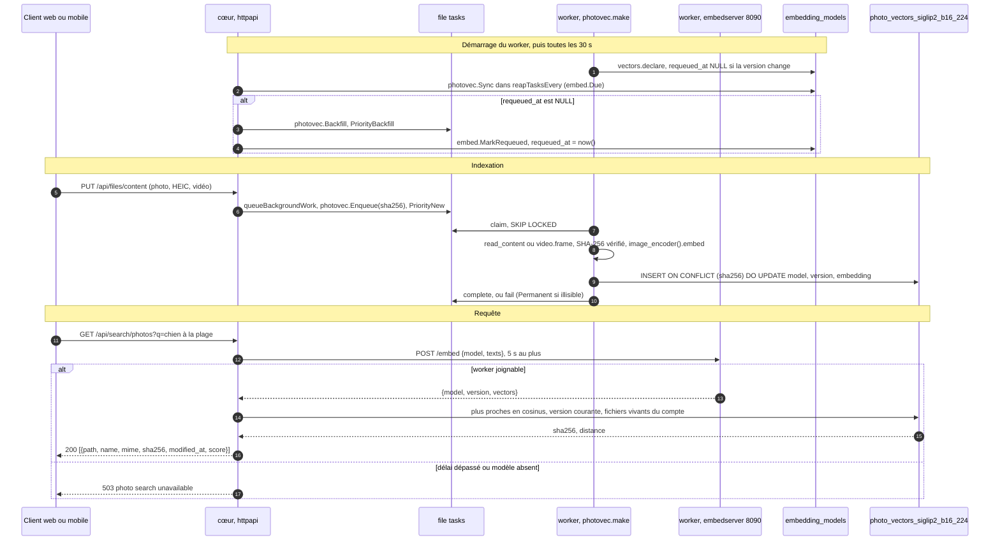

# Vecteurs et recherche par le sens

Ce que montrent les photos et les vidéos, rangé en vecteurs dans pgvector pour les retrouver en décrivant la scène, en français : « chien à la plage ». Le worker encode chaque contenu avec SigLIP 2 ([models.md](models.md)), et le cœur cherche les plus proches d'une phrase encodée par le même modèle.
Issue : #71 (Feature #65). Le mécanisme des requêtes et le registre des modèles servent aussi aux documents : Arctic Embed et leurs vecteurs par fenêtre de texte (#70, [search-ai.md](search-ai.md)). Demander mêle les photos aux documents en une seule liste (#72, [search.md](search.md)).

| Pièce | Où | Rôle |
|---|---|---|
| `embedding_models` | `core/migrations/0020_photo_vectors.sql` | le nom, la version et la dimension de chaque modèle que sert le worker ; `requeued_at` dit si le cœur a remis les contenus en file pour cette version |
| `photo_vectors_siglip2_b16_224` | même migration | un `vector(768)` par contenu (clé SHA-256), avec `model`, `version` et `source` (`image` ou `video`), index HNSW cosinus |
| Tâche `photovec` | `worker/src/worker/photovec.py` | lit la photo ou l'image clé de la vidéo, l'encode, écrit le vecteur |
| Déclaration des modèles | `worker/src/worker/vectors.py` (`declare`) | au démarrage du worker, dans `embedding_models` |
| Point de requête | `worker/src/worker/embedserver.py` | `POST /embed` sur le port 8090, réseau Compose seulement |
| File, rattrapage, nettoyage, recherche | `core/internal/photovec` | `Enqueue`, `Backfill`, `Sync`, `Prune`, `Searcher.Search` |
| Client des requêtes, registre | `core/internal/embed` | `Client.Query`, `Due`, `MarkRequeued` |
| Route | `core/internal/httpapi/photosearch.go` | `GET /api/search/photos?q=…&limit=…` (session exigée) |

## Indexation

- **Comme les miniatures.** `queueBackgroundWork` met une tâche `photovec` en file pour chaque nouveau contenu photo ou vidéo (`thumbs.IsMedia` : JPEG, PNG, WebP, HEIF, HEIC, MP4, QuickTime), à la priorité du nouveau fichier ; `core import` et le rattrapage la mettent à `PriorityBackfill`. La clé de déduplication est `photovec:<sha256>`, et rien n'est mis en file quand le contenu a déjà un vecteur de la version déclarée.
- **La lecture.** Le worker lit `/data` en lecture seule et vérifie le SHA-256 de la copie lue (`content_path`, `read_content`). Une photo passe par `thumbs.open_upright`, comme pour la miniature et l'OCR : orientation EXIF appliquée, HEIC par libheif, garde contre les images géantes. Un JPEG y est décodé à l'échelle réduite qui garde au moins 896 px sur le grand côté : le petit côté reste à 224 px ou plus, l'entrée du modèle, jusqu'à un panorama 4:1. Une vidéo est lue par l'image que montre sa miniature (`video.frame`, à 1 s). La transparence devient du blanc, pas du noir. Une image illisible donne `Permanent`.
- **L'écriture.** Un upsert par contenu : un contenu partagé par deux fichiers ou deux comptes a un seul vecteur. Le worker n'écrit aucun fichier.
- **Le nettoyage.** `Prune` efface, au tour de 30 s, les vecteurs qu'aucun fichier n'a plus. Un fichier à la corbeille garde le sien, pour sa restauration, mais n'est jamais rendu.

## Modèle et version

- **Le worker sait ce qu'il fait tourner.** `models.embedding_models()` donne, par nom de modèle, sa version, sa dimension et son encodeur de requêtes. `vectors.declare` l'écrit dans `embedding_models` au démarrage. Une version déjà déclarée ne change rien ; une nouvelle remet `requeued_at` à NULL.
- **Le cœur remet tout en file une fois par version.** `photovec.Sync` (et `textemb.Sync` pour les documents), au tour de 30 s, lit `embed.Due` (une requête). Quand `requeued_at` est NULL, il lance `Backfill` puis `embed.MarkRequeued`. Le premier démarrage passe par là : les photos déjà stockées sont rattrapées sans commande. `core photovec backfill` fait le rattrapage à la main.
- **Le classement des documents y est déclaré aussi** (#73) : sous le nom `doccat`, avec la version de ses phrases et des vecteurs d'Arctic qu'il compare, et la dimension de ces vecteurs. `doccat.Sync` le suit de la même façon ; il reclasse à partir des vecteurs stockés, sans réencoder ([documents.md](documents.md), « Classement »).
- **Jamais de mélange.** La version (`IMAGE_MODEL_VERSION`, `ba1f3b0-int8` : la révision que fige `fetch.sh` et la quantification) est écrite sur chaque ligne. La recherche ne compare que les vecteurs de la version qui a encodé la requête. Pendant un rattrapage, une photo pas encore réencodée manque à la recherche par le sens et reste trouvable par son nom.
- **Changer de modèle.** Une autre version du même modèle : changer `IMAGE_MODEL_VERSION` (et `fetch.sh`), la table reste. Un autre modèle, ou une autre dimension : une nouvelle table par migration, une ligne `table` et `Model` dans `core/internal/photovec`, et l'ancienne table supprimée une fois la nouvelle remplie.

## Requête

- **Le cœur ne fait tourner aucun modèle.** `embed.Client.Query` envoie `POST /embed` au worker (`WORKER_URL`, `http://worker:8090` dans `compose.yaml`) avec `{"model": "siglip2-base-patch16-224", "texts": ["chien à la plage"]}` et reçoit `{"model", "version", "vectors"}`. Une requête prend quelques dizaines de millisecondes ; au-delà de 5 s (la marge couvre un modèle que la machine a sorti de la mémoire pendant une longue inactivité), ou si le worker est arrêté, démarre ou n'a pas le modèle, la route répond 503 : la recherche par nom reste là.
- **Pourquoi pas par la file.** Le worker fait une tâche à la fois : une requête mise en file attendrait derrière une page d'OCR (3 s) ou une extraction de PDF (jusqu'à 60 s). Le serveur tourne dans le processus du worker, sur son propre fil (`http.server` de la bibliothèque standard) et avec ses propres sessions ONNX. Il charge la partie texte de SigLIP 2 au démarrage : la première requête n'attend pas son chargement. Si le cœur abandonne avant la réponse, le worker l'écrit en une ligne d'avertissement, sans trace.
- **Le gabarit.** SigLIP 2 a appris sur des légendes d'images : la requête est lue comme « une photo de chien à la plage » (`IMAGE_QUERY_TEMPLATE`). Sur le banc d'essai, la bonne photo sort en premier pour 18 requêtes sur 18, contre 17 sans gabarit (« chat » seul donnait les chiens). Le gabarit ne touche que les requêtes, pas les vecteurs stockés.
- **La recherche.** `Searcher.Search` prend au plus 200 caractères, et 30 résultats par défaut (100 au plus). Dans une transaction, `hnsw.iterative_scan = relaxed_order` et `hnsw.ef_search = 100` laissent l'index continuer tant que les filtres (version, propriétaire, `trash_id IS NULL`) écartent des lignes : les photos d'un autre compte ne poussent pas celles-ci hors du résultat. Chaque fichier vivant du compte qui a le contenu est rendu, du plus proche au plus loin, avec `score`, la similarité cosinus.
- **Le score minimal.** Sous `MinScore` (0,06), une photo n'est pas rendue. Mesures sur le banc d'essai, avec le gabarit : toutes les photos attendues font au moins 0,077. Le seuil écarte 90 % des autres photos des requêtes de photos, et 78 % des photos qu'une requête de document (« facture d'électricité ») ferait remonter. Les scores de SigLIP se tassent (0,07 à 0,14 pour une bonne photo) : la liste de Demander les ramène sur l'échelle de ceux des documents avant de les mêler, `(cos − 0,065) / 0,055` ([search.md](search.md), #72).
- **Le processeur change un peu les vecteurs.** Le décodage et la préparation des pixels donnent les mêmes tenseurs sur arm64 et sur x86-64. ONNX Runtime, lui, ne calcule pas pareil en int8. Mesures sur le banc d'essai, en cosinus moyen avec les vecteurs du modèle fp32 :
  - les requêtes : 0,998 sur arm64, mais 0,94 sur un x86-64 sans VNNI (AVX2, comme les machines de la CI), qui sature les produits int8 de la partie texte ;
  - les photos : 0,80 sur les deux, à cause de la quantification des activations de la partie image.

  Arctic, pour les documents, en souffrait aussi : en int8, la CI x86-64 mettait l'assurance habitation devant le bail sur « contrat de l'appart ». #70 l'a passé en fp16, qui donne les mêmes vecteurs sur les deux processeurs ([ADR 005](../decisions/005-modeles-locaux.md)).

  Pour les photos, la bonne photo sort en premier pour les 15 requêtes du banc sur arm64, et pour 14 sur x86-64, où « parasols sur la plage » donne un chien sur une plage devant la photo de parasols. Sur arm64, l'écart n'est que de 0,013, contre 0,054 en fp32. La variante uint8 de la partie texte ne fait pas mieux (0,935 sur les deux processeurs). Le choix de la quantification est à revoir avec le matériel de référence ([ADR 005](../decisions/005-modeles-locaux.md)).

## Règles

- **Rien ne sort de la box.** Les modèles sont dans l'image et la télémétrie d'ONNX Runtime est coupée ([models.md](models.md)). Le port 8090 du worker n'est joignable que sur le réseau Compose (`expose`, jamais `ports`). Il ne lit ni fichier ni base, et ne journalise jamais une requête.
- **Rien n'est écrit dans les fichiers.** Le worker monte `/data` en lecture seule et n'écrit que dans la base. La migration inverse ne perd que des vecteurs, qui se recalculent.
- **Une table par modèle, la version sur chaque ligne** (`CLAUDE.md`).

## Mémoire et vitesse

SigLIP 2 chargé (les deux parties et leur tokenizer) occupe environ 850 Mo au pic. L'ADR 005 mesure 43 ms par photo et 17 ms par requête, et estime sur un Pi 5 0,3 s par photo et quelques dizaines de millisecondes par requête. Un HEIC ou une vidéo coûte en plus son décodage, comme pour la miniature.

## Tests

- **Go** (`core/internal/photovec`, `embed`, `httpapi/photosearch_test.go`) : mise en file (formats, déduplication, version), rattrapage, `Sync` une fois par version, `Prune`, la recherche (ordre, score minimal, corbeille, version, isolation entre comptes, limite, 503) avec un faux worker, et la migration appliquée, défaite et réappliquée.
- **Worker** (`tests/test_photovec.py`, `test_embedserver.py`, `test_vectors.py`) : un JPEG, un HEIC, un PNG transparent et l'image clé d'une vidéo encodés sans toucher au fichier, une ancienne version réencodée, `POST /embed` et ses erreurs, une requête jamais journalisée, `declare`. De bout en bout, les 17 photos du banc passent par la tâche et les 15 requêtes du banc sont encodées par `POST /embed`, puis cherchées dans pgvector. « Chien à la plage » et « coucher de soleil » donnent leurs photos en premier. Les autres requêtes trouvent les leurs en premier, toutes sauf une au plus, et jamais avec plus d'une photo devant : c'est ce que tiennent arm64 et x86-64.
