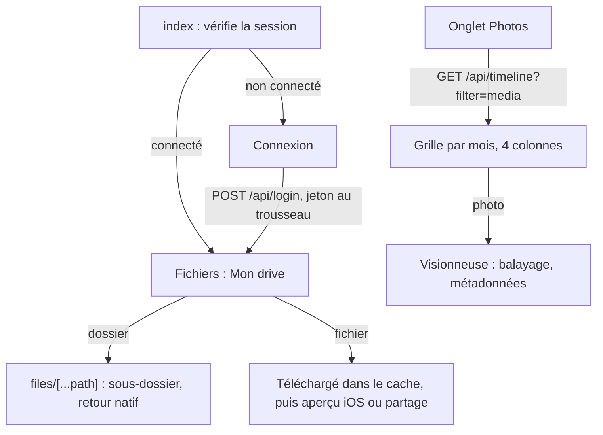

# App mobile

L'app du téléphone : se connecter à la box, parcourir le drive, voir les photos. Code : `mobile/`. Issue : #37 (Feature #33). La sauvegarde automatique arrive avec #38.

## Pile

Expo SDK 58, React Native 0.88, TypeScript, expo-router. Toutes les dépendances sont sous licence MIT. Le style est natif iOS (navigation, listes, grands titres), avec la palette du bureau, en clair et en sombre.

| Paquet | Pour |
|---|---|
| `expo-router` | Les écrans, à partir de `mobile/src/app/` |
| `expo-secure-store` | Le jeton de session, dans le trousseau iOS |
| `@react-native-async-storage/async-storage` | L'adresse de la box, qui n'est pas un secret |
| `expo-image` | Miniatures et photos, avec l'en-tête d'authentification et un cache |
| `expo-file-system`, `expo-sharing` | Télécharger un fichier, puis l'ouvrir dans l'aperçu natif ou la feuille de partage |
| `expo-symbols` | Les icônes (SF Symbols) |

## Types partagés

`shared/api-types.ts` (à la racine) déclare les types de l'API : `Account`, `Entry`, `TimelineEntry`, `TimelinePage`, `MonthCount`, `MediaMeta`, `SignedIn`. Le web les réexporte (`web/src/api.ts`, `drive/files.ts`, `desktop/timeline.ts`) et le mobile les importe.

- **Types seulement :** aucun bundler (Vite, Metro) n'a à charger ce fichier, car les deux côtés l'importent en `import type`.
- **Image du cœur :** son étape web copie `shared/` (`core/Dockerfile`), pour que `tsc` le trouve.
- **Synchronisation :** à garder en phase avec `core/internal/httpapi`.

## Session

- **Connexion :** l'écran Connexion demande l'adresse de la box (`192.168.1.20:8480`, complétée en `http://…`), l'identifiant et le mot de passe, puis appelle `POST /api/login`.
- **Jeton :** le cœur rend un jeton de session, que l'app garde dans le trousseau (expo-secure-store). Elle l'envoie en `Authorization: Bearer` avec `X-Cloudos-Client: mobile` (`auth.TokenFrom` lit le cookie ou ce jeton). Pas de cookie : les téléchargements et les images natives ne partagent pas forcément ceux de `fetch`, alors que l'en-tête passe partout (expo-image, `File.downloadFileAsync`).
- **Au démarrage :** `GET /api/me` vérifie le jeton. Un 401 l'oublie et renvoie à la Connexion. Une box injoignable garde le jeton pour plus tard.
- **Déconnexion :** `POST /api/logout`, puis le jeton est effacé, même si la box ne répond pas.

## Écrans



- **Fichiers** (`src/app/(tabs)/files`) : les dossiers d'abord, puis les fichiers, avec la miniature des images et la taille. On rafraîchit en tirant vers le bas. Un dossier s'empile avec le retour natif. Un fichier est téléchargé dans le cache (`Paths.cache/cloudos/<empreinte>/<nom>`) puis ouvert dans l'aperçu d'iOS (`File.preview`), ou à défaut dans la feuille de partage.
- **Photos** (`src/app/(tabs)/photos.tsx`) : `GET /api/timeline?filter=media`, comme l'app Photos du bureau (#35). Les miniatures sont en grille de 4 colonnes, avec un titre par mois, et la suite se charge en descendant.
- **Visionneuse** (`src/components/Viewer.tsx`) : en plein écran, on balaie d'une photo à l'autre. L'image d'origine s'affiche si iOS sait la dessiner, HEIC compris, sinon la miniature. Un panneau montre la date de prise de vue, l'appareil, les dimensions, le GPS et le dossier (`GET /api/files/meta`).

## Réseau local

La box parle en http sur le réseau de la maison. `app.json` autorise les connexions locales (`NSAllowsLocalNetworking`, sans ouvrir tout http) et explique la demande d'accès au réseau local (`NSLocalNetworkUsageDescription`). Une box exposée en HTTPS fonctionne aussi.

## Développer et tester

```bash
cd mobile && npm ci
npm run typecheck && npm run lint && npm test   # tsc, oxlint, Jest (jest-expo)
npx expo run:ios                                # build et lance dans le simulateur iOS
```

- **Dans le simulateur :** la box de la pile Compose est à `localhost:<port du cœur>`.
- **Sur un iPhone :** `npx expo run:ios --device` installe un development build, avec ton identifiant Apple dans Xcode (Signing & Capabilities). Le téléphone doit être sur le même réseau que la box, avec l'adresse IP du Mac, par exemple `192.168.1.20:8480`.
- **Dossiers natifs :** `ios/` et `android/` sont générés (`expo prebuild`) et ignorés par git.
- **Watchman :** s'il est installé mais cassé (bibliothèque Homebrew manquante), Jest s'en passe (`"watchman": false`). Pour Metro, mettre devant lui, dans le `PATH`, un faux `watchman` qui sort en erreur, ou réparer watchman (`brew reinstall watchman`).
