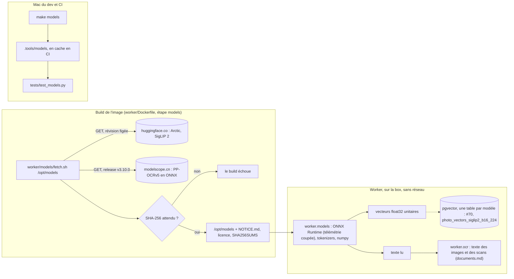

# Modèles d'IA locaux

Les trois modèles qui donnent au worker la compréhension des documents, des photos et du texte des images. Ils tournent sur le CPU de la box avec ONNX Runtime, sans PyTorch et sans réseau. Le choix et ses mesures : [ADR 005](../decisions/005-modeles-locaux.md).
Issue : #66 (Feature #65).

| Usage | Dossier dans `CLOUDOS_MODELS_DIR` | Classe ou fonction de `worker.models` | Sortie |
|---|---|---|---|
| Documents et requêtes (Arctic Embed M v2.0, int8) | `arctic-embed-m-v2.0/` : `model.onnx`, `tokenizer.json` | `text_encoder()` → `TextEncoder.embed(textes, query=…)` | vecteurs unitaires, 768 dimensions |
| Photos (SigLIP 2 base/16 224, int8) | `siglip2-base-patch16-224/` : `vision_model.onnx` | `image_encoder()` → `ImageEncoder.embed(images)` | vecteurs unitaires, 768 dimensions |
| Requêtes sur les photos (SigLIP 2, partie texte) | `siglip2-base-patch16-224/` : `text_model.onnx`, `tokenizer.json` | `image_query_encoder()` → `SiglipTextEncoder.embed(textes)` | vecteurs comparables à ceux des photos |
| OCR (PP-OCRv5 mobile, reconnaissance latine) | `pp-ocrv5-latin/` : `det.onnx`, `rec.onnx` | `ocr_model()` → `OcrModel.text_map(image)`, `OcrModel.read_line(image)` | carte de probabilité du texte, texte d'une ligne |

## Du build à la box

## Règles

- **Rien n'est téléchargé à l'exécution.** `session()` lève `FileNotFoundError` quand un fichier manque. `fetch.sh` est le seul à télécharger, au build, et il vérifie chaque fichier par son SHA-256.
- **Rien ne sort de la box.** ONNX Runtime 1.32 envoie par défaut des événements d'usage à Microsoft. Le paquet `worker` pose `ORT_DISABLE_TELEMETRY=1` avant tout import d'ONNX Runtime, `worker.models` appelle `ort.disable_telemetry_events()`, et l'image pose la même variable avec `HF_HUB_OFFLINE=1`.
- **Une requête ne s'encode pas comme un document.** Arctic met `query: ` devant une requête, rien devant un document (`embed(…, query=True)`). SigLIP 2 met le texte en minuscules et le complète à 64 tokens, comme à son entraînement.
- **512 tokens par passage** pour Arctic (`TEXT_SPEC_MAX_TOKENS`). Il en accepte 8 192, mais à 2 048 tokens d'un coup le pic de RAM du worker passe de 1,2 à 2,6 Go. Les documents sont découpés en fenêtres de 512 tokens qui se chevauchent de 64 ([search-ai.md](search-ai.md)).
- **Chaque modèle est chargé une fois par processus**, par le premier fil qui le demande : le fil des tâches ou le point de requête (`worker.embedserver`). Un verrou (`_load_once`) fait attendre le second au lieu d'en charger une autre copie.
- **Le nom du modèle accompagne chaque vecteur** (`TEXT_MODEL`, `IMAGE_MODEL`, `OCR_MODEL`), avec sa version (`IMAGE_MODEL_VERSION`, `TEXT_MODEL_VERSION` plus le découpage de `worker.textemb`), et chaque modèle a sa table (`TEXT_TABLE` pour le texte) : changer de modèle, c'est changer `fetch.sh` et la version, et le cœur réencode tout ([embeddings.md](embeddings.md)).
- **Les recherches de photos sont lues comme des légendes** : « une photo de … » (`IMAGE_QUERY_TEMPLATE`), l'encodeur que `embedding_models()` donne au point de requête. Celles de documents prennent le préfixe d'Arctic, « query: » (`text_queries`).
- **4 fils ONNX Runtime par modèle**, les 4 cœurs d'un Pi 5 ; `CLOUDOS_MODEL_THREADS` en donne moins.
- **L'OCR ne fait que tourner les modèles.** Le détecteur (`text_map`) reçoit l'image ramenée entre 736 px pour le petit côté et 2 000 px pour le grand, ou entre les bornes qu'on lui donne (`min_side`, `max_side` : le tri document ou photo regarde à 960 px). La reconnaissance (`read_lines`) reçoit des lignes à 48 px de haut, en BGR ramené à -1…1, comme à l'entraînement de PaddleOCR, 8 à la fois, chacune complétée à la largeur de la plus large de son lot. Elle décode en CTC avec la liste des caractères inscrite dans le modèle et rend, pour chaque ligne, la probabilité moyenne des caractères gardés. Le découpage d'une page en lignes et leur ordre de lecture sont dans `worker.ocr` ([documents.md](documents.md), #68).

## Mémoire et vitesse

Les trois modèles chargés occupent 1,2 Go, et 1,8 Go au pic au travail (mesure dans l'image, ADR 005). Estimation sur un Pi 5 : 0,3 s par document, 0,3 s par photo, environ 3 s par page lue par l'OCR, quelques dizaines de millisecondes par requête.

## Le banc d'essai

`worker/bench` (hors de l'image, groupe `bench` de `pyproject.toml`) classe les candidats sur `worker/tests/fixtures/bench`. Il mesure le recall@1, le MRR, la latence et la RAM pour le texte et les photos, puis le taux d'erreur par caractère et la recherche après OCR pour l'OCR. Il tourne dans un conteneur Linux (`worker/bench/Dockerfile`) avec Tesseract de Debian pour comparer. Les commandes sont dans l'ADR 005.
