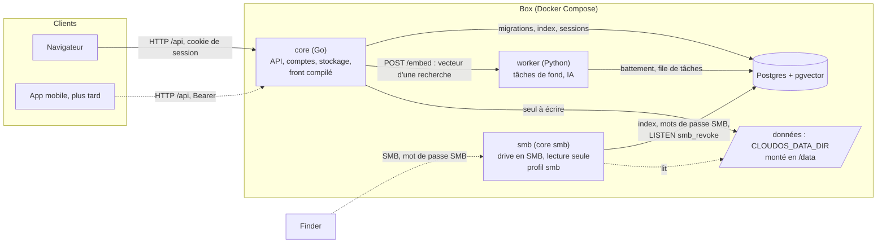
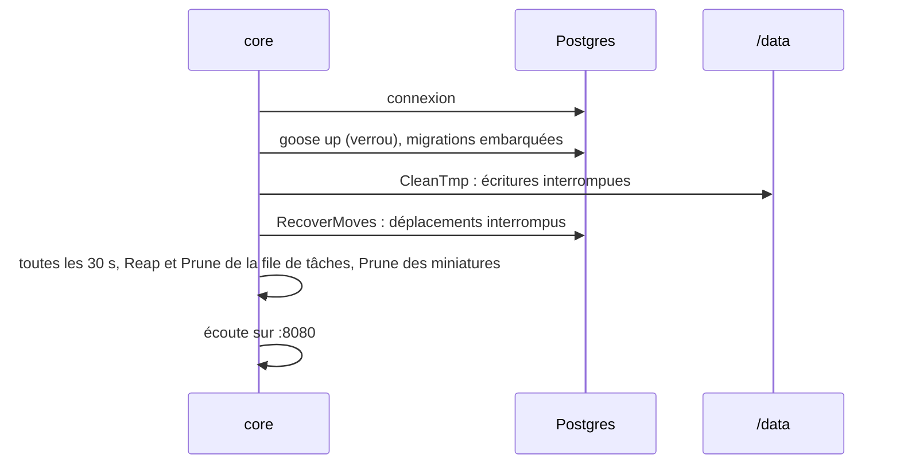
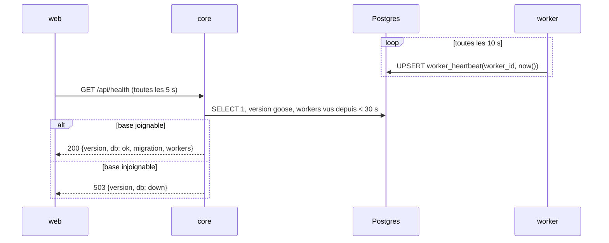

# Vue d'ensemble

La pile de Cloud OS et la façon dont ses services se parlent. Les choix de langages et leurs raisons sont dans [`docs/decisions/001-stack.md`](../decisions/001-stack.md).
Issue : #3.

## Services

- **Les clients ne parlent qu'au cœur.** Le cœur sert aussi le front compilé (`STATIC_DIR`). En développement, Vite le sert avec rechargement à chaud et renvoie `/api` vers le cœur.
- **Le cœur et les workers se parlent par Postgres** : le battement, et la file de tâches (voir [tasks.md](tasks.md)). Une seule exception : le cœur demande au worker le vecteur d'une recherche (`POST /embed`, port 8090 sur le réseau Compose seulement), parce qu'une requête ne peut pas attendre derrière la file (voir [embeddings.md](embeddings.md)). Un worker n'écrit jamais dans les fichiers des utilisateurs : il les lit depuis `/data`, monté en lecture seule, et écrit ses résultats en base (par exemple les miniatures, voir [thumbnails.md](thumbnails.md)).
- **Seul le cœur applique les migrations**, au démarrage, sous un verrou Postgres (goose). Un worker attend que les tables dont il a besoin existent, et le service `smb` refuse de démarrer tant qu'une migration manque.
- **SMB tourne à part**, dans le service `smb` (`core smb`, même image que le cœur), éteint par défaut : une panne SMB n'emporte ni le cœur ni le web (voir [smb.md](smb.md)).

| Service | Image | Port hôte (défaut) |
|---|---|---|
| `db` | `pgvector/pgvector:0.8.1-pg17` | 54320 |
| `core` | `core/Dockerfile` (front compilé + binaire Go, distroless, non root) | 8480 |
| `worker` | `worker/Dockerfile` (Python 3.13, uv) | aucun (8090 sur le réseau Compose seulement) ; `/data` en lecture seule |
| `smb` (profil `smb`, `CLOUDOS_SMB=1`) | `core/Dockerfile`, commande `core smb` ; 512 Mo au plus ; `/data` en lecture seule | 1445 |
| `web` | `node:24-alpine`, Vite en développement | 5180 |

Tous les ports sont liés à `127.0.0.1` et réglables (`CLOUDOS_*_PORT`), pour qu'une pile par worktree tourne sans conflit.

## Démarrage du cœur

Les sous-commandes `core import`, `core verify` et `core reset-password` passent par les mêmes deux premières étapes, puis font leur travail sans démarrer le serveur. Elles ne nettoient rien, parce qu'un serveur peut tourner à côté.

## Santé

`GET /api/health` est public. Il renvoie la version (fichier `VERSION`), l'état de la base, la version de migration et les workers vus depuis moins de 30 s. Si la base ne répond pas, il renvoie 503 avec `db: down`.

`core health` interroge ce point depuis le conteneur, dont l'image n'a ni shell ni curl : c'est le `healthcheck` du service `core` dans Compose, que le service `smb` attend avant de démarrer.

Le worker reprend tout seul quand la base revient : il se reconnecte toutes les 2 s.
