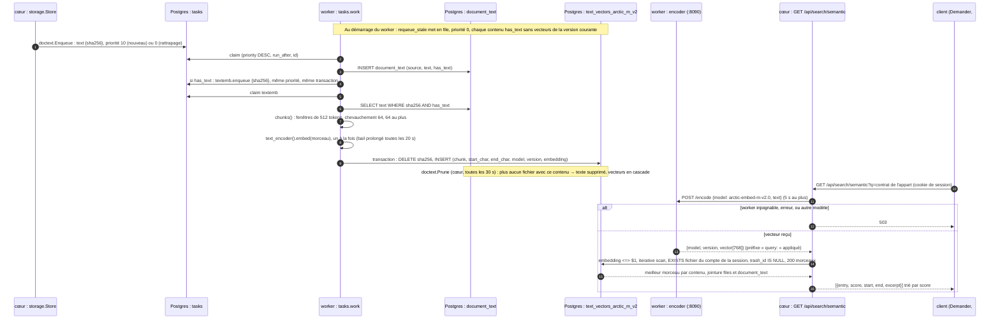

# Recherche par le sens

Retrouver un document avec ses propres mots, pas seulement ceux du document : « contrat de l'appart » trouve le bail. Les workers transforment le texte de chaque document en vecteurs, rangés dans pgvector ; une recherche transforme la requête en vecteur et cherche les plus proches. Tout se calcule sur la box, avec les modèles locaux ([models.md](models.md)).
Issue : #70 (Feature #65). La recherche des photos par leur contenu (#71) et la liste fusionnée de Demander (#72) s'appuient sur les mêmes mécanismes.

## Parcours

## Indexation (worker)

`worker/src/worker/textemb.py`, tâche `textemb`, charge `{"sha256": hex}`, clé de dédoublonnage `textemb:<sha256>`.

- **Mise en file :** le worker qui écrit un texte avec des mots (`has_text`) met la tâche en file dans la même transaction, à la priorité de la tâche qui l'a écrit : `doctext.make` aujourd'hui, l'OCR de #68 demain (`textemb.enqueue(conn, sha, task.priority)`). Un fichier qui arrive reste prioritaire (10), un rattrapage reste en rattrapage (0). Rien ne part à chaque dépôt de fichier, et un scan attend son OCR.
- **Découpage :** `chunks(text, tok)` coupe le texte en fenêtres de 510 tokens, plus les deux tokens spéciaux du modèle (512 en tout). Deux fenêtres voisines partagent 64 tokens, pour qu'une phrase coupée au bord soit entière dans l'une des deux. Un document en a 64 au plus (`MAX_CHUNKS`).
  - Une fenêtre fait environ 1 800 caractères de français (3,55 caractères par token sur le banc), et 64 fenêtres environ 100 000 caractères, une trentaine de pages. Au-delà, la recherche dans le contenu (#69) couvre la suite.
  - La plupart des documents du foyer tiennent en une fenêtre, entiers : 224 tokens en moyenne sur le banc, et seul le bail (520 tokens) en prend deux.
  - Les offsets viennent du tokenizer du modèle, sans le reconfigurer : il est partagé avec l'encodeur des requêtes. Sa troncature découpe un long texte en morceaux (`overflowing`), et ces morceaux mis bout à bout donnent chaque token avec sa place dans le texte. Charger une seconde copie du tokenizer coûterait 280 Mo.
- **Encodage :** un morceau à la fois, sans préfixe (Arctic ne met `query: ` que devant une requête). Mesuré sur le Mac (4 fils) : 59 ms par fenêtre seule, 81 ms par fenêtre en lots de quatre, avec 600 Mo de RAM en plus pour le lot. Estimé sur un Pi 5 : 0,7 s par fenêtre, 45 s au pire pour un document de 64 fenêtres, le bail de la tâche étant prolongé par `keep_lease` ([tasks.md](tasks.md)).
- **Écriture :** dans une transaction, la tâche supprime les lignes du contenu puis insère les nouvelles. Une recherche voit l'ancienne version ou la nouvelle, jamais un mélange. Elle ne lit que `document_text` : aucun fichier n'est lu ni écrit.
- **Rien à faire** quand le contenu n'a plus de texte (aucun fichier ne l'a plus) ou pas encore de mots (un scan), ou quand ses vecteurs sont déjà à la version courante.

### Pourquoi 512 tokens, alors qu'Arctic en lit 8 192

Mesuré sur le Mac en encodant le banc mis bout à bout :

| Fenêtre | ms par fenêtre | ms par 512 tokens | Pic de RAM du processus |
|---|---|---|---|
| 512 tokens | 95 | 95 | 1,2 Go |
| 1 024 tokens | 206 | 103 | 1,4 Go |
| 2 048 tokens | 618 | 155 | 2,6 Go |

À 2 048 tokens, la RAM double, ce qu'un Pi 5 de 4 Go ne tient pas à côté de Postgres. À 1 024, le coût est le même, mais une fenêtre plus longue dilue le passage qui répond à une question précise. La longue fenêtre d'Arctic sert ailleurs : à 512 tokens, rien n'est tronqué.

## Stockage

Une table par modèle (CLAUDE.md), migration `0018_text_vectors.sql` :

| Colonne | |
|---|---|
| `sha256` | Le contenu ; clé étrangère vers `document_text`, `ON DELETE CASCADE` |
| `chunk` | Rang de la fenêtre, à partir de 0 ; clé primaire `(sha256, chunk)` |
| `start_char`, `end_char` | La fenêtre dans `document_text.text`, en caractères : `[start_char, end_char)` |
| `model` | `arctic-embed-m-v2.0`, seul accepté par la table |
| `version` | `textemb.version()`, par exemple `03d923bb1850-w512-o64-n64` |
| `embedding` | `halfvec(768)`, vecteur unitaire en demi-précision |

- **Index :** HNSW `halfvec_cosine_ops` (réglages par défaut de pgvector, `m = 16`, `ef_construction = 64`).
- **Demi-précision :** `halfvec` divise par deux la place des vecteurs et de l'index, qui doit tenir en RAM. Mesuré sur le banc, le cosinus bouge de 0,00004 au plus et le premier résultat de chaque requête reste le même.
- **Place :** 1,5 Ko par fenêtre, plus l'index. Un fonds de 10 000 documents de trois fenêtres en moyenne fait environ 45 Mo de vecteurs.
- **Ménage :** les vecteurs suivent le texte. Quand plus aucun fichier n'a un contenu, corbeille comprise, `doctext.Prune` supprime son texte, et ses vecteurs partent en cascade. Un document restauré de la corbeille retrouve les siens.

## Version et changement de modèle

- **La version** nomme ce qui change les vecteurs : les 12 premiers caractères du SHA-256 du fichier du modèle (lu dans `SHA256SUMS`, écrit par `fetch.sh`, `models.file_sha256`) et les réglages du découpage (`w512-o64-n64`). Un nouveau fichier de modèle ou un autre découpage change la version, sans y penser.
- **Au démarrage**, le worker appelle `textemb.requeue_stale` : chaque contenu vivant, avec des mots et sans vecteurs de la version courante, est mis en file à la priorité 0. Changer de version relance donc toute l'indexation, derrière les fichiers qui arrivent. Ce passage rattrape aussi une tâche perdue. Un contenu qui échoue pour de bon est retenté à chaque démarrage.
- **Pendant le rattrapage**, les vecteurs de l'ancienne version du même modèle répondent encore, jusqu'à leur remplacement : ils restent comparables.
- **Un autre modèle**, c'est une autre table, donc une migration, et `textemb.Model`, `textemb.Table` dans le cœur avec `TEXT_MODEL`, `TEXT_TABLE` dans le worker. Les vecteurs de deux modèles ne se mélangent jamais.
- **`core embed backfill`** met en file, à la priorité 0, les contenus vivants avec des mots qui n'ont aucun vecteur, sans attendre un redémarrage du worker. Seul le worker connaît la version courante : il s'occupe des versions périmées.

## Encodage des requêtes

Le cœur n'a pas ONNX Runtime. Il demande le vecteur d'une requête au worker, qui a déjà le modèle en mémoire.

- **Worker :** `worker/src/worker/encoder.py`, un `ThreadingHTTPServer` de la bibliothèque standard, dans un fil du worker, sur `CLOUDOS_ENCODER_ADDR` (`0.0.0.0:8090`). Compose ne fait qu'`expose` ce port : il n'est joignable que sur le réseau Compose, jamais publié sur l'hôte. Rien ne sort de la box.
  - `POST /encode` avec `{"model": "<nom>", "text": "<requête>"}` renvoie `{"model", "version", "vector"}`.
  - 400 pour un corps qui n'est pas cela (16 Kio au plus), ou un texte vide ou de plus de 1 000 caractères ; 404 pour un modèle qu'il ne sert pas ; 500 si le modèle échoue.
  - La requête n'est jamais écrite dans les journaux.
  - Le modèle est chargé au démarrage du fil, pour que la première recherche ne l'attende pas. Le fil des tâches et l'encodeur partagent le même modèle : un verrou dans `worker.models` évite un double chargement.
- **Plusieurs modèles :** `encoder.ENCODERS` associe un nom de modèle à sa façon d'encoder une requête et à la version de ses vecteurs. #71 y ajoute la partie texte de SigLIP 2 pour les photos.
- **Cœur :** `core/internal/encoder`, `Client.Encode(ctx, model, text)` sur `CLOUDOS_ENCODER_URL` (`http://worker:8090`), 5 s au plus. Toute erreur devient `ErrUnavailable`, sans le texte de la requête. `Vector.Literal()` donne le texte que pgvector lit (`$1::halfvec`), sans dépendance Go à pgvector.
- **Pourquoi pas une tâche avec attente :** le worker ne regarde la file que toutes les 2 s quand il est inoccupé, et il peut tenir une page d'OCR ou un long document pendant des dizaines de secondes. Une recherche ne peut pas attendre cela.
- **Sans authentification entre le cœur et le worker :** l'encodeur ne lit aucune donnée de la box, il transforme le texte reçu en vecteur, et seuls les conteneurs de la pile le joignent.

## API

`GET /api/search/semantic?q=&limit=` (session requise) : `core/internal/httpapi/semantic.go`, puis `textemb.Search`.

- **Entrée :** `q` vide → `[]` ; plus de 1 000 caractères → 400. `limit` : 20 par défaut, 100 au plus.
- **Réponse :** `SemanticHit[]` (`shared/api-types.ts`), du plus proche au moins proche :
  - `entry` : le fichier ;
  - `score` : le cosinus de sa meilleure fenêtre, 1 au plus ;
  - `start`, `end` : cette fenêtre, en caractères du texte du document ;
  - `excerpt` : ses 240 premiers caractères.
  
  Un même contenu rangé deux fois par le compte donne deux résultats.
- **503** quand le worker ne répond pas, est encore en train de démarrer, ou renvoie le vecteur d'un autre modèle.
- **Compte et corbeille :** les vecteurs sont rangés par contenu, partagés si deux comptes ont le même fichier. La requête ne garde que les fenêtres d'un fichier vivant (`trash_id IS NULL`) du compte de la session, jamais d'un paramètre.
- **Requête SQL :**
  - dans une transaction en lecture seule, les 200 fenêtres les plus proches (`embedding <=> $1::halfvec`) parmi celles du compte ;
  - puis la meilleure par contenu (`DISTINCT ON`), jointe à `files` et à `document_text` pour l'extrait.
  - Le filtre du compte s'applique pendant le parcours de l'index HNSW : avec `hnsw.iterative_scan = relaxed_order` (pgvector 0.8), Postgres poursuit le parcours jusqu'à avoir assez de fenêtres du compte, au lieu de filtrer un nombre fixe de voisins. Les résultats sont triés de nouveau par distance (CTE `MATERIALIZED`). `hnsw.ef_search = 100`.
- **Pas d'interface ici :** Demander fusionnera ces résultats avec la recherche dans le contenu et celle des photos (#72).

## Interface fluide

- **Le worker passe en `nice 10`** au démarrage (`CLOUDOS_WORKER_NICE`, 0 pour ne rien changer) : le cœur et Postgres, qui répondent à l'utilisateur, gardent la main sur le CPU, et les fils du worker en héritent.
- **Aucune tâche ne tient longtemps le worker :** 64 fenêtres au plus, environ 45 s sur un Pi 5. À chaque `claim`, une tâche à priorité 10 passe devant tout le rattrapage.

## Tests

- **Worker** (`worker/tests/test_textemb.py`, `test_encoder.py`, `test_doctext.py`), avec les modèles :
  - le découpage : un document court en une fenêtre entière ; un long en fenêtres de 510 tokens qui se chevauchent de 64, du premier au dernier token ; le plafond ; un texte vide ;
  - la tâche : une ligne par fenêtre, avec modèle, version et vecteur unitaire ; rien à refaire à jour ; tout remplacé à une autre version ;
  - la mise en file : à la priorité de la tâche texte, et pas pour un scan ;
  - `requeue_stale` : seulement les contenus vivants sans la version courante, à la priorité 0 ;
  - `POST /encode` : le protocole, avec de faux modèles ; le vecteur d'Arctic, préfixe de requête compris ;
  - de bout en bout : les 30 documents du banc indexés par la tâche, chaque requête encodée par `POST /encode`. « contrat de l'appart » met le bail en premier, et le recall@1 reste au niveau de l'ADR 005 : 32 requêtes sur 33, la manquée étant déjà « montant du dépôt de garantie » quand chaque document était encodé entier. Même résultat sur x86-64 sans VNNI (les machines de la CI, mesuré en émulation `linux/amd64`), où les produits int8 d'Arctic saturent un peu.
- **Cœur** (`core/internal/textemb`, `encoder`, `httpapi/semantic_test.go`, `migrate`) :
  - `Search` avec des vecteurs posés à la main : ordre, meilleure fenêtre par contenu, extrait, limite ;
  - le même contenu dans deux comptes, chacun ne voyant que son fichier ; la corbeille exclue ;
  - `Backfill` ; la cascade de `doctext.Prune` ;
  - le client de l'encodeur et ses erreurs, sans le texte de la requête ;
  - la route : session, 400, 503 ;
  - la migration montée, défaite et remontée avec des données.
