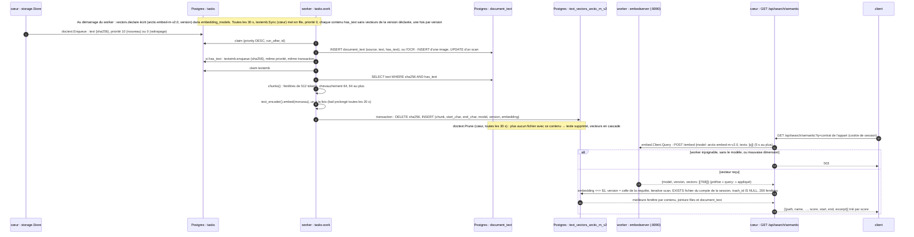

# Recherche par le sens

Retrouver un document avec ses propres mots, pas seulement ceux du document : « contrat de l'appart » trouve le bail. Les workers transforment le texte de chaque document en vecteurs, rangés dans pgvector ; une recherche transforme la requête en vecteur et cherche les plus proches. Tout se calcule sur la box, avec les modèles locaux ([models.md](models.md)).
Issue : #70 (Feature #65). Le vecteur d'une requête et la remise en file à un changement de modèle passent par le mécanisme commun aux recherches par le sens, décrit avec celle des photos (#71) dans [embeddings.md](embeddings.md). Demander mêle ces résultats à ceux des noms, des mots et des photos en une seule liste (#72, [search.md](search.md)).

## Parcours

## Indexation (worker)

`worker/src/worker/textemb.py`, tâche `textemb`, charge `{"sha256": hex}`, clé de dédoublonnage `textemb:<sha256>`.

- **Mise en file :** le worker qui écrit un texte avec des mots (`has_text`) met la tâche en file dans la même transaction, à la priorité de la tâche qui l'a écrit (`textemb.enqueue(conn, sha, task.priority)`) : `doctext.make` pour un document, `ocr.make` pour une image lue (INSERT) ou un scan lu en place (UPDATE, [documents.md](documents.md)). Un fichier qui arrive reste prioritaire (10), un rattrapage reste en rattrapage (0). Rien ne part à chaque dépôt de fichier, et un scan attend son OCR.
- **Découpage :** `chunks(text, tok)` coupe le texte en fenêtres de 510 tokens, plus les deux tokens spéciaux du modèle (512 en tout). Deux fenêtres voisines partagent 64 tokens, pour qu'une phrase coupée au bord soit entière dans l'une des deux. Un document en a 64 au plus (`MAX_CHUNKS`).
  - Une fenêtre fait environ 1 800 caractères de français (3,55 caractères par token sur le banc), et 64 fenêtres environ 100 000 caractères, une trentaine de pages. Au-delà, la recherche dans le contenu (#69) couvre la suite.
  - La plupart des documents du foyer tiennent en une fenêtre, entiers : 224 tokens en moyenne sur le banc, et seul le bail (520 tokens) en prend deux.
  - Les offsets viennent du tokenizer du modèle, sans le reconfigurer : il est partagé avec le point de requête (`worker.embedserver`). Sa troncature découpe un long texte en morceaux (`overflowing`), et ces morceaux mis bout à bout donnent chaque token avec sa place dans le texte. Charger une seconde copie du tokenizer coûterait 280 Mo.
- **Encodage :** un morceau à la fois, sans préfixe (Arctic ne met `query: ` que devant une requête), avec l'export fp16 d'Arctic (voir plus bas). Mesuré sous Linux arm64 sur le Mac, 4 fils, comme dans l'ADR 005 : 189 ms par fenêtre, 16 ms par requête. Estimé sur un Pi 5 (×6) : 1,1 s par fenêtre, 70 s au pire pour un document de 64 fenêtres, le bail de la tâche étant prolongé par `keep_lease` ([tasks.md](tasks.md)). Encoder les fenêtres par lots de quatre ne fait rien gagner et coûte 600 Mo de RAM de plus.
- **Écriture :** dans une transaction, la tâche supprime les lignes du contenu puis insère les nouvelles. Une recherche voit l'ancienne version ou la nouvelle, jamais un mélange. Elle ne lit que `document_text` : aucun fichier n'est lu ni écrit.
- **Rien à faire** quand le contenu n'a plus de texte (aucun fichier ne l'a plus) ou pas encore de mots (un scan), ou quand ses vecteurs sont déjà à la version courante.

### Pourquoi 512 tokens, alors qu'Arctic en lit 8 192

Mesuré sur le Mac en encodant le banc mis bout à bout (avec l'export int8 ; l'attention coûte pareil en fp16) :

| Fenêtre | ms par fenêtre | ms par 512 tokens | Pic de RAM du processus |
|---|---|---|---|
| 512 tokens | 95 | 95 | 1,2 Go |
| 1 024 tokens | 206 | 103 | 1,4 Go |
| 2 048 tokens | 618 | 155 | 2,6 Go |

À 2 048 tokens, la RAM double, ce qu'un Pi 5 de 4 Go ne tient pas à côté de Postgres. À 1 024, le coût est le même, mais une fenêtre plus longue dilue le passage qui répond à une question précise. La longue fenêtre d'Arctic sert ailleurs : à 512 tokens, rien n'est tronqué.

### Pourquoi fp16 et pas int8

L'ADR 005 avait retenu l'export int8 d'Arctic. La CI de #70 l'a pris en défaut : sur sa machine x86-64, « contrat de l'appart » mettait l'assurance habitation devant le bail, alors que le Mac mettait le bail en premier. Mesuré sur le banc, avec le découpage et la demi-précision du stockage (score du bail, de l'assurance, et cosinus moyen des vecteurs des fenêtres avec ceux du fp32) :

| Export | macOS arm64 | Linux arm64 | Linux x86-64 (émulé) | Cosinus au fp32 sous Linux |
|---|---|---|---|---|
| int8 | 0,387 / 0,359 | 0,419 / 0,398 | 0,412 / 0,402 | 0,96 |
| uint8 | 0,423 / 0,410 | **0,387 / 0,406** | 0,435 / 0,413 | 0,96 |
| **fp16** | 0,395 / 0,366 | 0,396 / 0,367 | 0,395 / 0,366 | **0,99996** |
| fp32 | 0,395 / 0,366 | 0,395 / 0,366 | 0,395 / 0,366 | 1 |

- **La cause :** l'export int8 quantifie au vol les activations de chaque produit matriciel, que les noyaux entiers d'ONNX Runtime calculent différemment selon le processeur (AVX2, VNNI, i8mm) et selon les fusions de son graphe. Sans aucune fusion, l'int8 est à 0,96 du fp32 partout ; le 0,995 de macOS vient d'une fusion propre à ce build. L'écart entre le bail et l'assurance (0,03 en fp32) tient dans ce bruit.
- **Le fp16** calcule en flottants : les vecteurs d'arm64 et de x86-64 ne diffèrent que de 0,0015 au plus, vingt fois moins que l'écart entre le bail et l'assurance, et le recall@1 reste à 32 sur 33.
- **Son prix**, sous Linux arm64 : 613 Mo de fichier au lieu de 311, 1,3 Go de RAM pour le modèle au lieu de 850 Mo, 189 ms par fenêtre au lieu de 54. Le fp32 coûte 2,3 Go de RAM ; le 4 bits (q4) n'est ni plus rapide ni plus petit en RAM (1,9 Go, sa table d'embeddings reste en fp32), et plus loin du fp32 (0,95).

## Stockage

Une table par modèle (CLAUDE.md), migration `0021_text_vectors.sql` :

| Colonne | |
|---|---|
| `sha256` | Le contenu ; clé étrangère vers `document_text`, `ON DELETE CASCADE` |
| `chunk` | Rang de la fenêtre, à partir de 0 ; clé primaire `(sha256, chunk)` |
| `start_char`, `end_char` | La fenêtre dans `document_text.text`, en caractères : `[start_char, end_char)` |
| `model` | `arctic-embed-m-v2.0`, seul accepté par la table |
| `version` | `textemb.version()` : `95c2741-fp16-w512-o64-n64` |
| `embedding` | `halfvec(768)`, vecteur unitaire en demi-précision |

- **Index :** HNSW `halfvec_cosine_ops` (réglages par défaut de pgvector, `m = 16`, `ef_construction = 64`).
- **Demi-précision :** `halfvec` divise par deux la place des vecteurs et de l'index, qui doit tenir en RAM. Mesuré sur le banc, le cosinus bouge de 0,00004 au plus et le premier résultat de chaque requête reste le même.
- **Place :** 1,5 Ko par fenêtre, plus l'index. Un fonds de 10 000 documents de trois fenêtres en moyenne fait environ 45 Mo de vecteurs.
- **Ménage :** les vecteurs suivent le texte. Quand plus aucun fichier n'a un contenu, corbeille comprise, `doctext.Prune` supprime son texte, et ses vecteurs partent en cascade. Un document restauré de la corbeille retrouve les siens.

## Version et changement de modèle

Le mécanisme est celui des photos ([embeddings.md](embeddings.md)) : le worker déclare ce qu'il sert, le cœur remet tout en file une fois par version.

- **La version** nomme ce qui change les vecteurs : la révision d'Arctic que `fetch.sh` épingle et son export fp16 (`models.TEXT_MODEL_VERSION`, `95c2741-fp16`), puis les réglages du découpage (`w512-o64-n64`), ajoutés par `textemb.version()`. Changer de découpage change la version sans y penser ; changer de fichier de modèle oblige à changer `TEXT_MODEL_VERSION`, ce qu'un test vérifie contre `fetch.sh`.
- **Le worker la déclare** au démarrage : `models.embedding_models()` sert Arctic avec cette version, 768 dimensions et son encodeur de requêtes (`text_queries`, préfixe « query: »), et `vectors.declare` l'écrit dans `embedding_models`.
- **Le cœur remet tout en file une fois par version :** `textemb.Sync`, au tour de 30 s, lit `embed.Due`. Pour une version nouvelle, `Backfill` met en file, à la priorité 0, chaque contenu vivant avec des mots et sans vecteurs de cette version, puis `embed.MarkRequeued`. Le premier démarrage passe par là : les textes écrits avant les vecteurs sont rattrapés sans commande. Changer de version relance donc toute l'indexation, derrière les fichiers qui arrivent.
- **Pendant le rattrapage**, une recherche ne compare que les vecteurs de la version de la requête : un document attend ses nouveaux vecteurs pour revenir dans les résultats, sans jamais mélanger deux versions.
- **Un autre modèle**, c'est une autre table, donc une migration, et `textemb.Model`, `textemb.Table` dans le cœur avec `TEXT_MODEL`, `TEXT_TABLE` dans le worker. Les vecteurs de deux modèles ne se mélangent jamais.
- **`core textemb backfill`** fait le rattrapage à la main : une tâche perdue ou un contenu qui avait échoué.

## Encodage des requêtes

Le cœur n'a pas ONNX Runtime : il demande le vecteur d'une requête au worker, qui a déjà le modèle en mémoire, par `POST /embed` (`core/internal/embed`, `worker/src/worker/embedserver.py`, port 8090 sur le réseau Compose seulement). Le protocole, les limites et les erreurs sont dans [embeddings.md](embeddings.md) ; ce qui est propre au texte :

- **Arctic** est servi sous son nom, `arctic-embed-m-v2.0`, avec le préfixe de requête « query: » qu'il a appris (les documents n'en ont pas).
- **Le modèle est chargé une fois** dans le processus du worker : le point de requête le charge au démarrage pour que la première recherche ne l'attende pas, et le fil des tâches attend ce chargement au lieu d'en faire une autre copie (`_load_once` dans `worker.models`).
- **Une requête de plus de 1 000 caractères** (`textemb.MaxQueryChars`, la limite du point de requête) est coupée. Arctic en lirait davantage, mais une recherche n'est pas un document.

## API

`GET /api/search/semantic?q=&limit=` (session requise) : `core/internal/httpapi/semantic.go`, puis `textemb.Searcher.Search`.

- **Entrée :** `q` ramené à des espaces simples ; vide → `[]` sans demander au worker. `limit` : 20 par défaut, 100 au plus.
- **Réponse :** `SemanticHit[]` (`shared/api-types.ts`), du plus proche au moins proche. Comme `PhotoHit` et `ContentHit`, chaque résultat est l'entrée du fichier (`path`, `name`, `kind`, …), avec en plus :
  - `score` : le cosinus de sa meilleure fenêtre, 1 au plus ;
  - `start`, `end` : cette fenêtre, en caractères du texte du document ;
  - `excerpt` : ses 240 premiers caractères.

  Un même contenu rangé deux fois par le compte donne deux résultats.
- **503** quand le worker ne répond pas, démarre encore, n'a pas le modèle ou renvoie un vecteur d'une autre dimension (`embed.ErrUnavailable`) : la recherche par nom et dans le texte reste là.
- **Compte et corbeille :** les vecteurs sont rangés par contenu, partagés si deux comptes ont le même fichier. La requête ne garde que les fenêtres d'un fichier vivant (`trash_id IS NULL`) du compte de la session, jamais d'un paramètre.
- **Requête SQL :**
  - dans une transaction en lecture seule, les 200 fenêtres les plus proches (`embedding <=> $1::halfvec`) parmi celles du compte, à la version de la requête ;
  - puis la meilleure par contenu (`DISTINCT ON`), jointe à `files` et à `document_text` pour l'extrait.
  - Les filtres (version, compte, corbeille) s'appliquent pendant le parcours de l'index HNSW : avec `hnsw.iterative_scan = relaxed_order` (pgvector 0.8), Postgres poursuit le parcours jusqu'à avoir assez de fenêtres, au lieu de filtrer un nombre fixe de voisins. Les résultats sont triés de nouveau par distance (CTE `MATERIALIZED`). `hnsw.ef_search = 100`.
  - L'extrait est découpé dans `d.text || ''`, une copie entière : PostgreSQL 17.8 peut couper un caractère accentué quand il découpe en place une valeur compressée.
- **Demander** n'appelle pas cette route : `GET /api/search/all` passe par `textemb.Searcher.Search` avec le filtre de type et de date, et mêle ses résultats aux autres ([search.md](search.md)).

## Interface fluide

- **Le worker passe en `nice 10`** au démarrage (`CLOUDOS_WORKER_NICE`, 0 pour ne rien changer) : le cœur et Postgres, qui répondent à l'utilisateur, gardent la main sur le CPU, et les fils du worker en héritent.
- **Aucune tâche ne tient longtemps le worker :** 64 fenêtres au plus, environ 70 s estimées sur un Pi 5. À chaque `claim`, une tâche à priorité 10 passe devant tout le rattrapage.

## Tests

- **Worker** (`worker/tests/test_textemb.py`, `test_doctext.py`, `test_ocr.py`), avec les modèles :
  - le découpage : un document court en une fenêtre entière ; un long en fenêtres de 510 tokens qui se chevauchent de 64, du premier au dernier token ; le plafond ; un texte vide ;
  - la version : la révision et l'export fp16 épinglés par `fetch.sh`, et le découpage ; Arctic déclaré dans `embedding_models` avec elle ; une requête encodée avec le préfixe « query: » ;
  - la tâche : une ligne par fenêtre, avec modèle, version et vecteur unitaire ; rien à refaire à jour ; tout remplacé à une autre version ;
  - la mise en file : à la priorité de la tâche texte ou de l'OCR (image lue, scan lu en place), et pas pour un scan sans texte ni une photo sans texte ;
  - de bout en bout : les 30 documents du banc indexés par la tâche, chaque requête encodée par `POST /embed`. « contrat de l'appart » met le bail en premier, et le recall@1 reste au niveau de l'ADR 005 : 32 requêtes sur 33, la manquée étant déjà « montant du dépôt de garantie » quand chaque document était encodé entier. Le même test passe sous Linux arm64 et x86-64 (en émulation), et sur la machine x86-64 de la CI, où l'export int8 le faisait échouer.
- **Cœur** (`core/internal/textemb`, `httpapi/semantic_test.go`, `migrate`), avec un faux worker HTTP :
  - `Search` avec des vecteurs posés à la main : ordre, meilleure fenêtre par contenu, extrait, limite, requête vide ou trop longue ;
  - seulement les vecteurs de la version de la requête ; 503 sans worker, sans URL ou pour une autre dimension ;
  - le même contenu dans deux comptes, chacun ne voyant que son fichier ; la corbeille exclue ;
  - `Backfill` ; `Sync`, rien avant la déclaration, une fois par version ; la cascade de `doctext.Prune` ;
  - la route : session, entrées, 503 ;
  - la migration montée, défaite et remontée avec des données.
