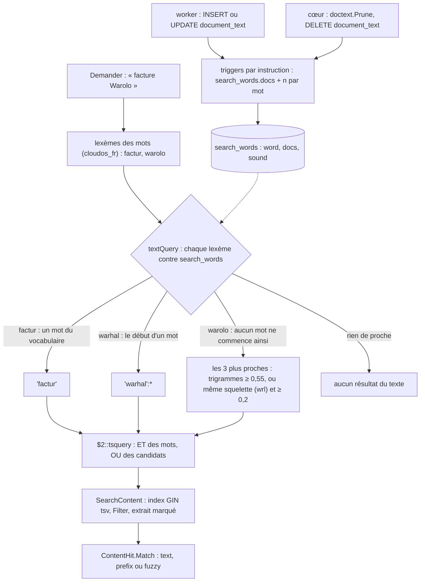
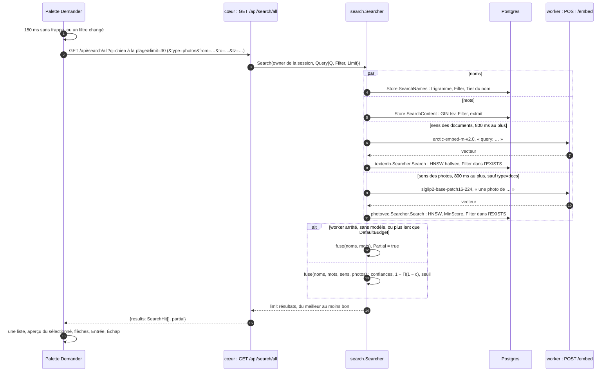

# Recherche

Trouver un fichier ou un dossier sans savoir où il est rangé : par nom et par chemin, et par le texte des documents. La recherche par le sens est dans [search-ai.md](search-ai.md) pour les documents (#70) et [embeddings.md](embeddings.md) pour les photos (#71). Demander réunit les quatre en une seule liste (#72, [plus bas](#une-seule-liste--get-apisearchall)).
Issues : #48 (Feature #45) pour les noms, #69 (Feature #65) pour le texte, #72 (Feature #65) pour la liste fusionnée, #85 (Feature #65) pour les mots tapés en partie ou avec une faute.

## Par nom : `GET /api/search`

`GET /api/search?q=&limit=` (session requise) appelle `storage.Store.Search`, qui cherche dans les fichiers et dossiers vivants (`trash_id IS NULL`) du compte connecté. Le propriétaire est toujours celui de la session, jamais un paramètre.

- **Accents et casse ignorés :** la migration 0012 ajoute `cloudos_fold(text)` = `lower(unaccent(…))`. « ete » trouve « Été 2024 », « BAIL » trouve « bail.pdf ».
- **Mots :** chaque mot de `q` (8 au plus) doit se trouver dans le chemin, dans n'importe quel ordre. Les caractères `%` et `_` sont cherchés tels quels (`escapeLike`).
- **Classement :**
  1. le nom qui commence par le premier mot ;
  2. le nom qui le contient ;
  3. le reste (un mot trouvé seulement dans le dossier).
  
  À rang égal, le plus récemment modifié passe d'abord. 30 résultats par défaut, 100 au plus.
- **Index :** GIN trigramme (`pg_trgm`) sur `cloudos_fold(path)` pour les lignes vivantes (`files_path_fold`). Une condition par mot, pour que chacune puisse s'en servir. Sur une petite table, Postgres préfère l'index du propriétaire ; sur une grande, l'index trigramme.
- **Pourquoi une fonction à nous :** `unaccent()` n'est que STABLE, car son dictionnaire pourrait changer, et un index exige une fonction IMMUTABLE. Nommer le dictionnaire (`'public.unaccent'::regdictionary`) permet de déclarer l'enveloppe IMMUTABLE.
- **Licences :** `unaccent` et `pg_trgm` sont livrées avec PostgreSQL (licence PostgreSQL).

## Dans le texte : `GET /api/search/content`

`GET /api/search/content?q=&limit=` (session requise) appelle `storage.Store.SearchContent`, qui cherche dans le texte que les workers ont extrait des documents (table `document_text`, [documents.md](documents.md)) : PDF, Office, OpenDocument, textes, et l'OCR quand il y sera. Seuls comptent les fichiers vivants du compte connecté. La route est à part de celle des noms : la recherche par nom garde sa forme et sa vitesse, et Demander lance les deux ensemble.

**Index (migration 0018).**

- **`cloudos_fr` :** une copie de la configuration `french` où les mots non ASCII passent par `unaccent` avant le radical français (Snowball). « contrats », « CONTRAT » et « contrat » donnent `contrat` ; « Électricité » et « electricite » donnent `electricit` ; « œufs » donne `oeuf`. Les mots vides (« le », « de ») sont ignorés.
- **`document_text.tsv` :** une colonne `tsvector` générée (`GENERATED ALWAYS AS (cloudos_doc_tsv(text)) STORED`), calculée quand le worker écrit la ligne, sans code de plus dans le worker, et servie par un index GIN (`document_text_tsv`). La migration la calcule pour les lignes déjà là.
- **`cloudos_doc_tsv(text)` :** un `tsvector` ne tient que 1 Mo de lexèmes et de positions. Un tableur d'un million de caractères fait de nombres tous différents le dépasse (1,4 Mo), et l'erreur ferait échouer l'`INSERT` du worker, qui perdrait aussi le texte. Dans ce seul cas, la fonction indexe les 100 000 premiers caractères. Un texte d'un million de caractères fait de mots tient en entier (305 Ko).

**Requête.**

- **Syntaxe :** `websearch_to_tsquery('public.cloudos_fr', q)`, sur les 8 premiers mots. Tous les mots doivent y être, dans n'importe quel ordre ; `"contrat de location"` cherche la phrase, `-vente` exclut un mot, `or` accepte l'un ou l'autre. Une requête sans mot à chercher (que des mots vides, ou que des exclusions) ne trouve rien : sans mot, elle trouverait tous les documents qui n'ont pas le mot exclu.
- **Filtre :** l'index GIN donne les contenus qui ont les mots, puis un `EXISTS` garde ceux dont le compte a un fichier vivant (`owner = $1 AND kind = 'file' AND trash_id IS NULL`, index `files_sha256`). Deux comptes qui ont le même contenu partagent sa ligne de `document_text`, mais chacun ne voit que ses fichiers. Un document mis à la corbeille disparaît ; restauré, il revient (sa ligne reste tant qu'un fichier, même à la corbeille, a son empreinte).
- **Classement :** `ts_rank_cd(tsv, query, 2)` : les mots proches les uns des autres comptent plus, et le rang est divisé par la longueur du document, pour qu'un relevé de 20 pages qui cite une fois « notaire » ne passe pas devant l'acte qui en parle. À rang égal, le plus récemment modifié passe d'abord. 20 résultats par défaut, 100 au plus.
- **Plusieurs fichiers, un contenu :** les contenus sont classés et limités d'abord, puis chaque fichier vivant du compte qui a ce contenu est une ligne du résultat, avec le même extrait.

**Extrait.**

- `ts_headline` donne deux fragments d'une quinzaine de mots, séparés par « … », les mots trouvés entre `\x01` et `\x02`. Le cœur les découpe en morceaux `{text, hit}` (`splitSnippet`) et replie les blancs (sauts de ligne et de page) en une espace. Un mot court (trois lettres au plus) en bord de fragment est retiré, et la ponctuation finale aussi.
- **Une fenêtre, pas tout le texte :** `ts_headline` analyse tout ce qu'on lui donne, 40 à 100 ms pour un document de 460 000 caractères, 850 ms pour 20. Le cœur cherche donc la première occurrence avec `regexp_instr` et une expression construite à partir des lexèmes de la requête (`firstWordPattern`) : chaque voyelle accentuée ou non, `œ` et `æ`, un mot qui commence par le radical suivi de 8 lettres au plus, la casse ignorée. `ts_headline` lit alors 2 400 caractères autour d'elle. Si l'expression ne trouve rien, ou si la fenêtre n'a aucun mot marqué (un radical qui ne commence pas son mot : « chevaux » donne `cheval`), il lit tout le texte.
- **PostgreSQL 17.8 :** `left()` et `substr()` sur un texte stocké et compressé peuvent échouer (« invalid byte sequence for encoding "UTF8" ») quand la tranche décompressée coupe un caractère accentué : une régression de 17.8, corrigée en 17.9, reproduite sur l'image locale. La fenêtre et `cloudos_doc_tsv` découpent donc une copie entière du texte (`text || ''`), jamais le texte stocké.

**Réponse.** `ContentHit[]` : un `Entry` comme celui de `/api/search`, plus `snippet`, la liste des morceaux de l'extrait (`{"text": "contrat", "hit": true}`, `{"text": " de location"}`). Le front affiche ces morceaux en nœuds texte : rien du document n'est lu comme du HTML.

**Vitesse.** Mesurée sur un corpus synthétique de 10 000 documents (211 millions de caractères, dont 100 documents de 460 000 caractères), sur le Mac de dev, base chaude : de 8 à 48 ms par recherche, pour un mot rare (50 documents) comme pour un mot présent dans 3 333 documents. Index GIN de 21 Mo ; la colonne `tsv` pèse à peu près la taille du texte compressé ; la calculer pour les 10 000 documents prend environ 100 s (à la migration, une seule fois). Les requêtes passent par un CTE : leur plan ne dépend pas des mots cherchés, et reste bon quand pgx les prépare.

### Mots tapés en partie, fautes de frappe

Un mot qu'aucun texte n'a est cherché dans le vocabulaire des textes (#85) : tapé en partie, il est complété ; avec une faute, il est remplacé par les mots les plus proches. `storage.textQuery` (`core/internal/storage/words.go`) classe chaque mot, puis `SearchContent` cherche comme avant, avec l'index GIN.

**Le vocabulaire** (migration 0022, table `search_words`) : un lexème de `document_text.tsv` par ligne, avec le nombre de textes qui l'ont (`docs`) et son squelette (`sound`). Seuls les lexèmes de 3 à 40 caractères qui ont une lettre y entrent (`cloudos_search_word`) : pas les nombres d'un tableur.

- **Trois triggers par instruction** (`AFTER INSERT`, `UPDATE`, `DELETE` sur `document_text`, avec tables de transition) le tiennent à jour, dans la transaction qui écrit le texte : celle du worker (texte, OCR) ou du cœur (`doctext.Prune`). Rien ne change dans le worker.
- **Par instruction, pas par ligne** : chaque mot est compté une fois par instruction, quel que soit le nombre de textes. Par ligne, un `INSERT` de 4 000 textes réécrivait un mot courant des milliers de fois dans la même transaction : 10 minutes au lieu de 43 s pour remplir le test de vitesse. Le même cas se présente quand `doctext.Prune` supprime les textes d'une corbeille vidée.
- **Les mots vont dans leur ordre** (`ORDER BY`), en une seule écriture chacun (`INSERT … ON CONFLICT`, ajouts et retraits mêlés), pour que deux écritures les verrouillent dans le même ordre. Seuls les mots que l'instruction a ramenés à 0 sont supprimés, jamais par un parcours de tout le vocabulaire. Rien ne peut refuser une ligne : un texte n'est jamais perdu à cause du vocabulaire.
- **Commun aux comptes**, comme les textes : il ne sert qu'à corriger la requête, puis la recherche ne garde que les fichiers du compte.
- **Index** : la clé primaire (mot exact), `text_pattern_ops` (début de mot), trigrammes (`pg_trgm`), btree sur `sound`.

**Le classement d'un mot** (`textQuery`), en une requête, puis une seconde pour les mots à corriger :

| Le lexème | Cherché comme |
|---|---|
| est dans le vocabulaire, ou le vocabulaire ne le garde pas (un nombre, deux lettres) | lui-même : `'factur'` |
| commence un mot du vocabulaire (3 caractères au moins) | un début de mot : `'warhal':*` |
| est proche de mots du vocabulaire (4 caractères au moins) | les 3 plus proches : `('warhallow')` |
| rien de tout cela | la requête n'a pas de résultat dans le texte, comme avant |

- **Proche** : une similarité en trigrammes de 0,55 au moins (`fuzzySimilarity`), ou, pour un mot de 5 lettres au moins, le même squelette de 3 lettres au moins et 0,2 de similarité (`soundSimilarity`). Le squelette (`cloudos_sound`) garde la première lettre, puis les consonnes sans h ni w, lettres doubles fusionnées : « warhallow » et « warolo » donnent tous deux « wrl ».
- **Rien ne change** quand tous les mots sont dans le vocabulaire, ni quand la requête a des guillemets, un `-mot` ou `or` : `websearch_to_tsquery`, comme avant. Sinon `to_tsquery` fait le ET des mots et le OU des candidats ; l'extrait marque les mots complétés ou corrigés (`firstWordPattern` reçoit les candidats).
- **Mesuré sur le vocabulaire du banc** (955 mots) :
  - les fautes d'une ou deux lettres ont de 0,57 à 0,73 de similarité (« quitance », « asurance », « vetrinaire », « electrisite », « Biaritz ») ;
  - les mots sans rapport qui partagent des lettres s'arrêtent à 0,50 (« sommet » et `somm`, « automne » et `automat`) ;
  - « Warolo » n'a que 0,21 avec « warhallow » (distance d'édition 4), mais le même squelette ;
  - les mots bien écrits absents du corpus (chat, dort, vélo, pizza, ciel, forêt) n'ont aucun candidat ;
  - Double Metaphone, essayé d'abord, faisait de « chat » une chaudière et de « vélo » un vol.
- **Les noms de fichiers** ne passent pas par là : la recherche par nom trouve déjà un mot tapé en partie, et une faute dans un nom n'est pas corrigée.

## Une seule liste : `GET /api/search/all`

`GET /api/search/all?q=&limit=&type=&from=&to=&tz=` (session requise) : `core/internal/httpapi/search.go`, puis `search.Searcher.Search` (`core/internal/search`). Demander n'appelle plus que cette route ; les quatre autres restent.

**Les quatre recherches** partent en même temps, avec le même filtre et au moins 40 résultats chacune (`candidates`) : par nom (`Store.SearchNames`, qui rend aussi le rang du nom, `Tier`), dans le texte (`Store.SearchContent`), par le sens des documents (`textemb`) et des photos (`photovec`). Une requête vide ne demande rien à personne.

**Le budget.** Les deux recherches par le sens ont 800 ms en tout (`DefaultBudget`), du vecteur demandé au worker jusqu'au parcours de l'index. Passé ce délai, ou si le worker est arrêté ou n'a pas le modèle, la réponse part avec les noms et les mots, et `partial: true` ; Demander l'écrit en une ligne. Une erreur des noms ou des mots fait échouer la route ; une erreur du sens la rend seulement partielle, et s'écrit dans le journal (jamais la requête).

**La fusion : des scores calibrés, pas RRF.** Les cosinus des deux modèles ne se comparent pas tels quels : un bon document fait 0,27 à 0,68 avec Arctic, une bonne photo 0,09 à 0,14 avec SigLIP 2, qui donne jusqu'à 0,10 à une photo sans rapport, et environ 0,08 à toutes les photos pour un mot qu'il ne connaît pas (« périm », « Etchev »). Chaque recherche donne donc, pour chaque fichier trouvé, une confiance entre 0 et 1 :

| Recherche | Confiance |
|---|---|
| Nom (`confNameStart`, `confName`, `confPath`) | 0,9 si le nom commence par le premier mot, 0,8 s'il le contient, 0,6 si seul un dossier du chemin le contient |
| Mots (`confText`) | 0,4 : le texte a tous les mots, tels quels |
| Début de mot (`confPrefix`) | 0,3 : un mot tapé en partie, complété |
| Mot approché (`confFuzzy`) | 0,25 : un mot tapé avec une faute, corrigé |
| Sens d'un document (`docScale`) | `(cos − 0,15) / 0,30`, bornée à [0, 1] |
| Sens d'une photo (`photoScale`) | `(écart − 0,02) / 0,04`, bornée à [0, 1], où l'écart (`photovec.Hit.Lift`) est le cosinus de la photo moins la moyenne des photos du compte pour la même requête |

- **Le score d'un fichier** est `1 − Π(1 − c)` sur les recherches qui l'ont trouvé : une recherche sûre suffit, deux qui s'accordent se renforcent. Il classe la liste d'une requête et ne se compare pas d'une requête à l'autre.
- **Le seuil** (`keepAbs`, `keepRel`) : un fichier trouvé seulement par le sens, ou par un mot approché, reste si son score atteint `max(0,2 ; 0,3 × le meilleur score de la requête)`. Le nom et les mots, tels quels ou complétés, ne sont jamais coupés : une faute ne passe jamais devant une réponse sûre. Pour « contrat de l'appart », le bail fait 1 et les photos les plus proches 0,2 : elles partent. Une requête vague, où rien n'est sûr, garde sa liste.
- **À score égal**, le fichier le mieux placé dans l'une des listes passe d'abord, puis le plus récent, puis le chemin.
- **Pourquoi pas RRF** : la fusion par rangs réciproques donne le même poids au premier de chaque liste, quel que soit son score. Le premier document par le sens est donc ex aequo avec la première photo, même pour « un chat qui dort » : simulée sur les réponses des quatre routes, elle ne met la bonne photo en premier que pour 1 requête de photo sur 15. La pondérer par le score demanderait la même calibration.
- **L'écart d'une photo, pas son cosinus** (#88). Le cosinus brut ne sépare pas une bonne photo du bruit : 0,090 pour le chat de « un chat qui dort », 0,097 pour la montagne de « facture de gaz de l'hiver ». L'écart avec la moyenne les sépare : sur le banc, 0,036 ou plus pour une bonne photo (requêtes de photo et mixtes), 0,024 au plus pour un mot tapé en partie ou avec une faute. Avant, une photo sans rapport à 0,085 valait 0,36 de confiance et passait devant le document d'un début de mot (0,3) : « Etchev » sortait la montagne avant la location à Biarritz.
  - La moyenne est prise sur 1 000 photos du compte au plus, les premières par empreinte, donc au hasard, dans toutes ses photos quel que soit le filtre.
  - Elle part de 10 photos à `MinScore` (0,06) : un compte qui n'a que quelques photos, dont la bonne tire la moyenne vers le haut, est traité comme une bibliothèque moyenne. Au-delà de quelques dizaines de photos, sa propre moyenne l'emporte.
- **Les constantes** viennent du banc d'essai (30 documents, 17 photos, 52 requêtes, `worker/tests/fixtures/bench`). Dans une grille de 2 916 jeux de constantes autour d'elles, 1 582 gardent 32 sur 33, 15 sur 15, les chiens en tête et aucune photo devant le bon document : elles ne tiennent pas à un cheveu. Pour l'écart des photos, 55 jeux sur 80 passent tout le banc (zéro de 0,01 à 0,03, plein de 0,05 à 0,08, 0 à 20 photos de départ), dont tous les voisins directs du jeu retenu ; ceux qui échouent donnent trop peu de confiance aux photos. À revoir avec le matériel de référence, et si un modèle change.

**Réponse.** `SearchAnswer` (`shared/api-types.ts`) : `results`, des `SearchHit` (l'entrée du fichier, son `score`, `found_by` parmi `name`, `text`, `prefix`, `fuzzy`, `meaning`, `image`, l'extrait des mots `snippet` ou, à défaut, le passage le plus proche par le sens `excerpt`), et `partial`. 30 résultats par défaut, 100 au plus.

**Filtres** (`storage.Filter`, `core/internal/storage/filter.go`), appliqués dans le SQL de chaque recherche et non après la fusion, pour qu'un filtre étroit ne vide pas la liste :

- `type=docs` ou `type=photos`, par type MIME comme la frise : images et vidéos d'un côté, le reste de l'autre. Avec `type=docs`, la recherche des photos ne part pas. Un autre type répond 400.
- `from` et `to`, des jours inclus (`2025-12-31`), sur la date de la frise : la prise de vue (`media_meta.taken_at`), sinon la modification, au fuseau `tz` du navigateur (UTC s'il manque ou si la box ne le connaît pas). Une date invalide, ou `to` avant `from`, répond 400.
- Avec un filtre, les dossiers ne sont pas listés.
- Dans les recherches par le sens, le filtre est dans l'`EXISTS` que l'index HNSW évalue pendant son parcours (`iterative_scan`) : un filtre étroit ne vide pas la liste.

**Le banc d'essai** (`core/internal/search/bench_test.go`) passe par la route, sur les vecteurs que les modèles du worker font du banc : `testdata/bench.json.gz`, écrit par `worker/bench/golden.py` dans l'image du worker, avec les fonctions des tâches (découpage, encodeurs, gabarits des requêtes). Le test Go n'a pas de modèle ; `worker/tests/test_golden.py` échoue quand les versions des modèles, le découpage ou le corpus ne sont plus ceux du fichier.

- **Résultats** : la bonne réponse arrive en premier pour 32 requêtes de document sur 33 et pour les 15 requêtes de photo.
  - La manquée, « montant du dépôt de garantie », l'est déjà par Arctic seul ([search-ai.md](search-ai.md)).
  - Les trois photos de chien à la plage sont en tête de « chien à la plage », et aucune photo ne passe devant le bon document.
  - Sur les 33 requêtes de document, 4 photos sont listées en tout, après le document (9 avec le cosinus brut) ; sur les 15 requêtes de photo, 5 documents, après la photo.
  - « chien », « plage », « voiture » et « vacances au bord de la mer » mêlent photos et documents dans leurs 8 premiers.
  - Les 12 débuts de mots (« quittan », « kinési », « Biarr », « radiogra », « vidan », « scolar », et les noms propres « Etchev », « Stalingr », « Augagn », « Garni », « Dunoi », « Synte ») et les 5 fautes (« quitance de loyer », « location à Biaritz », « facture d'electrisite », « asurance habitation », « kinésitérapie ») trouvent leur document en premier, complété (`prefix`) ou corrigé (`fuzzy`).
  - Sans le worker, 20 requêtes de document sur 33 trouvent encore le leur en premier, par les noms et les mots (18 avant les débuts de mots).
- **Les vecteurs se font sous Linux**, comme sur la box. Sous macOS, l'export int8 de la partie texte de SigLIP 2 donne d'autres vecteurs, qui notent jusqu'à 0,02 plus haut des photos sans rapport : avec eux, des photos passaient le seuil sous des requêtes de document.

**Vitesse.** Mesurée par `TestSpeedOn10000Files` (à part : `CLOUDOS_SEARCH_BENCH=1`) sur le Mac de dev, sur 10 000 fichiers synthétiques :

- **Le fonds** : 6 000 photos, dont un tiers avec une date de prise de vue, et 4 000 documents de 300 à 900 mots du vocabulaire du banc, d'une à trois fenêtres chacun. Les vecteurs sont aléatoires, et un faux worker répond après un délai.
- **Avec un worker à 20 ms** (Arctic encode une requête en 16 ms sur le Mac) : de 32 à 59 ms par recherche au 50e centile, 65 ms au plus au 95e, filtres compris, sur 15 requêtes dont 5 avec une faute ou un mot tapé en partie (#85).
- **Le vocabulaire des fautes** ne ralentit pas l'écriture : remplir les 10 000 fichiers prend 47 s, contre 43 s sans lui.
- **Avec un worker à 100 ms** (estimé sur un Raspberry Pi 5) : de 114 à 157 ms au 95e centile.

## Web : la palette Demander

`web/src/desktop/Palette.tsx` (et `search.ts` pour les filtres) :

- **Ouvrir :** ⌘K ou Ctrl+K depuis n'importe quel écran (le même raccourci la referme), le bouton Demander du dock, ou la pilule de la barre de menus (masquée sur téléphone).
- **Pendant la frappe :** 150 ms après la dernière touche ou le dernier filtre changé, une seule requête part, `GET /api/search/all` (`searchAll`). Une réponse plus ancienne qui arrive en retard est ignorée.
- **Résultats :** une seule liste, dans l'ordre du cœur, documents, photos et dossiers mêlés, sans groupes. Une photo ou une vidéo a sa vignette dans sa ligne. Les flèches parcourent la liste en bouclant.
- **Filtres :** sous le champ, « Tout », « Documents », « Photos », et une période : « Toutes les dates », « 30 derniers jours », « Cette année », « L'an dernier », « Plus ancien » (`filtersOf`, comptée depuis aujourd'hui sur l'horloge du navigateur, envoyée avec son fuseau). Choisir un type rend la main au champ.
- **Extrait :** deux lignes sous le nom : les mots trouvés en `<mark>`, ou à défaut le passage le plus proche par le sens. Rien du document n'est lu comme du HTML.
- **Messages :** « Rien trouvé » (« avec ces filtres » s'il y en a), l'erreur de la route, et une ligne quand la recherche par le sens ne répond pas : les noms et les mots restent.
- **Aperçu :** la miniature (#14), le PDF ou le début du texte (#52), sinon l'icône ; l'extrait ; le dossier, la taille, la date, et par quoi le fichier a été trouvé (« le nom, le sens du texte », « un mot approchant du texte »). Masqué sur téléphone.
- **Actions :** Entrée ou un clic ouvre le dossier (ou le dossier du fichier) dans Fichiers. Télécharger récupère le fichier. Échap ou un clic à côté ferme la palette.
