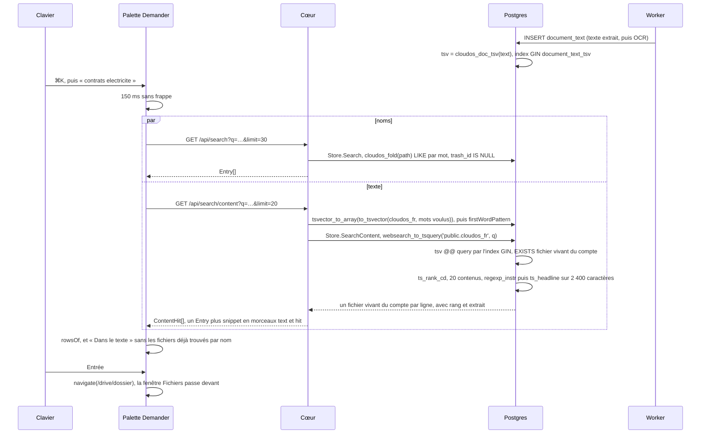

# Recherche

Trouver un fichier ou un dossier sans savoir où il est rangé : par nom et par chemin, et par le texte des documents. Le langage naturel viendra avec l'index IA de la phase 3 (#70, #71, #72).
Issues : #48 (Feature #45) pour les noms, #69 (Feature #65) pour le texte.

## Par nom : `GET /api/search`

`GET /api/search?q=&limit=` (session requise) appelle `storage.Store.Search`, qui cherche dans les fichiers et dossiers vivants (`trash_id IS NULL`) du compte connecté. Le propriétaire est toujours celui de la session, jamais un paramètre.

- **Accents et casse ignorés :** la migration 0012 ajoute `cloudos_fold(text)` = `lower(unaccent(…))`. « ete » trouve « Été 2024 », « BAIL » trouve « bail.pdf ».
- **Mots :** chaque mot de `q` (8 au plus) doit se trouver dans le chemin, dans n'importe quel ordre. Les caractères `%` et `_` sont cherchés tels quels (`escapeLike`).
- **Classement :**
  1. le nom qui commence par le premier mot ;
  2. le nom qui le contient ;
  3. le reste (un mot trouvé seulement dans le dossier).
  
  À rang égal, le plus récemment modifié passe d'abord. 30 résultats par défaut, 100 au plus.
- **Index :** GIN trigramme (`pg_trgm`) sur `cloudos_fold(path)` pour les lignes vivantes (`files_path_fold`). Une condition par mot, pour que chacune puisse s'en servir. Sur une petite table, Postgres préfère l'index du propriétaire ; sur une grande, l'index trigramme.
- **Pourquoi une fonction à nous :** `unaccent()` n'est que STABLE, car son dictionnaire pourrait changer, et un index exige une fonction IMMUTABLE. Nommer le dictionnaire (`'public.unaccent'::regdictionary`) permet de déclarer l'enveloppe IMMUTABLE.
- **Licences :** `unaccent` et `pg_trgm` sont livrées avec PostgreSQL (licence PostgreSQL).

## Dans le texte : `GET /api/search/content`

`GET /api/search/content?q=&limit=` (session requise) appelle `storage.Store.SearchContent`, qui cherche dans le texte que les workers ont extrait des documents (table `document_text`, [documents.md](documents.md)) : PDF, Office, OpenDocument, textes, et l'OCR quand il y sera. Seuls comptent les fichiers vivants du compte connecté. La route est à part de celle des noms : la recherche par nom garde sa forme et sa vitesse, et Demander lance les deux ensemble.

**Index (migration 0018).**

- **`cloudos_fr` :** une copie de la configuration `french` où les mots non ASCII passent par `unaccent` avant le radical français (Snowball). « contrats », « CONTRAT » et « contrat » donnent `contrat` ; « Électricité » et « electricite » donnent `electricit` ; « œufs » donne `oeuf`. Les mots vides (« le », « de ») sont ignorés.
- **`document_text.tsv` :** une colonne `tsvector` générée (`GENERATED ALWAYS AS (cloudos_doc_tsv(text)) STORED`), calculée quand le worker écrit la ligne, sans code de plus dans le worker, et servie par un index GIN (`document_text_tsv`). La migration la calcule pour les lignes déjà là.
- **`cloudos_doc_tsv(text)` :** un `tsvector` ne tient que 1 Mo de lexèmes et de positions. Un tableur d'un million de caractères fait de nombres tous différents le dépasse (1,4 Mo), et l'erreur ferait échouer l'`INSERT` du worker, qui perdrait aussi le texte. Dans ce seul cas, la fonction indexe les 100 000 premiers caractères. Un texte d'un million de caractères fait de mots tient en entier (305 Ko).

**Requête.**

- **Syntaxe :** `websearch_to_tsquery('public.cloudos_fr', q)`, sur les 8 premiers mots. Tous les mots doivent y être, dans n'importe quel ordre ; `"contrat de location"` cherche la phrase, `-vente` exclut un mot, `or` accepte l'un ou l'autre. Une requête sans mot à chercher (que des mots vides, ou que des exclusions) ne trouve rien : sans mot, elle trouverait tous les documents qui n'ont pas le mot exclu.
- **Filtre :** l'index GIN donne les contenus qui ont les mots, puis un `EXISTS` garde ceux dont le compte a un fichier vivant (`owner = $1 AND kind = 'file' AND trash_id IS NULL`, index `files_sha256`). Deux comptes qui ont le même contenu partagent sa ligne de `document_text`, mais chacun ne voit que ses fichiers. Un document mis à la corbeille disparaît ; restauré, il revient (sa ligne reste tant qu'un fichier, même à la corbeille, a son empreinte).
- **Classement :** `ts_rank_cd(tsv, query, 2)` : les mots proches les uns des autres comptent plus, et le rang est divisé par la longueur du document, pour qu'un relevé de 20 pages qui cite une fois « notaire » ne passe pas devant l'acte qui en parle. À rang égal, le plus récemment modifié passe d'abord. 20 résultats par défaut, 100 au plus.
- **Plusieurs fichiers, un contenu :** les contenus sont classés et limités d'abord, puis chaque fichier vivant du compte qui a ce contenu est une ligne du résultat, avec le même extrait.

**Extrait.**

- `ts_headline` donne deux fragments d'une quinzaine de mots, séparés par « … », les mots trouvés entre `\x01` et `\x02`. Le cœur les découpe en morceaux `{text, hit}` (`splitSnippet`) et replie les blancs (sauts de ligne et de page) en une espace. Un mot court (trois lettres au plus) en bord de fragment est retiré, et la ponctuation finale aussi.
- **Une fenêtre, pas tout le texte :** `ts_headline` analyse tout ce qu'on lui donne, 40 à 100 ms pour un document de 460 000 caractères, 850 ms pour 20. Le cœur cherche donc la première occurrence avec `regexp_instr` et une expression construite à partir des lexèmes de la requête (`firstWordPattern`) : chaque voyelle accentuée ou non, `œ` et `æ`, un mot qui commence par le radical suivi de 8 lettres au plus, la casse ignorée. `ts_headline` lit alors 2 400 caractères autour d'elle. Si l'expression ne trouve rien, ou si la fenêtre n'a aucun mot marqué (un radical qui ne commence pas son mot : « chevaux » donne `cheval`), il lit tout le texte.
- **PostgreSQL 17.8 :** `left()` et `substr()` sur un texte stocké et compressé peuvent échouer (« invalid byte sequence for encoding "UTF8" ») quand la tranche décompressée coupe un caractère accentué : une régression de 17.8, corrigée en 17.9, reproduite sur l'image locale. La fenêtre et `cloudos_doc_tsv` découpent donc une copie entière du texte (`text || ''`), jamais le texte stocké.

**Réponse.** `ContentHit[]` : un `Entry` comme celui de `/api/search`, plus `snippet`, la liste des morceaux de l'extrait (`{"text": "contrat", "hit": true}`, `{"text": " de location"}`). Le front affiche ces morceaux en nœuds texte : rien du document n'est lu comme du HTML.

**Vitesse.** Mesurée sur un corpus synthétique de 10 000 documents (211 millions de caractères, dont 100 documents de 460 000 caractères), sur le Mac de dev, base chaude : de 8 à 48 ms par recherche, pour un mot rare (50 documents) comme pour un mot présent dans 3 333 documents. Index GIN de 21 Mo ; la colonne `tsv` pèse à peu près la taille du texte compressé ; la calculer pour les 10 000 documents prend environ 100 s (à la migration, une seule fois). Les requêtes passent par un CTE : leur plan ne dépend pas des mots cherchés, et reste bon quand pgx les prépare.

**Pas encore :** le préfixe pendant la frappe (« fact » ne trouve pas « facture » dans le texte ; la recherche par nom, elle, le trouve), la recherche par le sens (#70, #72).

## Web : la palette Demander

`web/src/desktop/Palette.tsx` (et `search.ts` pour les groupes) :

- **Ouvrir :** ⌘K ou Ctrl+K depuis n'importe quel écran (le même raccourci la referme), le bouton Demander du dock, ou la pilule de la barre de menus (masquée sur téléphone).
- **Pendant la frappe :** 150 ms après la dernière touche, les deux recherches partent ensemble : par nom (30 résultats) et dans le texte (20). Les noms s'affichent dès qu'ils arrivent, le texte quand il suit. Une réponse plus ancienne qui arrive en retard est ignorée, et la réponse du texte ne s'affiche qu'avec les noms de la même requête.
- **Résultats :** groupés en Dossiers, Photos et vidéos, Documents, puis « Dans le texte » (`rowsOf`). Un fichier trouvé par son nom et par son texte reste dans son groupe, avec l'extrait sous son nom ; « Dans le texte » liste les autres, dans l'ordre du cœur. Les flèches parcourent les résultats dans l'ordre affiché, en bouclant.
- **Extrait :** deux lignes sous le nom, les mots trouvés en `<mark>`. « Rien trouvé » ne s'affiche qu'une fois les deux réponses arrivées. Si la recherche dans le texte échoue, les noms restent et une ligne le dit.
- **Aperçu :** la miniature (#14), le PDF ou le début du texte (#52), sinon l'icône ; l'extrait ; le dossier, la taille et la date. Masqué sur téléphone.
- **Actions :** Entrée ou un clic ouvre le dossier (ou le dossier du fichier) dans Fichiers. Télécharger récupère le fichier. Échap ou un clic à côté ferme la palette.

