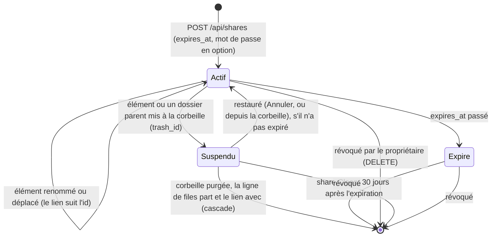
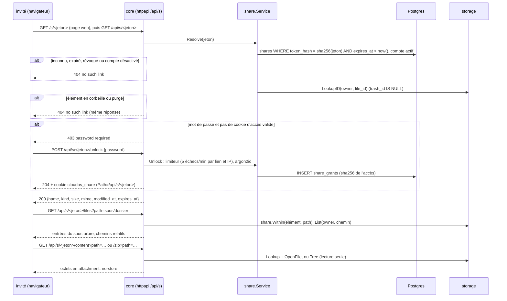

# Partage par lien

Un membre partage un fichier ou un dossier de son espace par un lien. Un invité sans compte ouvre ce lien, voit et télécharge ce qui est partagé, et rien d'autre. Code : `core/internal/share`, les routes de `core/internal/httpapi/shares.go`, et dans le front `web/src/share/`.
Issue : #13.

## Ce qui est garanti

- **Lecture seule :** sous `/api/s/` il n'y a que des `GET`, plus `unlock` qui vérifie un mot de passe. Aucune route d'un invité n'écrit, ne renomme, ne supprime ni ne montre les versions. Rien n'est jamais écrit ni effacé dans le dossier de données : le paquet ne fait que lire `storage`.
- **Le sous-arbre, rien d'autre :** un chemin demandé par l'invité est relatif à l'élément partagé. `share.Within` le passe par `storage.CleanPath` (ni `..`, ni `/` initial, ni `\`) puis le colle au chemin courant de l'élément ; `storage` le revérifie à la lecture. Les chemins renvoyés à l'invité sont relatifs : il ne voit pas où l'élément se trouve dans l'espace du propriétaire.
- **Jeton :** 32 octets aléatoires (256 bits), en base64url (43 caractères). Seul son SHA-256 est stocké : une copie de la base n'ouvre aucun lien, et le lien complet ne s'affiche qu'une fois, à sa création.
- **Une seule réponse pour un lien mort :** inconnu, expiré, révoqué, élément en corbeille ou purgé, compte désactivé : toujours `404 {"error":"no such link"}`.

## Tables

- `shares` : `token_hash` (SHA-256, unique), `owner` (→ `accounts`), `file_id` (→ `files`, `ON DELETE CASCADE`), `password_hash` (argon2id, `NULL` sans mot de passe), `expires_at` (obligatoire, dans le futur, sans maximum), `created_at`. Révoquer supprime la ligne.
- `share_grants` : les accès ouverts par le mot de passe d'un lien. `token_hash` (SHA-256), `share_id` (→ `shares`, `ON DELETE CASCADE`), `expires_at` (24 h, jamais après le lien).
- **Migration 0009 :** sa partie « down » supprime les liens et les accès ; aucun fichier n'est touché.

## Le lien suit l'élément

Le lien pointe sur l'identifiant de la ligne de l'élément dans `files`, pas sur son chemin.

- **Nouveau fichier à l'ancien chemin :** c'est une autre ligne, donc un autre id ; il n'hérite jamais du lien.
- **Dossier partagé :** un fichier qu'on y range devient visible par le lien ; un fichier qu'on en sort ne l'est plus. La liste et le zip lisent le dossier au moment de la requête.
- **Suspendu, expiré ou compte désactivé :** le lien ne donne rien à l'invité, et reste dans la liste du propriétaire avec son état.

## Ouvrir un lien

- **Cookie d'accès :** `cloudos_share`, `HttpOnly`, `SameSite=Strict`, `Secure` en HTTPS (`edge.Secure`, comme le cookie de session). Avec Tailscale Funnel, l'invité ouvre le lien sur `https://<box>:8443`, où seules les routes des liens répondent ; `GET /api/config` donne cette adresse au web, qui y construit les liens ([box.md](box.md), « Accès »). Son `Path` est celui du lien (`/api/s/<jeton>`) : chaque lien a le sien, et l'accès d'un lien n'en ouvre aucun autre.
- **Mot de passe :** de 6 à 256 caractères, haché en argon2id comme ceux des comptes. 5 échecs par minute pour un même lien depuis une même IP, puis 429.
- **Zip :** `archive/zip` de la bibliothèque standard, écrit en flux dans la réponse, en méthode Store (sans compression : photos et vidéos le sont déjà), sans fichier temporaire. Un fichier déplacé ou mis à la corbeille pendant l'écriture est sauté. Les dossiers vides n'y figurent pas.

## Routes

| Route | Accès | Effet |
|---|---|---|
| `POST /api/shares` `{path, expires_at, password?}` | member | Crée un lien vers un élément de son espace ; renvoie `{share, token}`, le seul moment où le jeton est donné |
| `GET /api/shares` | member | Ses liens, les plus récents d'abord : nom, chemin courant, type, mot de passe oui/non, expiration, `expired`, `trashed` |
| `DELETE /api/shares/{id}` | member | Révoque ; 404 pour le lien d'un autre compte |
| `GET /api/s/{token}` | public | Ce que l'invité voit de l'élément |
| `POST /api/s/{token}/unlock` `{password}` | public | Ouvre un accès (cookie) ; 403 si faux, 429 après 5 échecs |
| `GET /api/s/{token}/files?path=` | public | Liste un dossier du sous-arbre |
| `GET /api/s/{token}/content?path=` | public | Télécharge un fichier du sous-arbre (`Range`, `If-None-Match`) ; `path` vide pour un lien vers un fichier |
| `GET /api/s/{token}/zip?path=` | public | Télécharge un dossier du sous-arbre en zip |

- **En-têtes :** les réponses de `/api/s/` et la page `/s/…` portent `Referrer-Policy: no-referrer` (le jeton ne part pas vers un autre site), `X-Robots-Tag: noindex, nofollow` et `Cache-Control: no-store` (un lien révoqué ne sert rien depuis un cache).
- **Téléchargements :** toujours en `attachment`, avec `X-Content-Type-Options: nosniff` et `Content-Security-Policy: sandbox` : un fichier HTML partagé ne s'exécute jamais sur l'origine de la box.
- **Ménage :** `share.Clean` tourne au démarrage du cœur puis toutes les heures. Il supprime les accès expirés et les liens expirés depuis plus de 30 jours, seulement des lignes de base.

## Front

- **Partager :** l'action « Partager » d'une ligne du drive ouvre `ShareDialog` : expiration en 1, 7 (par défaut) ou 30 jours, ou jusqu'à une date (fin de journée, heure locale), et mot de passe en option. Le lien s'affiche ensuite une fois, avec « Copier le lien ».
- **Partages :** la page `/partages` (`SharesPage`) liste les liens, avec l'emplacement actuel de l'élément et son état, et « Révoquer » après confirmation.
- **Page invité :** `/s/<jeton>` (`SharePage`) s'affiche avant toute vérification de session. Elle montre le formulaire du mot de passe si besoin, puis le fichier avec « Télécharger », ou le dossier avec son fil d'Ariane, un lien de téléchargement par fichier et « Tout télécharger (zip) ».
