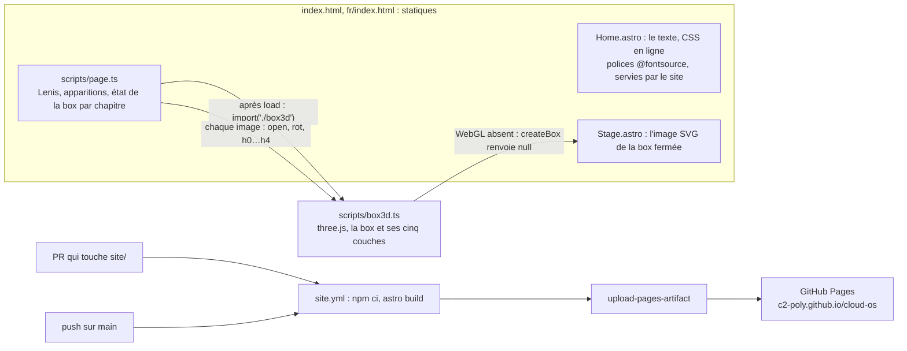

# Le site public

La page qui présente Cloud OS à qui le découvre : <https://c2-poly.github.io/cloud-os/>, en anglais à la racine et en français sous `/fr/`. Code : `site/`. Issue : #113.

Le site est à part de la box : il ne dépend ni du cœur, ni du front, ni de leurs tests, aucune image ne l'embarque, et un changement qui ne touche que `site/` ne change pas `VERSION`. Il reprend la stack du site de Fourchette (Astro et Lenis, publié sur GitHub Pages), sans GSAP (ADR 003).

## Comment la page se charge

Astro rend la page en HTML statique, avec son CSS en ligne. Le texte se lit avant toute 3D, et même sans JavaScript. Le script de la page (`page.ts`, avec Lenis) arrive avec elle. three.js arrive seulement après l'événement `load`, par un `import()` de `box3d.ts`. D'ici là, ou si le navigateur n'a pas WebGL, une image SVG de la box fermée tient sa place.

- **L'état de la box suit le défilement.** Chaque chapitre porte `data-k`, son état dans `KD` de `page.ts` : ouverture, rotation, couche mise en avant, place à l'écran, visible ou non. `KM` corrige la place sur téléphone, où la box est dans un bandeau au-dessus du texte. Entre deux chapitres, `page.ts` mélange les deux états et les lisse à chaque image. `box3d.ts` dessine l'état reçu et place la légende de la couche mise en avant.
- **Mouvement réduit** (`prefers-reduced-motion`) : pas de Lenis, pas d'apparition, pas de requête tapée. La box passe d'une vue fixe à l'autre, et n'est redessinée que quand la vue change.
- **Sans JavaScript** : rien n'est caché. La classe `.motion`, qui décale les apparitions, n'est posée que par le script du `<head>`, et elle est retirée si le script de la page n'a pas démarré au bout de 3 secondes.

## Fichiers

| Fichier | Rôle |
|---|---|
| `site/astro.config.mjs` | `site` et `base` lus dans `SITE_URL` et `SITE_BASE` (`https://c2-poly.github.io`, `/cloud-os` par défaut), i18n anglais et français, CSS en ligne |
| `site/src/layouts/Base.astro` | Les métadonnées (titre, description, `canonical`, `hreflang`, Open Graph), le thème clair ou sombre avant la première image, les polices et l'icône |
| `site/src/components/Header.astro`, `Footer.astro` | Le menu, le sélecteur de langue, le bouton de thème ; le pied de page, avec le lien vers le code et les licences |
| `site/src/components/Stage.astro` | La scène fixe : l'image SVG de la box fermée, le canvas de three.js, la légende |
| `site/src/components/Home.astro` | La page, chapitre par chapitre : la box, Fichiers, Photos, Recherche, Accès, Sauvegarde, l'écran, ce qui arrive, l'installer |
| `site/src/components/Icons.astro` | Les icônes, aux formes de celles du front (Lucide, ISC) |
| `site/src/i18n/en.ts`, `fr.ts`, `index.ts` | Les textes des deux langues, avec les mêmes clés ; les chemins sous la base du site |
| `site/src/scripts/page.ts` | Lenis, les ancres, les apparitions, la requête tapée, l'horloge de la maquette, l'état de la box selon le défilement |
| `site/src/scripts/box3d.ts` | La box en three.js : géométrie, matériaux, environnement, les cinq couches et leurs détails, la caméra, la légende |
| `site/src/styles/site.css` | Le CSS de la page, en ligne dans le HTML |
| `site/public/` | L'icône, l'image Open Graph de chaque langue, `licences.txt` (les licences des polices, de three.js, de Lenis et de Lucide) |
| `.github/workflows/site.yml` | La construction sur chaque PR qui touche `site/`, la publication sur Pages sur un push sur `main` |

## Règles

- **La page ne demande rien à un autre domaine.** Les polices viennent de @fontsource et sont servies par le site, sans CDN et sans mesure d'audience. Le pied de page le dit : « Cette page n'a aucun traceur ».
- **Le poids est mesuré en gzip.** Le premier chargement (la page avec son CSS en ligne, plus le JavaScript chargé avant `load`) pèse au plus 30 Ko, et la 3D au plus 180 Ko. Les polices (woff2, déjà compressées) se comptent à part. Mesure : `gzip -9c <fichier> | wc -c` sur `dist/index.html`, `dist/fr/index.html` et chaque fichier de `dist/_astro/`.
- **Lighthouse sur mobile** donne au moins 90 dans chaque catégorie.
- **Licences** : astro, lenis et three sont sous MIT. Les polices Inter et JetBrains Mono sont sous OFL et servies telles quelles, avec leur licence dans `licences.txt` (ADR 004). sharp, qu'Astro installe pour ses images, apporte libvips sous LGPL. C'est un outil de construction, non modifié et chargé dynamiquement, qui n'entre pas dans le site publié (ADR 002).
- **Une fonction pas encore livrée porte le badge « V1 · en finition »** (« V1 · finishing »), et la page ne promet rien que la box ne fasse. Sur la page anglaise, la liste « Install it » dit que l'interface est en français.
