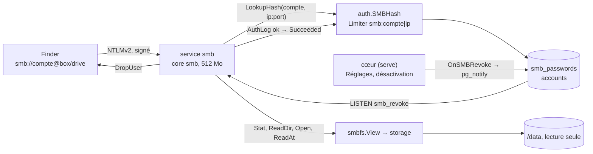
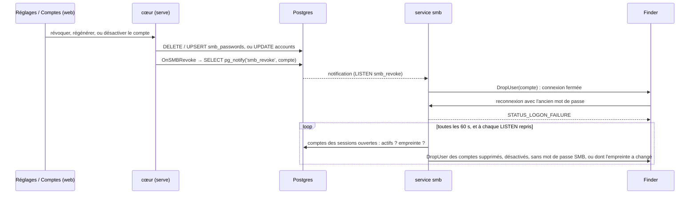

# SMB : le drive en partage réseau, en lecture seule

Le drive de chaque compte, servi en SMB pour le Finder et l'Explorateur. Le code est dans `core/internal/smbfs`, et le service démarre par `core smb` (`core/cmd/core/main.go`). Le protocole est celui de smbsrv, dont nous gardons une copie corrigée dans `core/third_party/smbsrv` (`docs/decisions/006-smb.md`).
Issues : #90 (essai), #91 (mot de passe SMB), #95 (serveur durci et isolé), #92 (écriture), #15 (accès SMB).

## Ce qui est garanti

- **Éteint par défaut.** Le service `smb` est dans le profil Compose `smb`, que seul `CLOUDOS_SMB=1 make up` active. Lancé sans `CLOUDOS_SMB=1`, `core smb` refuse de démarrer.
- **Un processus à part.** Le service `smb` est un second processus du même binaire, dans son propre conteneur :
  - il a sa propre limite de mémoire (`mem_limit: 512m`, `GOMEMLIMIT` à 384 Mio), un seul processeur (`cpus: 1`), une limite de processus (`pids_limit`), et redémarre seul après un plantage (`restart: unless-stopped`) ;
  - le tuer ou le saturer laisse le cœur, l'API et le web répondre ;
  - il n'applique aucune migration, et refuse de démarrer tant qu'une migration manque ;
  - il ne fait ni `CleanTmp`, ni `RecoverMoves`, ni aucun autre nettoyage du cœur, qui peut écrire pendant ce temps.
- **Le mot de passe SMB, jamais celui du compte.** Chaque compte se connecte avec le mot de passe SMB tiré dans Réglages (#91, [auth.md](auth.md)). Le mot de passe du compte n'a pas d'empreinte NT et n'ouvre pas SMB. Ni l'anonyme ni un invité n'entrent.
- **Un compte, un drive.** Le nom SMB est le nom du compte, dans n'importe quelle casse. Il voit un seul partage, `drive`, qui est son espace. Sa clé, `cloudos:<compte>`, sépare les verrous, les modes de partage et les notifications de deux comptes.
- **Essais limités.** 5 échecs par minute pour un compte depuis une adresse (`auth.SMBHash`, clé `smb:<compte>|<ip>`), après quoi même le bon mot de passe est refusé. Une connexion réussie efface le compte de ses échecs. smbsrv retient la réponse d'un échec 2 s.
- **Révoquer coupe.** Un mot de passe révoqué ou régénéré, ou un compte désactivé, ferme les sessions ouvertes, et la reconnexion avec l'ancien mot de passe est refusée (voir « Révocation » plus bas).
- **Réseau privé seulement.** `Backend.Allow` n'accepte que les adresses privées, de boucle locale ou de lien local. Compose publie `127.0.0.1:${CLOUDOS_SMB_PORT:-1445}` vers le port 445 du service : le partage de fichiers de macOS occupe déjà le 445 du Mac. Sous Docker Desktop, le client vu par le service est la passerelle Docker, une adresse privée : `Allow` ne filtre vraiment que sur la box.
- **Lecture seule.** `/data` est monté en lecture seule dans le service, et aucun chemin d'écriture n'existe : smbsrv voit un partage `ReadOnly`, et l'adaptateur refuse toute écriture. #92 écrira à travers `storage`, qui sérialise déjà les écritures d'un compte par un verrou Postgres (`pg_advisory_lock`). Deux processus restent donc sûrs.

```bash
CLOUDOS_SMB=1 make up
```

Puis Finder › Se connecter au serveur › `smb://<compte>@localhost:1445/drive`, avec le mot de passe SMB de Réglages, ou `mount_smbfs //<compte>@localhost:1445/drive <dossier>`.

## Connexion et requêtes



`backend.go` branche smbsrv sur le cœur :
- **`LookupHash(nom, ip:port)`** appelle `auth.SMBHash(nom, ip)`. Il rend l'empreinte NT et garde l'identifiant sous l'adresse `ip:port` de la connexion jusqu'au verdict. Un compte inconnu, désactivé ou sans mot de passe SMB, une limite atteinte, ou une empreinte nulle répondent `ok=false`. smbsrv refuse aussi toute empreinte qui n'a pas 16 octets (`PATCHES.md`, 6).
- **`AuthLog(ok)`** retrouve cet identifiant par la même adresse. Si la réponse NTLMv2 était juste, il appelle `SMBCredential.Succeeded`, qui efface les échecs et note `last_used_at`, puis retient l'empreinte avec laquelle la session s'est ouverte.
- **`Login(compte)`** rend le partage `drive` du compte, lu par `smbfs.View`.

| Requête SMB | Ce que fait le service |
|---|---|
| Ouvrir un dossier (QUERY_DIRECTORY) | `View.List` → `Store.List` |
| Ouvrir un fichier (CREATE en lecture, READ) | `View.Open` → `Store.Lookup` puis `Store.OpenFile`, lu par `ReadAt` (un décalage négatif est refusé) |
| Informations (QUERY_INFO) | `View.Stat` ; la racine est un dossier synthétique ; l'identifiant de fichier est l'`id` de la ligne d'index |
| Taille du volume | `diskUsage` : `statfs` du disque de `Store.Root` |
| Créer, écrire, tronquer, renommer, supprimer, changer dates ou attributs | `ErrReadOnly`, qui enveloppe `os.ErrPermission` : smbsrv répond STATUS_ACCESS_DENIED |

smbsrv vérifie `ReadOnly` et `CanWrite` avant toute écriture. L'adaptateur refuse aussi de son côté :
- `Open` refuse toute ouverture en écriture (`O_WRONLY`, `O_RDWR`, `O_CREATE`, `O_TRUNC`, `O_APPEND`) ;
- `Mkdir`, `Remove`, `Rename`, `SetModTime`, `WriteAt` et `Truncate` renvoient tous `ErrReadOnly`.

## Révocation

Le cœur change les mots de passe et désactive les comptes, mais c'est le service `smb` qui tient les sessions. Postgres fait le lien (`revoke.go`) :



- **Le NOTIFY.** `smbfs.NotifyRevoke` est le `OnSMBRevoke` du cœur. Il envoie le nom du compte sur le canal `smb_revoke`. Le service `smb` garde une connexion Postgres à part en `LISTEN`, et appelle `DropUser` pour chaque nom reçu. `DropUser` ferme toutes les connexions où ce compte a une session.
- **Le balayage.** Une notification se perd si le service `smb` est arrêté ou si sa connexion tombe. Toutes les 60 s, et chaque fois que le `LISTEN` reprend, `Sweep` compare donc chaque session ouverte à la base, et ferme celles d'un compte :
  - supprimé ou désactivé ;
  - sans mot de passe SMB ;
  - dont l'empreinte n'est plus celle avec laquelle la session s'est ouverte.

  Ce dernier cas couvre aussi un mot de passe changé pendant qu'une connexion était en cours d'ouverture.
- **Un NOTIFY qui échoue** est écrit dans le journal du cœur. La révocation reste enregistrée en base, et le balayage suivant coupe les sessions.

## Le serveur durci

La copie de smbsrv dans `core/third_party/smbsrv` corrige les cinq défauts de l'ADR 006. Chaque correction a un test qui échoue sur la version d'origine. Le détail, avec le pourquoi, est dans `core/third_party/smbsrv/PATCHES.md`.

1. **U+F029 et ses voisins** de la zone privée sont convertis avant le contrôle de `.` et `..`. Ils ne peuvent plus écrire `..` ni un séparateur.
2. **Un bind RPC sur IPC$** avec un `max_recv_frag` trop petit le voit porté à 1432 octets, et la réponse ne boucle plus.
3. **Les motifs de recherche** (`*`, `?`, `<`, `>`, `"`) se comparent en temps linéaire. Un motif de plus de 255 caractères est refusé.
4. **La mémoire qu'un client peut faire tenir est bornée** :
   - une requête passée en STATUS_PENDING garde sa place parmi les 32 requêtes en cours ;
   - un READ n'alloue que ce que le fichier peut rendre ;
   - par connexion, 32 Mio de trames en cours et 32 Mio de données lues mais pas encore écrites ;
   - les READ d'une même requête composée rendent au plus 8 Mio, pour tenir dans une trame ;
   - au plus 1024 requêtes en attente d'un changement ou d'un verrou.
5. **Un `recover`** dans chaque goroutine du serveur. Une panique ferme la seule connexion fautive, avec sa pile dans le journal.

S'y ajoute un écart d'interface : `Backend.LookupHash(nom, ip:port)` reçoit l'adresse du client, et une empreinte qui n'a pas 16 octets n'ouvre aucune session.

`cmd/` et `wsd/` (WS-Discovery, LLMNR) ne sont pas copiés : rien n'annonce le serveur sur le réseau. `make test` lance les tests de la copie avec `-race`, et `make lint` les vérifie. `core/internal/guard` contrôle aussi son code : seule `setEndOfFile` y peut tronquer, et elle passe par `File.Truncate` de l'adaptateur, qui refuse. Le `localfs` de smbsrv, qui efface des fichiers, n'est lié nulle part : le garde échoue si un fichier l'importe.

## Chemins

Avant d'atteindre `storage`, chaque nom passe par `smbfs.Clean`, en plus du contrôle de smbsrv :
- `\` devient `/`, les barres en tête et en fin sont ôtées, et un nom vide désigne la racine ;
- un `:` est refusé, car il signale un flux nommé (`a.txt:Zone.Identifier`) ou une lettre de lecteur ;
- `storage.CleanPath` normalise ensuite en NFC et refuse les chemins absolus, les segments vides, `.` et `..`, les caractères de contrôle (dont NUL), et les noms de plus de 255 octets.

Un refus se présente comme un fichier absent (`os.ErrNotExist`). `TestServer/paths` envoie `..\bob\secret.txt`, `/etc/passwd`, `C:\Windows` et les noms en U+F029.

## Fichiers du Finder

Le Finder voit le volume en lecture seule. `.DS_Store`, `._*` et les étiquettes échouent donc côté Mac (EROFS), sans même arriver au service. Aucune étiquette ni FinderInfo n'est renvoyée. Coup d'œil fonctionne, car il ne fait que lire. Quand l'écriture arrivera (#92), ces fichiers suivront la règle de WebDAV : rangés à part par `davfs.AppleDouble` ([webdav.md](webdav.md)).

## Coupure et reconnexion

Si le service `smb` tombe ou redémarre, macOS rouvre la session tout seul dès qu'il répond de nouveau. Le cœur et le web ne sont pas touchés. Le service s'arrête avec son contexte (`srv.Close`).

## Tests

- **`core/third_party/smbsrv`** :
  - les tests et cibles de fuzz d'origine passent avec `-race` ;
  - un test de régression par correction (`patch_*_test.go`, `internal/rpc/patch_test.go`), dont un partage qui panique : seule sa connexion tombe.
- **`core/internal/smbfs/smbfs_test.go`**, avec le client `go-smb2` (BSD-2, utilisé seulement par les tests) :
  - `TestClean` : les chemins acceptés et refusés.
  - `TestServer` :
    - la connexion avec le mot de passe SMB tiré par `auth.NewSMBPassword`, et `last_used_at` noté ;
    - les refus : un mauvais mot de passe, le mot de passe du compte, le mot de passe d'un autre, un compte inconnu, l'anonyme ;
    - chaque compte ne voit que son drive ;
    - la lecture (SHA-256 de chaque fichier) et les chemins hostiles ;
    - 17 écritures, toutes refusées, avec le disque, `files`, `moves` et la corbeille inchangés ;
    - un compte désactivé : sa session se ferme et la reconnexion est refusée.
  - `TestLoginAttemptsAreLimited` : après 5 échecs, même le bon mot de passe est refusé, et un autre compte n'est pas retenu.
  - `TestRevokeByNotify` : après `RevokeSMBPassword` ou un nouveau tirage, une requête sur la session ouverte échoue et l'ancien mot de passe est refusé.
  - `TestRevokeBySweep` : sans notification, le balayage ferme les sessions d'un mot de passe révoqué ou changé, et celles d'un compte désactivé dès que le `LISTEN` reprend.
- **`core/cmd/core/main_test.go`** : `core smb` refuse de démarrer sans `CLOUDOS_SMB=1`.
