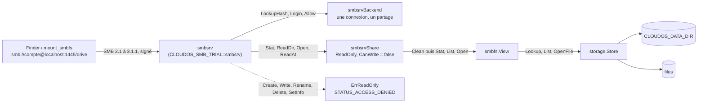

# SMB : le drive en partage réseau, en lecture seule (essai)

Le drive d'un compte servi en SMB, pour le Finder et l'Explorateur : `core/internal/smbfs`, démarré par `startSMBTrial` dans `core/cmd/core/main.go`. Le protocole est celui de `github.com/tobychui/smbsrv` (`docs/decisions/006-smb.md`).
Issues : #90 (essai en lecture seule), #15 (accès SMB), #91 (mot de passe SMB), #92 (écriture).

## État : un essai, éteint par défaut

- **Rien n'écoute** sans `CLOUDOS_SMB_TRIAL=smbsrv`. Toute autre valeur empêche le cœur de démarrer.
- **Une seule connexion** : le compte nommé par `CLOUDOS_SMB_TRIAL_USER`, qui doit exister et être actif. Le mot de passe est celui de `CLOUDOS_SMB_TRIAL_PASSWORD`, pas le mot de passe du compte, qui n'est gardé qu'en argon2id alors que NTLM a besoin de l'empreinte NT. Ce sont des identifiants de développement. Le mot de passe SMB de chaque compte (#91, `auth.SMBHash`) remplacera ce couple dans #92.
- **Un partage**, `drive`, qui montre l'espace du compte.
- **Lecture seule** : aucun chemin d'écriture n'existe.
- **Réseau** : le cœur écoute sur `CLOUDOS_SMB_ADDR` (`:445` par défaut). Compose publie `127.0.0.1:${CLOUDOS_SMB_PORT:-1445}` vers ce port, car le partage de fichiers de macOS occupe déjà le 445 du Mac. `Backend.Allow` n'accepte que les adresses privées, de boucle locale ou de lien local.

```bash
CLOUDOS_SMB_TRIAL=smbsrv CLOUDOS_SMB_TRIAL_USER=<compte> CLOUDOS_SMB_TRIAL_PASSWORD=<mot de passe de test> make up
```

Puis Finder › Se connecter au serveur › `smb://<compte>@localhost:1445/drive`, ou `mount_smbfs //<compte>@localhost:1445/drive <dossier>`.

## Chemin d'une requête



| Requête SMB | Ce que fait le cœur |
|---|---|
| Ouvrir un dossier (QUERY_DIRECTORY) | `View.List` → `Store.List` |
| Ouvrir un fichier (CREATE en lecture, READ) | `View.Open` → `Store.Lookup` puis `Store.OpenFile`, lu par `ReadAt` |
| Informations (QUERY_INFO) | `View.Stat` ; la racine est un dossier synthétique ; l'identifiant de fichier est l'`id` de la ligne d'index |
| Taille du volume | `diskUsage` : `statfs` du disque de `Store.Root` |
| Créer, écrire, tronquer, renommer, supprimer, changer dates ou attributs | `ErrReadOnly`, qui enveloppe `os.ErrPermission` : smbsrv répond STATUS_ACCESS_DENIED |

smbsrv vérifie `ReadOnly` et `CanWrite` avant toute écriture. L'adaptateur refuse aussi de son côté : `Open` refuse toute ouverture en écriture (`O_WRONLY`, `O_RDWR`, `O_CREATE`, `O_TRUNC`, `O_APPEND`), et `Mkdir`, `Remove`, `Rename`, `SetModTime`, `WriteAt` et `Truncate` renvoient tous `ErrReadOnly`.

## Chemins

Avant d'atteindre `storage`, chaque nom passe par `smbfs.Clean` :
- `\` devient `/`, les barres en tête et en fin sont ôtées, et un nom vide désigne la racine ;
- un `:` est refusé, car il signale un flux nommé (`a.txt:Zone.Identifier`) ou une lettre de lecteur ;
- `storage.CleanPath` normalise ensuite en NFC et refuse les chemins absolus, les segments vides, `.` et `..`, les caractères de contrôle, dont NUL, et les noms de plus de 255 octets.

Un refus se présente comme un fichier absent (`os.ErrNotExist`).

Ce contrôle ne dépend pas de celui de smbsrv, qui laisse passer U+F029 : le point de la zone privée du Mac, changé en « . » après son propre contrôle de `..` (`docs/decisions/006-smb.md`, point 1). `TestServer/paths` envoie ces noms, ainsi que `..\bob\secret.txt`, `/etc/passwd` et `C:\Windows`.

## Fichiers du Finder

Le Finder voit le volume en lecture seule. `.DS_Store`, `._*` et les étiquettes échouent donc côté Mac (EROFS) sans même arriver au cœur. Aucune étiquette ni FinderInfo n'est renvoyée. Coup d'œil fonctionne, car il ne fait que lire. Quand l'écriture arrivera (#92), ces fichiers suivront la règle de WebDAV : rangés à part par `davfs.AppleDouble` (`webdav.md`).

## Coupure et reconnexion

Après un redémarrage du cœur, macOS rouvre la session tout seul : le volume répond de nouveau en 1 s environ. Une lecture en cours reprend grâce à la poignée durable de smbsrv et se termine avec le bon contenu. Le serveur s'arrête avec le contexte du cœur (`srv.Close`).

## Tests

`core/internal/smbfs/smbfs_test.go` :
- `TestClean` : les chemins acceptés, et les chemins refusés (`..`, `\`, absolus, flux nommés, NUL, UTF-8 invalide, noms trop longs).
- `TestServer` sert un compte avec smbsrv et s'y connecte avec le client `go-smb2` (BSD-2, utilisé seulement par les tests). Il vérifie :
  - la connexion : mauvais mot de passe, compte inconnu et anonyme refusés ;
  - la lecture : listage, SHA-256 de chaque fichier ;
  - les chemins hostiles, dont l'accès à l'espace d'un autre compte ;
  - 17 écritures, toutes refusées, avec le disque, la table `files`, `moves` et la corbeille inchangés.
