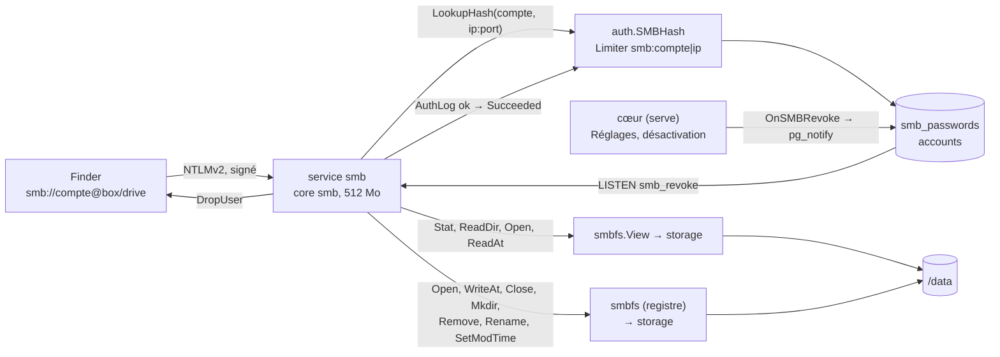
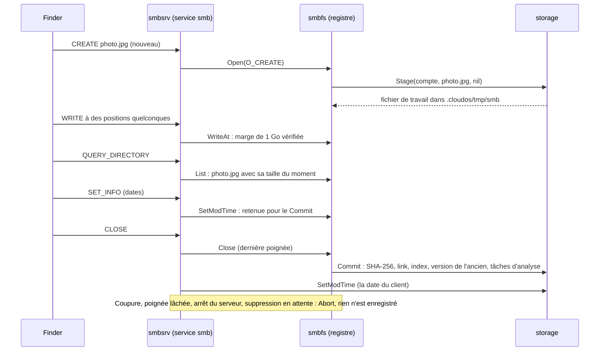
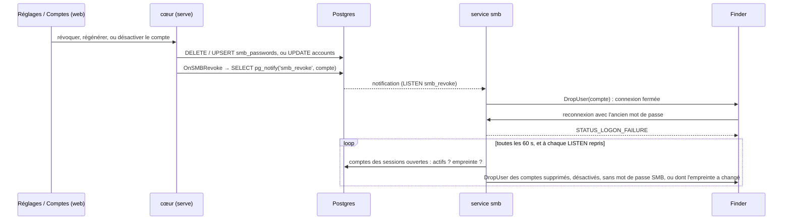
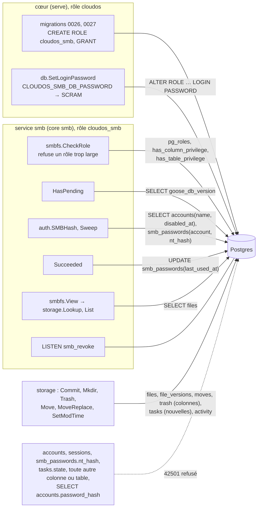

# SMB : le drive en partage réseau

Le drive de chaque compte, servi en SMB pour le Finder et l'Explorateur. Le code est dans `core/internal/smbfs`, et le service démarre par `core smb` (`core/cmd/core/main.go`). Le protocole est celui de smbsrv, dont nous gardons une copie corrigée dans `core/third_party/smbsrv` (`docs/decisions/006-smb.md`).
Issues : #90 (essai), #91 (mot de passe SMB), #95 (serveur durci et isolé), #97 (rôle en base), #92 (écriture), #15 (accès SMB).

## Ce qui est garanti

- **Éteint par défaut.** Le service `smb` est dans le profil Compose `smb`, que seul `CLOUDOS_SMB=1 make up` active. Lancé sans `CLOUDOS_SMB=1`, `core smb` refuse de démarrer.
- **Un processus à part.** Le service `smb` est un second processus du même binaire, dans son propre conteneur :
  - il a sa propre limite de mémoire (`mem_limit: 512m`, `GOMEMLIMIT` à 384 Mio), un seul processeur (`cpus: 1`), une limite de processus (`pids_limit`), et redémarre seul après un plantage (`restart: unless-stopped`) ;
  - le tuer ou le saturer laisse le cœur, l'API et le web répondre ;
  - il n'applique aucune migration, et refuse de démarrer tant qu'une migration manque ;
  - il ne fait ni `CleanTmp`, ni `RecoverMoves`, ni aucun autre nettoyage du cœur, qui peut écrire pendant ce temps.
- **Un rôle en base à lui.** Le service se connecte en `cloudos_smb`, qui lit ce dont SMB a besoin, note `last_used_at`, et n'écrit que les colonnes dont `storage` a besoin pour les écritures SMB. Il ne lit pas les empreintes des mots de passe des comptes, et n'écrit ni les comptes, ni les sessions, ni les mots de passe SMB au-delà de `last_used_at`. Lancé avec un rôle plus large, `core smb` refuse de démarrer (voir « Rôle en base » plus bas).
- **Le mot de passe SMB, jamais celui du compte.** Chaque compte se connecte avec le mot de passe SMB tiré dans Réglages (#91, [auth.md](auth.md)). Le mot de passe du compte n'a pas d'empreinte NT et n'ouvre pas SMB. Ni l'anonyme ni un invité n'entrent.
- **Un compte, un drive.** Le nom SMB est le nom du compte, dans n'importe quelle casse. Il voit un seul partage, `drive`, qui est son espace. Sa clé, `cloudos:<compte>`, sépare les verrous, les modes de partage et les notifications de deux comptes.
- **Essais limités.** 5 échecs par minute pour un compte depuis une adresse (`auth.SMBHash`, clé `smb:<compte>|<ip>`), après quoi même le bon mot de passe est refusé. Une connexion réussie efface le compte de ses échecs. smbsrv retient la réponse d'un échec 2 s.
- **Révoquer coupe.** Un mot de passe révoqué ou régénéré, ou un compte désactivé, ferme les sessions ouvertes, et la reconnexion avec l'ancien mot de passe est refusée (voir « Révocation » plus bas).
- **Réseau privé seulement.** `Backend.Allow` n'accepte que les adresses privées, de boucle locale ou de lien local. Compose publie `127.0.0.1:${CLOUDOS_SMB_PORT:-1445}` vers le port 445 du service : le partage de fichiers de macOS occupe déjà le 445 du Mac. Sous Docker Desktop, le client vu par le service est la passerelle Docker, une adresse privée : `Allow` ne filtre vraiment que sur la box.
- **Écrire sans risque de perte (#92).** Tout passe par `storage`, comme en WebDAV : un fichier écrit est vérifié par son SHA-256 puis lié à sa place, un contenu remplacé devient une version, une suppression va à la corbeille, un renommage est journalisé dans `moves`. L'adaptateur ne touche jamais `/data` lui-même. Un fichier ouvert en écriture se remplit dans un fichier de travail, enregistré seulement au CLOSE du client : une coupure laisse l'original intact et ne crée rien (voir « Écriture » plus bas).
- **Deux processus qui écrivent.** Le cœur et le service `smb` écrivent tous deux par `storage`, qui sérialise les écritures d'un compte par son verrou Postgres (`pg_advisory_lock`). `RecoverMoves`, au démarrage du cœur, prend ce verrou pour chaque entrée du journal : il ne reprend jamais une opération que le service `smb` est en train de faire. Les fichiers de travail de SMB (`.cloudos/tmp/smb`) n'appartiennent qu'au service `smb`, qui les vide à son démarrage ; `CleanTmp` du cœur les laisse.

```bash
CLOUDOS_SMB=1 make up
```

Puis Finder › Se connecter au serveur › `smb://<compte>@localhost:1445/drive`, avec le mot de passe SMB de Réglages, ou `mount_smbfs //<compte>@localhost:1445/drive <dossier>`.

## Connexion et requêtes



`backend.go` branche smbsrv sur le cœur :
- **`LookupHash(nom, ip:port)`** appelle `auth.SMBHash(nom, ip)`. Il rend l'empreinte NT et garde l'identifiant sous l'adresse `ip:port` de la connexion jusqu'au verdict. Un compte inconnu, désactivé ou sans mot de passe SMB, une limite atteinte, ou une empreinte nulle répondent `ok=false`. smbsrv refuse aussi toute empreinte qui n'a pas 16 octets (`PATCHES.md`, 6).
- **`AuthLog(ok)`** retrouve cet identifiant par la même adresse. Si la réponse NTLMv2 était juste, il appelle `SMBCredential.Succeeded`, qui efface les échecs et note `last_used_at`, puis retient l'empreinte avec laquelle la session s'est ouverte.
- **`Login(compte)`** rend le partage `drive` du compte, lu par `smbfs.View`.

| Requête SMB | Ce que fait le service |
|---|---|
| Ouvrir un dossier (QUERY_DIRECTORY) | `View.List` → `Store.List` |
| Ouvrir un fichier (CREATE en lecture, READ) | `View.Open` → `Store.Lookup` puis `Store.OpenFile`, lu par `ReadAt` (un décalage négatif est refusé) |
| Informations (QUERY_INFO) | `View.Stat` ; la racine est un dossier synthétique ; l'identifiant de fichier est l'`id` de la ligne d'index |
| Taille du volume | `diskUsage` : `statfs` du disque de `Store.Root` |
| Créer ou ouvrir en écriture (CREATE), écrire, tronquer | le registre des fichiers en cours (`write.go`) → `Store.Stage`, puis `Staged.Commit` au CLOSE |
| Créer un dossier | `Store.Mkdir`, ses parents avec lui |
| Supprimer (disposition, ou suppression à la fermeture) | `Store.Trash`, fichier ou dossier |
| Renommer (SET_INFO FileRenameInformation) | `Store.Move`, ou `Store.MoveReplace` si le client demande d'écraser |
| Changer les dates (SET_INFO FileBasicInformation) | `Store.SetModTime` ; sur un fichier en cours, la date de son `Commit` |
| `.DS_Store`, `._*`, `.TemporaryItems` | `davfs.AppleDouble`, à part, hors de l'index |
| Flux nommé (`a.txt:Zone.Identifier`) | refusé : le partage n'est pas un `StreamShare`, le Mac se replie sur les `._*` |

## Écriture



- **Le registre** (`write.go`) tient les fichiers en cours d'écriture de tous les comptes, par compte et par chemin (sans tenir compte de la casse, comme smbsrv et `storage`).
  - Toutes les poignées en écriture d'un même chemin, de n'importe quelle connexion du compte, partagent un seul `storage.Staged`. Une ouverture en lecture d'un fichier en cours lit ce fichier de travail ; sinon elle lit le fichier stocké.
  - `Stat` et `List` montrent un fichier en cours avec sa taille du moment, même neuf. La poignée implémente `PendingFile` de smbsrv pour sa propre taille.
  - Le fichier est enregistré par `Commit` quand sa dernière poignée se ferme. Un fichier existant est d'abord lu sur place, et recopié dans le fichier de travail seulement à la première écriture (copie paresseuse) : une ouverture en écriture sans rien écrire n'enregistre rien.
  - Un fichier neuf renommé avant sa fermeture ne change que le registre. Un fichier stocké qu'on renomme pendant qu'il est ouvert est déplacé dans `storage`, et son fichier de travail suit.
- **CLOSE contre coupure.** smbsrv appelle `Close` de la poignée pour un CLOSE du client, et `Abort` pour toute autre fin : connexion coupée, déconnexion, arrêt du serveur, CREATE échoué, ou fichier en attente de suppression (correctif 7, `core/third_party/smbsrv/PATCHES.md`). Le registre marque le fichier :
  - une poignée qui a écrit puis s'est terminée par `Abort` ;
  - ou une écriture qui a échoué (disque plein) ;

  et le fichier n'est alors pas enregistré, même si une autre poignée se ferme par un CLOSE. Ce CLOSE reçoit une erreur : le client sait que son fichier n'est pas là. Ni moitié de fichier, ni original remplacé.
- **Disque plein.** `HaveSpace` laisse le contrôle aux poignées : smbsrv refuserait de lui-même, et le fichier ne saurait pas qu'un morceau lui manque. `WriteAt` et `Truncate` gardent 1 Go libre sur le disque, en comptant la copie qu'une première écriture fait d'un fichier existant. Au-delà, la réponse est STATUS_DISK_FULL et le fichier n'est pas enregistré.
- **Le dernier arrivé gagne.** Si le fichier a été remplacé entre-temps (web, WebDAV), `Commit` le remplace à son tour : l'autre contenu reste en version.
- **Renommer par-dessus un fichier.** smbsrv vérifie que le client demande d'écraser, que la cible n'est pas ouverte et n'est pas un dossier, puis appelle `Rename` : c'est `Store.MoveReplace`, une seule entrée du journal. La cible garde son identité et son contenu d'avant devient une version ([storage.md](storage.md)).
- **Supprimer.** smbsrv supprime à la fermeture de la dernière poignée (disposition ou `DELETE_ON_CLOSE`), et refuse un dossier qui n'est pas vide : le Mac supprime donc un dossier en commençant par son contenu, et chaque élément part à la corbeille.
- **L'enregistrement atomique des apps du Mac.** TextEdit et Pages renomment l'original, écrivent le nouveau, puis suppriment l'ancien : l'ancien contenu va donc à la corbeille, pas en version. Rien n'est perdu.

## Révocation

Le cœur change les mots de passe et désactive les comptes, mais c'est le service `smb` qui tient les sessions. Postgres fait le lien (`revoke.go`) :



- **Le NOTIFY.** `smbfs.NotifyRevoke` est le `OnSMBRevoke` du cœur. Il envoie le nom du compte sur le canal `smb_revoke`. Le service `smb` garde une connexion Postgres à part en `LISTEN`, et appelle `DropUser` pour chaque nom reçu. `DropUser` ferme toutes les connexions où ce compte a une session.
- **Le balayage.** Une notification se perd si le service `smb` est arrêté ou si sa connexion tombe. Toutes les 60 s, et chaque fois que le `LISTEN` reprend, `Sweep` compare donc chaque session ouverte à la base, et ferme celles d'un compte :
  - supprimé ou désactivé ;
  - sans mot de passe SMB ;
  - dont l'empreinte n'est plus celle avec laquelle la session s'est ouverte.

  Ce dernier cas couvre aussi un mot de passe changé pendant qu'une connexion était en cours d'ouverture.
- **Un NOTIFY qui échoue** est écrit dans le journal du cœur. La révocation reste enregistrée en base, et le balayage suivant coupe les sessions.

## Rôle en base

Le service `smb` ne se connecte pas avec le rôle du cœur (`cloudos`), mais avec le sien, `cloudos_smb`. La migration `0026_smb_role.sql` le crée et lui donne ses droits de lecture, `0027_smb_write.sql` ceux des écritures de `storage` :

| Droit | Pour |
|---|---|
| `SELECT (name, disabled_at)` sur `accounts` | `auth.SMBHash` et `Sweep` : le compte existe-t-il, est-il actif |
| `SELECT (account, nt_hash)` sur `smb_passwords` | `auth.SMBHash` et `Sweep` : l'empreinte NT |
| `UPDATE (last_used_at)` sur `smb_passwords` | `SMBCredential.Succeeded` |
| `SELECT` sur `files` | `smbfs.View`, par `storage.Lookup` et `storage.List` |
| `SELECT` sur `goose_db_version` | `migrate.HasPending` |
| aucun | `LISTEN smb_revoke` |
| `INSERT (owner, path, kind, size, mime, sha256, modified_at)`, `UPDATE (path, size, mime, sha256, modified_at, indexed_at, trash_id)` et `DELETE` sur `files` | `Commit` et `Mkdir` (lignes neuves et dossiers parents), un remplacement et `SetModTime` (contenu, date), `Move` (chemin), `Trash` (marque de corbeille) ; `DELETE` est celui de `MoveReplace`, dont la source disparaît |
| `SELECT`, `INSERT (file_id, owner, size, mime, sha256, modified_at)`, `DELETE` sur `file_versions` | un contenu remplacé gardé ; la rétention du fichier remplacé, et l'annulation d'un remplacement échoué |
| `SELECT`, `INSERT (owner, from_path, to_path, op, trash_id, version_id)`, `DELETE` sur `moves` | le journal : l'intention avant le disque, effacée une fois indexée |
| `SELECT`, `INSERT (owner, path, kind, size, expires_at)`, `DELETE` sur `trash` | `Trash`, et son annulation si le disque refuse |
| `SELECT (id, dedupe_key, state)`, `INSERT (kind, payload, priority, max_attempts, dedupe_key)` sur `tasks` | les tâches d'analyse d'un nouveau contenu (`ON CONFLICT` lit les colonnes de l'index de déduplication) |
| `SELECT` de `sha256` (et `size`, `name`, `version`) sur `thumbnails`, `media_meta`, `document_text`, `embedding_models`, `photo_vectors_siglip2_b16_224` | savoir si un contenu a déjà sa miniature, ses métadonnées, son texte, son vecteur |
| `INSERT (owner, kind, path)` sur `activity` | le journal d'activité : « ajouté », « remplacé », « mis à la corbeille » |



- **Le rôle.** Il est `NOLOGIN` à sa création, `NOINHERIT`, sans aucun attribut, et limité à 8 connexions. Un rôle vaut pour tout le serveur Postgres : la migration ne le crée que s'il n'existe pas. Sa migration inverse retire les droits de cette base, et ne supprime le rôle que si aucune autre base du serveur ne lui en donne (les bases jetables des tests).
- **Son mot de passe.** Une migration ne lit pas l'environnement. C'est donc `serve` qui le pose, à chaque démarrage et avant d'écouter, depuis `CLOUDOS_SMB_DB_PASSWORD` (`db.SetLoginPassword`).
  - Le cœur calcule lui-même le vérificateur SCRAM-SHA-256 et n'envoie que lui (`ALTER ROLE … LOGIN PASSWORD 'SCRAM-SHA-256$…'`) : le mot de passe n'atteint ni Postgres ni son journal.
  - Seuls les caractères ASCII imprimables sont acceptés, pour que SASLprep ne fasse pas diverger le client et le serveur. `openssl rand -hex 32` en donne un.
  - Vide, le rôle repasse en `NOLOGIN`. Un échec est écrit dans le journal du cœur, qui continue sans SMB.
- **Le câblage Compose.** Le service `smb` reçoit `DATABASE_URL: postgres://cloudos_smb@db:5432/cloudos` et le mot de passe à part, dans `PGPASSWORD`, qui n'a ainsi rien à échapper. Le cœur reçoit `CLOUDOS_SMB_DB_PASSWORD`. Les deux viennent de `x-smb-db-password`, qui vaut `cloudos-smb` par défaut, pour la base locale seulement, comme `cloudos`/`cloudos`.
- **Le contrôle au démarrage.** `core smb` appelle `smbfs.CheckRole` avant tout. Il refuse de servir si son rôle :
  - est superutilisateur, ou a `CREATEROLE`, `CREATEDB` ou `BYPASSRLS` ;
  - peut insérer ou modifier une colonne hors de la liste fermée `writeGrants` (`role.go`), qui reprend exactement les droits de 0026 et 0027 ;
  - peut supprimer des lignes ailleurs que dans `files`, `file_versions`, `moves` et `trash`, vider une table (`TRUNCATE`), ou modifier une séquence ;
  - peut lire `accounts.password_hash`.

  Le contrôle se fait colonne par colonne (`has_column_privilege`) : un droit sur toute la table se voit sur chacune de ses colonnes. Un câblage qui redonnerait au service le rôle du cœur l'empêche donc de démarrer, comme un droit de plus donné par erreur.
- **Les tables à venir** n'ont aucun droit par défaut. Une migration qui donne plus au service le dit, et élargit `writeGrants` du même droit, pas plus.
- **La limite.** Ce rôle borne une faille qui passe par la connexion du service. En développement, le mot de passe du rôle `cloudos` est connu (`compose.yaml`), et le service `smb` est sur le même réseau que `db` : un processus SMB compromis pourrait s'y connecter. Sur la box, les deux mots de passe devront venir d'un secret.

## Le serveur durci

La copie de smbsrv dans `core/third_party/smbsrv` corrige les cinq défauts de l'ADR 006, et ajoute ce dont l'écriture a besoin (7). Chaque correction a un test qui échoue sur la version d'origine. Le détail, avec le pourquoi, est dans `core/third_party/smbsrv/PATCHES.md`.

1. **U+F029 et ses voisins** de la zone privée sont convertis avant le contrôle de `.` et `..`. Ils ne peuvent plus écrire `..` ni un séparateur.
2. **Un bind RPC sur IPC$** avec un `max_recv_frag` trop petit le voit porté à 1432 octets, et la réponse ne boucle plus.
3. **Les motifs de recherche** (`*`, `?`, `<`, `>`, `"`) se comparent en temps linéaire. Un motif de plus de 255 caractères est refusé.
4. **La mémoire qu'un client peut faire tenir est bornée** :
   - une requête passée en STATUS_PENDING garde sa place parmi les 32 requêtes en cours ;
   - un READ n'alloue que ce que le fichier peut rendre ;
   - par connexion, 32 Mio de trames en cours et 32 Mio de données lues mais pas encore écrites ;
   - les READ d'une même requête composée rendent au plus 8 Mio, pour tenir dans une trame ;
   - au plus 1024 requêtes en attente d'un changement ou d'un verrou.
5. **Un `recover`** dans chaque goroutine du serveur. Une panique ferme la seule connexion fautive, avec sa pile dans le journal.

S'y ajoutent deux écarts d'interface :
- `Backend.LookupHash(nom, ip:port)` reçoit l'adresse du client, et une empreinte qui n'a pas 16 octets n'ouvre aucune session (6) ;
- un `File` peut être un `Aborter` : seul un CLOSE du client appelle `Close`, et toute autre fin appelle `Abort` (7).

`cmd/` et `wsd/` (WS-Discovery, LLMNR) ne sont pas copiés : rien n'annonce le serveur sur le réseau. `make test` lance les tests de la copie avec `-race`, et `make lint` les vérifie. `core/internal/guard` contrôle aussi son code : seule `setEndOfFile` y peut tronquer, et elle passe par `File.Truncate` de l'adaptateur, qui ne coupe qu'un fichier de travail ou un fichier du Finder. Le `localfs` de smbsrv, qui efface des fichiers, n'est lié nulle part : le garde échoue si un fichier l'importe.

## Chemins

Avant d'atteindre `storage`, chaque nom passe par `smbfs.Clean`, en plus du contrôle de smbsrv :
- `\` devient `/`, les barres en tête et en fin sont ôtées, et un nom vide désigne la racine ;
- un `:` est refusé, car il signale un flux nommé (`a.txt:Zone.Identifier`) ou une lettre de lecteur ;
- `storage.CleanPath` normalise ensuite en NFC et refuse les chemins absolus, les segments vides, `.` et `..`, les caractères de contrôle (dont NUL), et les noms de plus de 255 octets.

Un refus se présente comme un fichier absent (`os.ErrNotExist`). `TestServer/paths` envoie `..\bob\secret.txt`, `/etc/passwd`, `C:\Windows` et les noms en U+F029.

## Fichiers du Finder

`.DS_Store`, `._*` et ce qui est sous `.TemporaryItems` suivent la règle de WebDAV : rangés à part par `davfs.AppleDouble` sous `.cloudos/appledouble/<compte>/<chemin>` ([webdav.md](webdav.md)). Ils ne sont ni indexés, ni mis à la corbeille, ni listés, et sont effacés quand le Finder les supprime. Il leur faut un accès aléatoire : `AppleDouble.Open` rend un `*os.File`, et la marge de 1 Go vaut pour eux aussi.

- **Les flux nommés restent refusés** : le partage n'est pas un `StreamShare`, et smbsrv n'annonce pas `FILE_NAMED_STREAMS`. Le Mac range donc étiquettes et ressources dans les `._*`.
- **Un fichier du Finder renommé en document** (une app qui enregistre via `.TemporaryItems`) est stocké par `Store.Put` avec `Replace`, puis effacé de `AppleDouble`. L'inverse, un document renommé en fichier du Finder, est refusé : il quitterait le drive.

## Coupure et reconnexion

Si le service `smb` tombe ou redémarre, macOS rouvre la session tout seul dès qu'il répond de nouveau. Le cœur et le web ne sont pas touchés. Le service s'arrête avec son contexte (`srv.Close`).

Une écriture en cours au moment de la coupure n'est pas enregistrée : `Abort` supprime son fichier de travail, et l'original reste tel quel. Un arrêt brutal (le processus tué) laisse son fichier de travail dans `.cloudos/tmp/smb`, que `core smb` vide à son redémarrage (`CleanStaged`). Le partage ne donne ni bail ni poignée durable (ce n'est pas un `PollableShare`) : après une reconnexion, le Mac rouvre ses fichiers.

## Tests

- **`core/third_party/smbsrv`** :
  - les tests et cibles de fuzz d'origine passent avec `-race` ;
  - un test de régression par correction (`patch_*_test.go`, `internal/rpc/patch_test.go`), dont un partage qui panique : seule sa connexion tombe, et `TestPatchOnlyACloseStores` : seul un CLOSE appelle `Close`.
- **`core/internal/smbfs/smbfs_test.go`**, avec le client `go-smb2` (BSD-2, utilisé seulement par les tests) :
  - `TestClean` : les chemins acceptés et refusés.
  - `TestServer` :
    - la connexion avec le mot de passe SMB tiré par `auth.NewSMBPassword`, et `last_used_at` noté ;
    - les refus : un mauvais mot de passe, le mot de passe du compte, le mot de passe d'un autre, un compte inconnu, l'anonyme ;
    - chaque compte ne voit que son drive ;
    - la lecture (SHA-256 de chaque fichier) et les chemins hostiles ;
    - un compte désactivé : sa session se ferme et la reconnexion est refusée.
  - `TestLoginAttemptsAreLimited` : après 5 échecs, même le bon mot de passe est refusé, et un autre compte n'est pas retenu.
  - `TestRevokeByNotify` : après `RevokeSMBPassword` ou un nouveau tirage, une requête sur la session ouverte échoue et l'ancien mot de passe est refusé.
  - `TestRevokeBySweep` : sans notification, le balayage ferme les sessions d'un mot de passe révoqué ou changé, et celles d'un compte désactivé dès que le `LISTEN` reprend.
  - `TestServerUnderItsRole` : le serveur tourne sur un pool en `SET ROLE cloudos_smb`. La connexion, la lecture, `last_used_at`, `HasPending`, la révocation et le balayage marchent, et chaque écriture SMB aussi : créer, modifier (une version), un dossier, une date, renommer, renommer par-dessus un fichier, supprimer, avec ses tâches d'analyse et son activité. 32 écritures ou lectures hors de ses droits sont refusées en `42501`, et l'index comme le disque restent inchangés. `CheckRole` accepte `cloudos_smb`, refuse le rôle du cœur, et refuse `cloudos_smb` dès qu'on lui donne une colonne ou une suppression de plus.
- **`core/internal/smbfs/write_test.go`**, avec `go-smb2` :
  - `TestWrite` :
    - des écritures à des positions quelconques, une troncature et un CLOSE : le SHA-256 et l'index correspondent, et le texte du document est en file. Avant le CLOSE, le fichier se voit avec sa taille, depuis une autre connexion aussi, et rien n'est stocké ;
    - une modification garde la version ; une ouverture en écriture sans rien écrire n'en crée pas ;
    - une date posée par le client, sur un fichier stocké et sur un fichier en cours, et des dossiers imbriqués ;
    - un renommage (un fichier, un dossier), un renommage sur un fichier refusé sans demande d'écraser, et `MoveReplace` quand le client le demande : l'ancien contenu est en version (go-smb2 ne sait pas demander d'écraser : le test appelle le `Rename` du partage, comme smbsrv après ses contrôles) ;
    - un fichier et un dossier supprimés, puis restaurés ;
    - `.DS_Store` et `._a.txt` rangés à part, hors de l'index et des listes ; un flux nommé refusé ;
    - deux poignées sur un même fichier ;
    - une connexion coupée avant le CLOSE : l'original est intact, rien n'est créé, aucun fichier de travail ne reste.
  - `TestWriteDiskFull` : au-delà de la marge, une écriture et la copie d'un fichier à modifier sont refusées, et rien ne reste ; une petite écriture passe.
- **`core/internal/storage/stage_test.go`** : `Stage` puis `Commit` pour un fichier neuf et pour un remplacement qui garde la version, la copie paresseuse, le dernier arrivé gagne, `Abort` qui ne laisse rien, `CleanTmp` qui laisse `tmp/smb`, `MoveReplace` (et ses refus), `MoveReplace` coupé à chaque étape puis `RecoverMoves`, `RecoverMoves` qui attend le verrou du compte, et `SetModTime`.
- **`core/internal/migrate`** : `TestSMBRoleMigration` vérifie chaque droit de `cloudos_smb`, ses attributs, puis la migration inverse (droits retirés, lignes gardées) et la réapplication. `TestSMBWriteMigration` vérifie que 0027 donne exactement la liste des écritures attendues, que sa migration inverse est refusée tant qu'un remplacement est journalisé, puis retire les droits sans toucher une ligne, et se réapplique.
- **`core/internal/db`** : `TestSCRAMVerifierMatchesPostgres` compare le vérificateur à celui que calcule Postgres pour le même sel. `TestSetLoginPassword`, sur un rôle jetable, se connecte en TCP avec le mot de passe, est refusé avec un mauvais ou l'ancien, et ne se connecte plus une fois le mot de passe vidé. `TestSetLoginPasswordRefusesNonASCII` vérifie que le mot de passe n'apparaît jamais dans l'erreur.
- **`core/cmd/core/main_test.go`** : `core smb` refuse de démarrer sans `CLOUDOS_SMB=1`.
