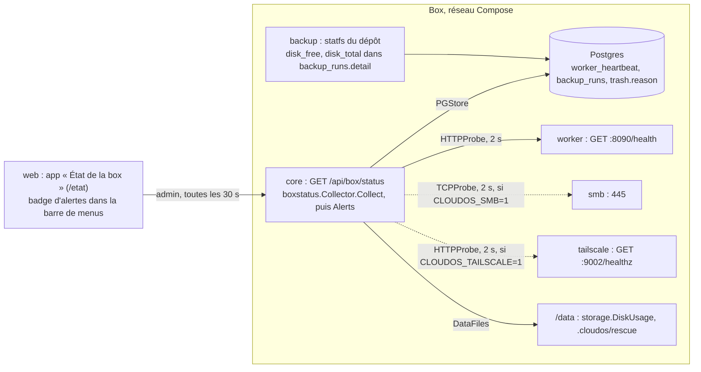

# L'état de la box

Ce que l'administrateur voit de la box dans le web, sans terminal : un disque presque plein, un service arrêté, une sauvegarde ratée. Issue : #102 (Feature #98). Les alertes hors du web (mail, notification sur le téléphone) ne sont pas faites.

Une route réservée aux admins, `GET /api/box/status`, rassemble l'état de la box en un seul objet. Le cœur y calcule lui-même les alertes, à un seul endroit (`boxstatus.Alerts`). Le web en tire l'app « État de la box » et le badge d'alertes de la barre de menus. Les membres ne voient ni l'un ni l'autre, et le web ne leur demande rien.

## Les sources

Le paquet `core/internal/boxstatus` met chaque source derrière une petite interface, pour que les tests en donnent de fausses : `Store` (la base, `PGStore`), `Files` (le disque des données, `DataFiles`) et `Probe` (un service, `HTTPProbe` ou `TCPProbe`). Les services sont interrogés en parallèle, chacun en 2 s au plus (`ProbeTimeout`). La route répond donc en un peu plus de 2 s au pire. Une erreur de la base fait répondre 503 ; un disque ou un dossier illisible est seulement laissé de côté.

| Ce que montre le panneau | D'où il vient |
|---|---|
| **Version** | `main.version`, celle de `/api/health` |
| **Disque des données** | `statfs` sur `store.Root`, avec `storage.DiskUsage`. `smbfs` s'en sert aussi pour la place qu'il annonce au Finder. |
| **Disque de sauvegarde** | Le cœur ne monte pas ce disque : s'il manquait, Docker créerait un dossier vide et le panneau montrerait le disque système. Le service `backup` écrit donc `disk_free` et `disk_total` dans `backup_runs.detail` à la fin de chaque passage (`Service.end`), mais seulement quand le dépôt est là (son fichier `config`). Le panneau montre la dernière mesure, avec sa date. |
| **Analyse (worker)** | `worker_heartbeat` : le dernier signe de vie de tous les workers. Il doit avoir moins de 30 s, comme pour `/api/health`. |
| **Recherche (worker)** | `GET http://worker:8090/health`, qui doit répondre 2xx. Sans `WORKER_URL`, elle est « éteinte ». |
| **SMB** | Avec `CLOUDOS_SMB=1`, une connexion TCP à `smb:445`, fermée aussitôt sans rien envoyer. Sinon, il est « éteint ». |
| **Tailscale** | Avec `CLOUDOS_TAILSCALE=1`, `GET http://tailscale:9002/healthz`. Le panneau montre aussi `CLOUDOS_PUBLIC_URL`, et si les liens de partage sont ouverts sur internet (`CLOUDOS_FUNNEL=1`). |
| **Sauvegarde** | La dernière ligne de `backup_runs` de chaque type (`backup`, `copy`, `check`, `restore_test`), la fin de la dernière sauvegarde réussie et le début de la première. Le cœur est propriétaire de la table : il la lit, sans droit à ajouter. Les chemins d'un test de restauration qui diffère restent dans `backup_runs` : le panneau n'en montre que le nombre. |
| **Fichiers SMB gardés** (#111) | Le nombre de notes dans `.cloudos/rescue` (`Store.RescuedCount`), et les lignes de `trash` marquées `reason = 'smb_not_saved'` sur 30 jours, avec la plus récente. |

**Ce qui est allumé.** `compose.yaml` passe au cœur `CLOUDOS_SMB`, `CLOUDOS_TAILSCALE`, `CLOUDOS_FUNNEL` et `CLOUDOS_BACKUP`. Sur la box, la sauvegarde s'allume dès que `backup-init` a écrit `CLOUDOS_BACKUP_DIR` dans `box.env`, sans `CLOUDOS_BACKUP` : `scripts/box` exporte donc lui-même `CLOUDOS_BACKUP=1` (ou vide) pour Compose, quelle que soit la valeur du shell. Le cœur n'interroge et ne cherche le nom d'un service que s'il est allumé : Docker demanderait un nom inconnu au DNS de la maison.

## Les alertes

`boxstatus.Alerts(status, now)` les rend dans un ordre fixe. Les alertes de la sauvegarde ne comptent que quand le service de sauvegarde tourne.

| Alerte | Quand |
|---|---|
| `data_disk_low` | Moins de 10 % d'espace libre sur le disque des données |
| `backup_disk_low` | Moins de 10 % d'espace libre sur le disque de sauvegarde, à sa dernière mesure |
| `service_down` (avec `service`) | Le worker : son dernier signe de vie a 30 s ou plus, ou `/health` ne répond pas. SMB ou Tailscale : allumé, mais sans réponse en 2 s |
| `backup_failed` | La dernière sauvegarde a échoué, ou n'a pas fini au bout de 6 h : elle est alors notée « interrompue » (le service s'est arrêté pendant) |
| `backup_stale` | Aucune sauvegarde réussie depuis 36 h, ou jamais encore. Elle couvre un service arrêté, un disque débranché ou une nuit manquée. |
| `restore_test_failed` | Le dernier test de restauration a échoué ou a été interrompu |
| `restore_test_stale` | Le dernier test a plus de 8 jours ; ou bien il n'y en a jamais eu, alors que la première sauvegarde a plus de 8 jours |
| `smb_kept` | Un fichier attend dans `.cloudos/rescue`, ou un fichier a été gardé à la corbeille dans les 7 derniers jours |

Une sauvegarde en cours depuis moins de 6 h ne déclenche rien. Une vérification (`check`) ou une copie distante (`copy`) qui échoue se voit dans le panneau, en rouge, mais n'a pas d'alerte : le design ne l'a pas prévu.

## La route

`GET /api/box/status`, réservée aux admins (`{"GET /api/box/status", admin}`) : 401 sans session, 403 pour un membre, et `TestEveryRouteIsProtected` la couvre d'office. Elle répond 503 si `Config.Status` manque (comme `analysisAPI`) ou si la base ne répond pas, sans dire pourquoi : la raison est dans les journaux du cœur. Le corps est `boxstatus.Status`, `BoxStatus` dans `shared/api-types.ts`. Ce qui n'a pas pu être mesuré est absent plutôt qu'à zéro, et `alerts` est toujours une liste.

## Le web

| Fichier | Rôle |
|---|---|
| `web/src/status/status.ts` | `useBoxStatus` : une seule lecture partagée par le badge et le panneau, toutes les 30 s et au retour sur l'onglet, comme les widgets. Rien n'est gardé une fois que les deux sont fermés. Aussi les textes en français : `alertText`, `stateLabel`, `runLabel`. |
| `web/src/status/BoxStatus.tsx` | L'app « État de la box » (`/etat`, `adminOnly`) : les alertes ou « Tout va bien », les disques, les services, les dernières sauvegardes, les fichiers SMB gardés, et le bloc Santé (`Health`) venu de Comptes. Et `AlertsBadge`, le badge de la barre de menus. |

- **Le badge** remplace « Sauvegarde à jour », qui s'allumait dès que la base répondait. Il dit « 2 alertes » et ouvre le panneau. Il n'apparaît que pour un admin qui a des alertes ; un membre ne le voit jamais, et `useBoxStatus(false)` ne fait aucune requête.
- **Comptes** ne garde que les comptes.

## Sécurité

- **Rien n'écrit** : les sondes lisent la base, le disque et `.cloudos/rescue`, ou ouvrent une connexion sans rien envoyer.
- **Le port 9002 de Tailscale** (`TS_LOCAL_ADDR_PORT: 0.0.0.0:9002`) n'est ouvert que sur le réseau Compose, jamais publié, comme le 8090 du worker. Il ne sert que `/healthz`, qui dit seulement si le nœud est en ligne. Les métriques restent éteintes.
- **Seuls les admins** lisent la route. Le message d'erreur d'une sauvegarde y figure tel que `backup_runs` le garde, débarrassé des secrets (`backup.scrub`).
- **Retour arrière** : un revert suffit. Aucune migration n'est ajoutée, le panneau se sert des colonnes de #101 et #111.

## Les tests

- `core/internal/boxstatus` :
  - chaque règle d'alerte à son seuil (`TestAlerts`) ;
  - `Collect` avec de fausses sources, dont une sonde qui ne répond jamais et qui est coupée à 2 s ;
  - `PGStore` sur une base jetable, et les sondes HTTP et TCP.
- `core/internal/httpapi` : la route avec de fausses sondes, pour un admin, un membre et un visiteur, et le 503 (`TestBoxStatus`, `TestBoxStatusUnavailable`).
- `core/internal/backup` : `disk_free` et `disk_total` notés à la fin d'un passage, seulement quand le dépôt est là (`TestEndNotesTheBackupDisk`, et dans l'image de sauvegarde : `TestBackupTwiceAddsAlmostNothing`, `TestBackupWithoutTheDisk`).
- `scripts/test-box.sh` : `up` dit au cœur que la sauvegarde tourne après `backup-init`, et pas avant.
- Web :
  - un admin voit l'app, ses alertes et le badge ;
  - un membre ne voit ni l'app ni le badge, et ne demande rien ;
  - « Sauvegarde à jour » a disparu ;
  - Comptes n'a plus le bloc Santé (`status.test.tsx`, `desktop.test.tsx`).
