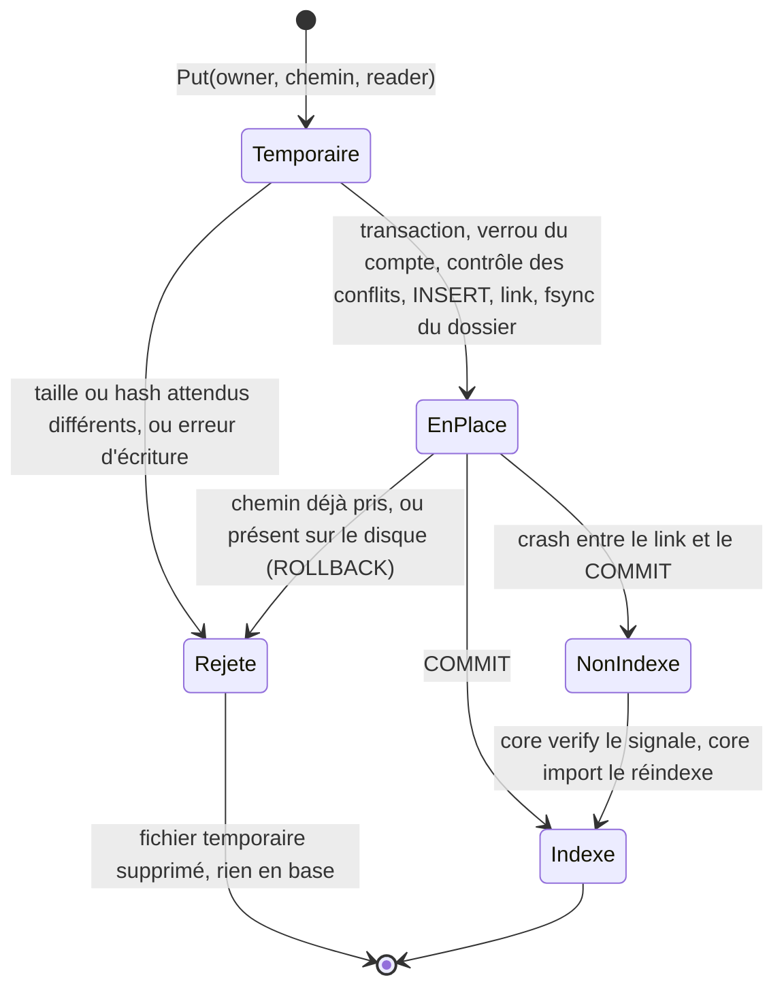
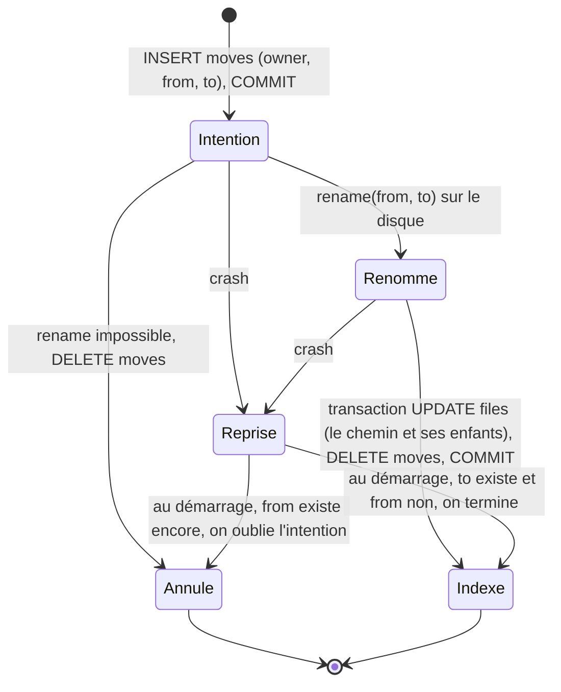

# Stockage des fichiers

Le domaine qui écrit, range et vérifie les fichiers des utilisateurs : `core/internal/storage`, et l'API qui l'expose, `core/internal/httpapi/files.go`.
Issues : #7 (écriture et index), #9 (dossiers, déplacements, API).

## Ce qui est garanti

- **Aucune perte, aucun écrasement.** Seul ce paquet écrit dans le dossier de données. Il n'écrase jamais un fichier existant, indexé ou non, et ne supprime jamais un fichier stocké.
- **Lisible sans le produit.** Les fichiers sont en clair sous `<données>/<compte>/<chemin>`, avec leurs vrais noms.
- **Disque et index d'accord.** Une écriture ou un déplacement interrompu ne laisse ni fichier à moitié écrit ni index faux. `core verify` le contrôle à tout moment, sans rien réparer.

## Disposition

```text
<CLOUDOS_DATA_DIR>/            /data dans le conteneur du cœur
├── .cloudos/tmp/              écritures en cours, vidées au démarrage du serveur
├── enzo/                      un dossier par compte (nom du compte = nom du dossier)
│   ├── Documents/contrat.pdf
│   └── Photos/2024/plage.jpg
└── johan/
```

## Index

Table `files` : une ligne par fichier (`kind = 'file'`, avec taille, type MIME et SHA-256) et par dossier (`kind = 'dir'`, taille 0, sans hash).

- **Noms :** les chemins sont relatifs, séparés par `/`, en Unicode NFC. Ils n'ont ni segment vide, ni `.` ou `..`, ni caractère de contrôle, ni `\`.
- **Casse :** deux chemins qui ne diffèrent que par la casse ne peuvent pas coexister pour un même compte (index unique sur `(owner, lower(path))`), comme dans le Finder et l'Explorateur.
- **Invariant :** chaque dossier parent d'une ligne a sa propre ligne `dir`. Lister un dossier revient donc à lire ses enfants directs.
- **Verrou :** toutes les écritures d'un compte passent par son verrou consultatif (`ownerLockKey`), ce qui rend les contrôles de conflit sûrs.

## Écrire un fichier (`Put`)



1. **Écriture temporaire :** le fichier va dans `.cloudos/tmp/`, son SHA-256 est calculé pendant la copie, puis `fsync`.
2. **Contrôle :** la taille et le hash attendus, quand le client les donne, doivent correspondre.
3. **Mise en place :** `os.Link` vers la place finale. Contrairement à `rename`, il échoue si la cible existe, ce qui rend l'écrasement impossible. Tout se fait dans la transaction qui indexe le fichier et crée les lignes des dossiers parents manquants.

## Déplacer ou renommer (`Move`)

Le verrou du compte est tenu sur une connexion dédiée pendant tout le déplacement. Aucune écriture du compte ne peut donc arriver dans le dossier déplacé entre deux étapes ; `TestConcurrentMovesAndPutsStayConsistent` échoue sans ce verrou.



- **Refus :** cible prise (y compris dans une autre casse), cible dans la source, dossier parent qui est un fichier, ou cible présente sur le disque sans être indexée.
- **Casse seule :** un renommage qui ne change que la casse est autorisé.
- **Reprise au démarrage :** `RecoverMoves` tourne avant que le serveur accepte des requêtes. Une intention dont les deux extrémités existent reste dans le journal et est signalée : elle n'est jamais devinée.

## Vérifier et importer

- **`core verify` :** il classe chaque entrée en *ok*, *modifié*, *disparu* ou *non indexé*, ne change rien, et sort avec le code 1 au premier écart.
- **`core import <compte> <dossier>` :** il ne fait que lire la source et garde les dates de modification. Il ignore les liens et les fichiers spéciaux, laisse en place un fichier déjà présent avec le même contenu, et adopte un fichier laissé non indexé par un crash quand son hash correspond.

## API

Toutes les routes exigent une session, et chacun ne voit que son propre espace : le compte vient de la session, jamais d'un paramètre.

| Route | Effet |
|---|---|
| `GET /api/files?path=` | Liste un dossier, la racine si `path` est vide ; dossiers d'abord |
| `POST /api/files/folders` `{path}` | Crée un dossier et ses parents |
| `POST /api/files/move` `{from, to}` | Renomme ou déplace un fichier ou un dossier |
| `GET /api/files/content?path=` | Télécharge ; `Range`, `If-None-Match` (ETag = SHA-256) et `If-Modified-Since` gérés |
| `PUT /api/files/content?path=` | Envoi en une requête ; `Content-Length` et `X-Content-SHA256` vérifiés, `X-Modified-At` en option |

- **En-tête client :** l'envoi brut porte l'en-tête `X-Cloudos-Client` à la place d'un corps JSON. Comme le JSON, il force la vérification préalable CORS, que le cœur n'accorde jamais.
- **Codes d'erreur :**

  | Code | Cas |
  |---|---|
  | 400 | Chemin dangereux |
  | 404 | Introuvable, ou appartenant à un autre compte |
  | 409 | Conflit de nom |
  | 422 | Taille ou hash différents |

- **Envoi reprenable :** l'envoi en plusieurs morceaux, avec reprise, arrive avec #18 (protocole tus).
