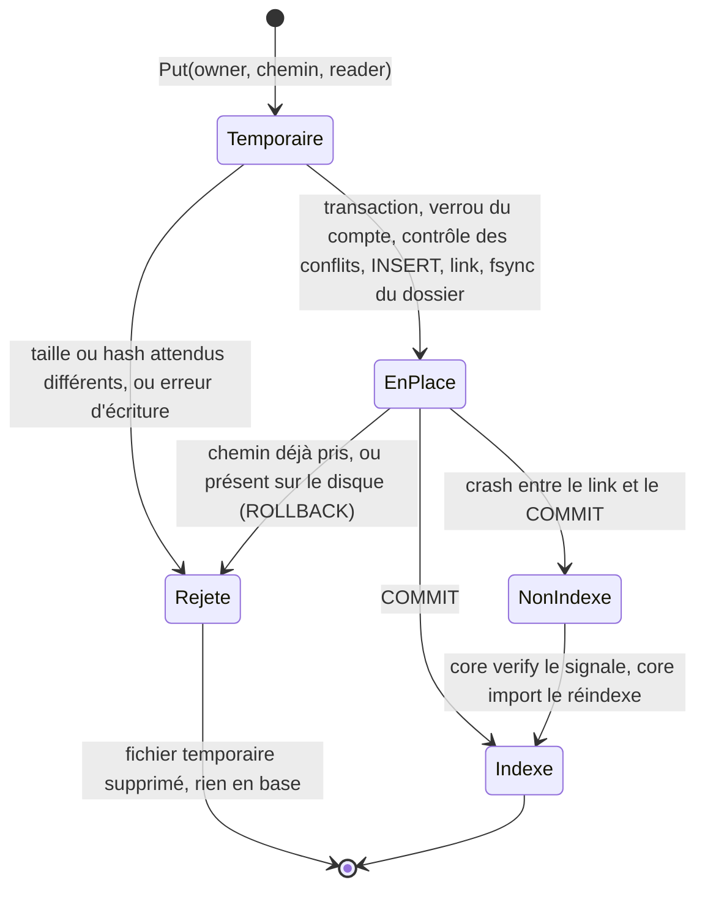
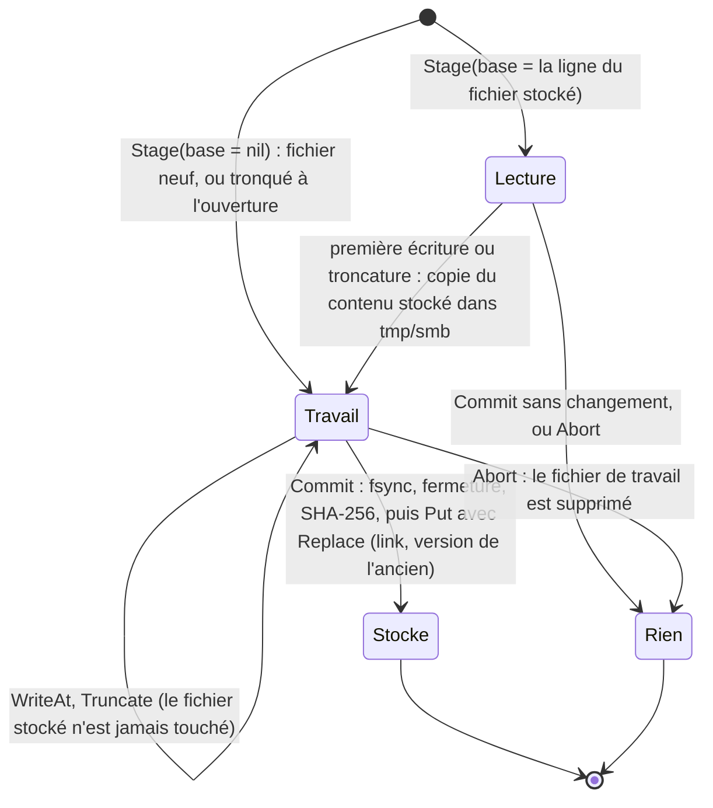
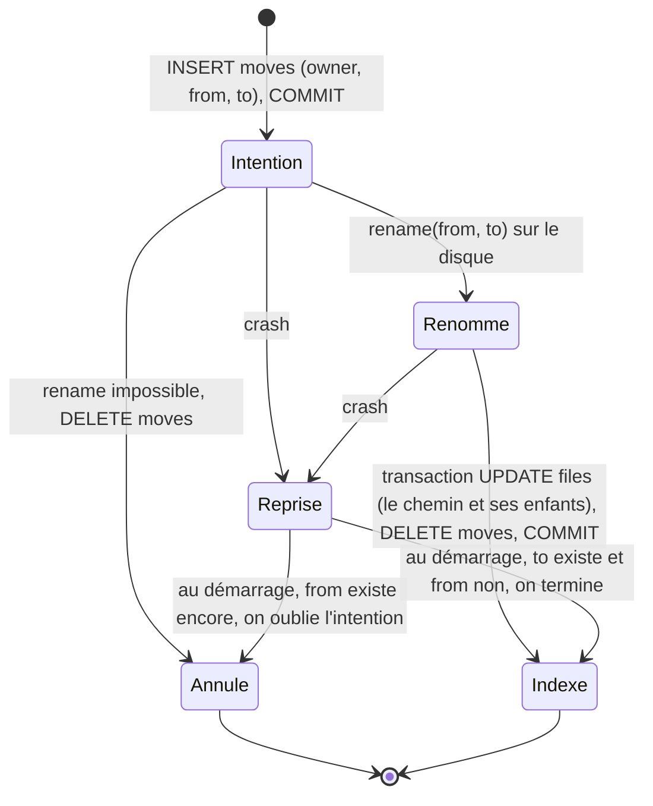
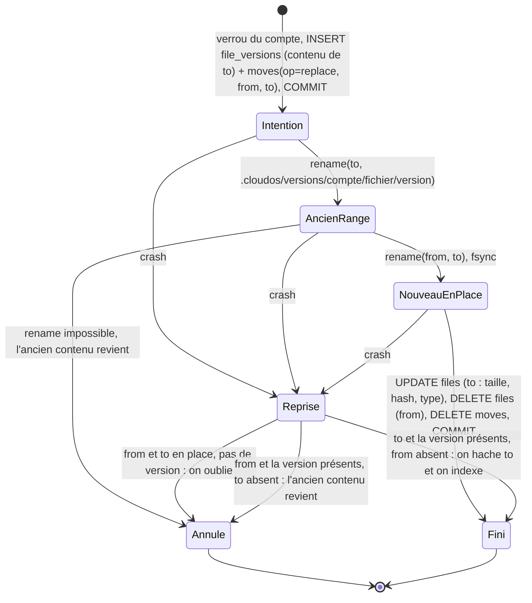
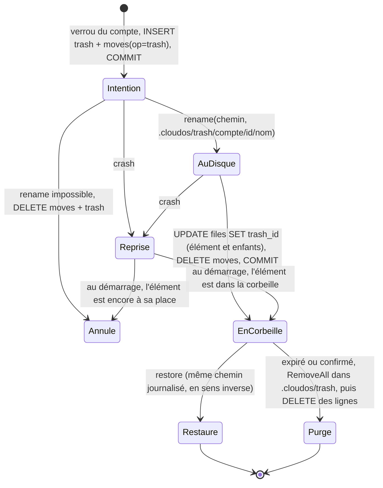
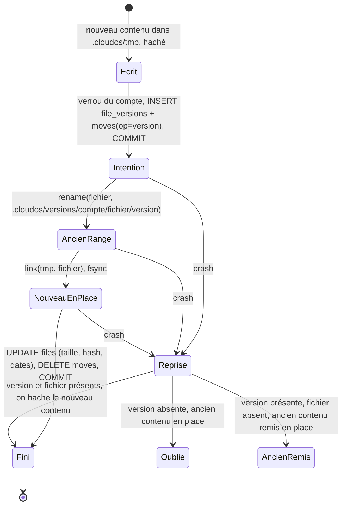
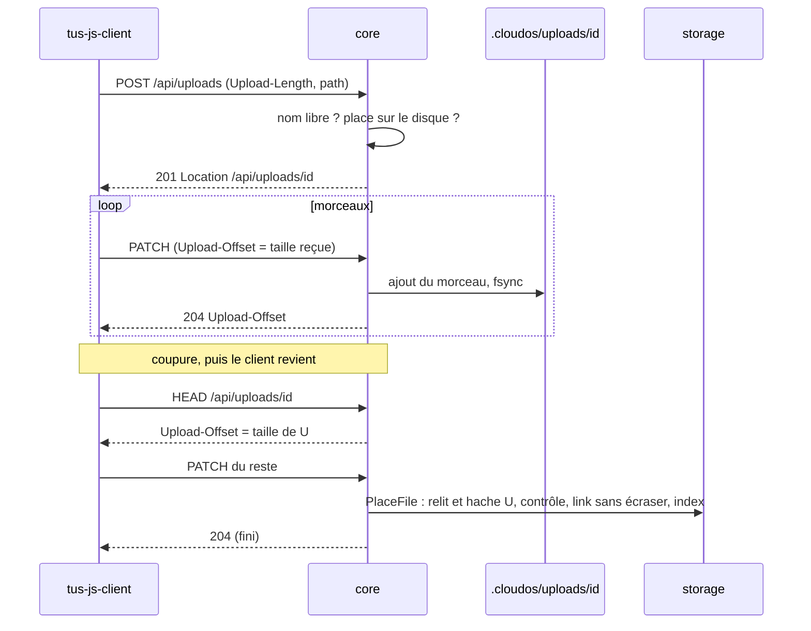

# Stockage des fichiers

Le domaine qui écrit, range et vérifie les fichiers des utilisateurs : `core/internal/storage`, et l'API qui l'expose, `core/internal/httpapi/files.go`.
Issues : #7 (écriture et index), #9 (dossiers, déplacements, API), #18 (envoi reprenable), #10 (corbeille), #24 (versions), #92 (écriture par morceaux, renommage qui écrase, dates : SMB).

## Ce qui est garanti

- **Aucune perte, aucun écrasement.** Seul ce paquet écrit dans le dossier de données. Il n'écrase jamais un fichier existant, indexé ou non. Remplacer un fichier, sur demande explicite, garde d'abord son contenu comme version. Supprimer, c'est mettre à la corbeille : seule la purge de la corbeille efface des octets, à l'expiration ou sur confirmation.
- **Garde-fou dans les tests.** `core/internal/guard/erase_test.go` analyse tout le code Go du cœur et échoue si une fonction hors de la liste fermée `allowedErasers` appelle `os.Remove`, `os.RemoveAll` ou `Truncate`. Ajouter une fonction à cette liste est une décision de design, à relire comme telle.
- **Lisible sans le produit.** Les fichiers sont en clair sous `<données>/<compte>/<chemin>`, avec leurs vrais noms.
- **Disque et index d'accord.** Une écriture ou un déplacement interrompu ne laisse ni fichier à moitié écrit ni index faux. `core verify` le contrôle à tout moment, sans rien réparer.

## Disposition

```text
<CLOUDOS_DATA_DIR>/            /data dans le conteneur du cœur
├── .cloudos/tmp/              écritures en cours, vidées au démarrage du serveur
├── .cloudos/tmp/smb/          fichiers de travail SMB (Stage), vidés au démarrage du service smb seulement
├── .cloudos/uploads/<id>      envois reprenables en cours (tus), supprimés à la fin ou après 24 h
├── .cloudos/rescue/<compte>/<id>       écritures SMB non enregistrées (et leur note <id>.json), en attente de la base pour aller à la corbeille
├── .cloudos/trash/<compte>/<id>/<nom>   éléments mis à la corbeille, effacés après 30 jours
├── .cloudos/versions/<compte>/<fichier>/<version>   contenus remplacés
├── enzo/                      un dossier par compte (nom du compte = nom du dossier)
│   ├── Documents/contrat.pdf
│   └── Photos/2024/plage.jpg
└── johan/
```

## Index

Table `files` : une ligne par fichier (`kind = 'file'`, avec taille, type MIME et SHA-256) et par dossier (`kind = 'dir'`, taille 0, sans hash).

- **Noms :** les chemins sont relatifs, séparés par `/`, en Unicode NFC. Ils n'ont ni segment vide, ni `.` ou `..`, ni caractère de contrôle, ni `\`.
- **Casse :** deux chemins qui ne diffèrent que par la casse ne peuvent pas coexister pour un même compte (index unique sur `(owner, lower(path))`), comme dans le Finder et l'Explorateur.
- **Invariant :** chaque dossier parent d'une ligne a sa propre ligne `dir`. Lister un dossier revient donc à lire ses enfants directs.
- **Verrou :** toutes les écritures d'un compte passent par son verrou consultatif (`ownerLockKey`), ce qui rend les contrôles de conflit sûrs.

## Écrire un fichier (`Put`)



1. **Écriture temporaire :** le fichier va dans `.cloudos/tmp/`, son SHA-256 est calculé pendant la copie, puis `fsync`.
2. **Contrôle :** la taille et le hash attendus, quand le client les donne, doivent correspondre.
3. **Mise en place :** `os.Link` vers la place finale. Contrairement à `rename`, il échoue si la cible existe, ce qui rend l'écrasement impossible. Tout se fait dans la transaction qui indexe le fichier et crée les lignes des dossiers parents manquants.
4. **Après coup :** une fois le fichier indexé, `AfterStore` (s'il est défini) reçoit le fichier et ses premiers octets. Le cœur s'en sert pour mettre en file la miniature et les métadonnées d'une image ou d'une vidéo ([thumbnails.md](thumbnails.md), [metadata.md](metadata.md)) et le texte d'un document ([documents.md](documents.md)). Il ne peut pas faire échouer l'écriture.

## Écrire par morceaux (`Stage`)

SMB écrit un fichier par morceaux, à des positions quelconques, et le relit pendant ce temps. `Store.Stage(ctx, compte, chemin, base)` ouvre pour cela un fichier de travail à accès aléatoire (`Staged` : `ReadAt`, `WriteAt`, `Truncate`, `Size`), dans `.cloudos/tmp/smb/`, sur le même disque que le stockage pour lier sans recopier. Le service `smb` s'en sert ([smb.md](smb.md)).



- **Copie paresseuse :** un fichier existant est lu sur place tant que rien n'y est écrit. Le Finder ouvre souvent en lecture-écriture sans rien écrire, et `Commit` n'enregistre alors rien, pas même une version. Une troncature ne copie que ce qu'elle garde.
- **`Commit`** ferme le fichier de travail avant de le lier : plus rien ne peut écrire au travers une fois qu'il est stocké. Il passe par le même `finish` que `Put`, avec `Replace` : le fichier de départ, ou celui qu'un autre client (web, WebDAV) a stocké entre-temps, devient une version. Le dernier arrivé gagne, et l'autre contenu reste en version. Un contenu identique au contenu stocké n'enregistre rien.
- **`Abort`** supprime le fichier de travail. Le fichier stocké reste tel quel.
- **Ménage :** `CleanTmp`, au démarrage du cœur, saute `tmp/smb/`. Seul `core smb` le vide, à son propre démarrage (`CleanStaged`) : un redémarrage du cœur n'efface pas une écriture SMB en cours.

## Déplacer ou renommer (`Move`)

Le verrou du compte est tenu sur une connexion dédiée pendant tout le déplacement. Aucune écriture du compte ne peut donc arriver dans le dossier déplacé entre deux étapes ; `TestConcurrentMovesAndPutsStayConsistent` échoue sans ce verrou.



- **Refus :** cible prise (y compris dans une autre casse), cible dans la source, dossier parent qui est un fichier, ou cible présente sur le disque sans être indexée.
- **Casse seule :** un renommage qui ne change que la casse est autorisé.
- **Reprise au démarrage :** `RecoverMoves` tourne avant que le serveur accepte des requêtes. Une intention dont les deux extrémités existent reste dans le journal et est signalée : elle n'est jamais devinée.
- **Deux processus :** le service `smb` écrit aussi, et peut être en plein déplacement quand le cœur démarre. `RecoverMoves` prend donc le verrou du compte pour chaque entrée, puis la relit : une opération en cours tient ce verrou jusqu'à avoir effacé sa propre entrée, qui n'est alors plus à reprendre (`TestRecoverMovesWaitsForTheOwnersLock`).

### Renommer par-dessus un fichier (`MoveReplace`)

Un renommage qui écrase un fichier (SMB, quand le client le demande) est une seule opération journalisée, `op = 'replace'` dans `moves`, sous le verrou du compte. La cible garde son identité (ses versions, albums et liens de partage) et prend le contenu de la source ; son contenu d'avant devient une version. On ne renomme jamais sur un chemin occupé.



- **Sans cible**, c'est `Move`. Un dossier ne remplace rien et n'est jamais remplacé.
- **Une source qui a ses propres versions** les perdrait avec sa ligne. La cible part alors d'abord à la corbeille (avec ses versions), puis la source est déplacée : rien n'est perdu, et l'ancien contenu se restaure depuis la corbeille.
- **Migration :** 0027 ajoute `replace` aux opérations du journal ; sa partie « down » refuse de s'exécuter tant qu'un remplacement y reste.

## Dates (`SetModTime`)

`Store.SetModTime(ctx, compte, chemin, date)` change `files.modified_at` et la date du fichier ou du dossier sur le disque, sous le verrou du compte. C'est une métadonnée : le contenu n'est jamais touché. Le Finder garde ainsi les dates d'une copie.

## Déduplication à l'envoi

Pour qu'un téléphone ne renvoie pas une photo que la box a déjà. Issue : #36. Le web ne s'en sert pas encore : calculer le hash d'une grosse vidéo dans le navigateur coûte cher. C'est l'app mobile (#38) qui en a besoin.

- **`POST /api/files/known` `{"sha256": [hex, …]}` → `{"known": [hex, …]}` :** les empreintes que le compte connecté a déjà dans un fichier vivant (`storage.Known`, 1 000 au plus par appel). Le client sait d'un coup quoi sauter.
- **`POST /api/files/dedupe` `{"path", "sha256", "modified_at"}` :** `storage.Dedupe` crée le fichier au chemin voulu sans aucun octet envoyé.
  - **201 :** le contenu est copié depuis un fichier vivant du compte qui a cette empreinte. La copie passe par `Put` avec `ExpectSize` et `ExpectSHA256`, si bien que la source est relue et vérifiée pendant la copie. Une source modifiée hors de Cloud OS est écartée, et on essaie la suivante (5 au plus).
  - **200 :** le chemin a déjà exactement ce contenu. Rien n'est fait, et une sauvegarde relancée ne crée rien en double.
  - **404 :** le compte n'a pas ce contenu (ou aucune source n'est intacte). Le client envoie le fichier normalement.
  - **409 :** le chemin est pris par un autre contenu.
- **Comptes :** on ne cherche que dans les fichiers vivants du compte connecté. Une empreinte d'un autre compte, ou seulement en corbeille, répond comme une empreinte inconnue.
- **Copie, pas lien dur :** chaque fichier reste indépendant sur le disque (inodes distincts), et un lien dur ferait qu'une modification faite hors du produit touche les deux. Le partage de place entre doublons pourra venir plus tard.
- **Hooks :** la copie passe par `Put`, donc par les mêmes hooks qu'un envoi : miniature et métadonnées (déjà là pour ce contenu, rien n'est refait), et « ajouté » dans le journal d'activité.

## Vérifier et importer

- **`core verify` :** il classe chaque entrée en *ok*, *modifié*, *disparu* ou *non indexé*, ne change rien, et sort avec le code 1 au premier écart.
- **`core import <compte> <dossier>` :** il ne fait que lire la source et garde les dates de modification. Il ignore les liens et les fichiers spéciaux, laisse en place un fichier déjà présent avec le même contenu, et adopte un fichier laissé non indexé par un crash quand son hash correspond.

## Corbeille

Supprimer un fichier ou un dossier l'envoie à la corbeille ; rien n'est effacé.

- **Disque :** les octets de l'élément, enfants compris, vont dans `.cloudos/trash/<compte>/<id>/<nom>`.
- **Index :** les lignes restent dans `files`, marquées `trash_id`. L'index unique ne porte que sur les lignes hors corbeille : le chemin d'origine se libère tout de suite. Toutes les requêtes sur les fichiers vivants filtrent `trash_id IS NULL`.
- **Table `trash` :** chemin d'origine, type, taille, date de suppression, expiration (`CLOUDOS_TRASH_DAYS`, 30 jours par défaut), et `reason` quand la box l'y a mis elle-même : `smb_not_saved` pour une écriture SMB qu'elle n'a pas pu enregistrer (op `rescue` du journal, [smb.md](smb.md), « Un enregistrement qui échoue »).

Mettre à la corbeille et restaurer suivent le même chemin journalisé qu'un déplacement (`moves.op` vaut `trash` ou `restore`), sous le verrou du compte tenu de bout en bout. `RecoverMoves` les termine ou les annule au démarrage.



- **Restaurer :** l'élément revient à son chemin d'origine. Si le chemin est pris, il revient à côté sous « nom (restauré).ext », puis « nom (restauré 2).ext ». Si son dossier est devenu un fichier, il revient à la racine. Les dossiers parents manquants sont recréés.
- **Purger :** `PurgeExpired` tourne au démarrage puis toutes les heures ; `Purge` et `EmptyTrash` répondent à une demande confirmée. Les octets partent d'abord (`removeTrashDir`, qui refuse tout dossier qui n'est pas exactement `.cloudos/trash/<compte>/<id>`), puis les lignes : un crash entre les deux est fini par la purge suivante. Un élément dont une opération est encore dans le journal n'est pas purgé.
- **Migration :** la partie « down » de 0006 refuse de s'exécuter tant que la corbeille n'est pas vide.

## Versions

Remplacer un fichier (`PutOptions.Replace`, uniquement sur demande explicite : `replace=1` à l'envoi simple, métadonnée tus `replace`) garde son contenu précédent comme version, dans la table `file_versions` et sous `.cloudos/versions/<compte>/<fichier>/<version>`. Sans `Replace`, un chemin existant est toujours refusé.



- **Reprise** (`recoverVersion`) : un crash ne perd jamais l'ancien contenu. Au pire, l'envoi interrompu est perdu et l'ancien contenu est remis en place.
- **Restaurer une version** remplace le fichier par une copie de la version : la version reste, et le contenu courant devient lui-même une version.
- **Ménage** (`PruneVersions`, au démarrage, toutes les heures et après chaque remplacement) : on garde les 10 dernières versions de chaque fichier et toutes celles de moins de 30 jours (`CLOUDOS_VERSIONS_KEEP`, `CLOUDOS_VERSIONS_DAYS`). `removeVersionFile` n'efface qu'exactement `.cloudos/versions/<compte>/<fichier>/<version>`.
- **Corbeille :** un fichier à la corbeille garde ses versions, qui reviennent avec lui. Le purger efface aussi ses versions (`removeVersionsDir`).
- **Intégrité :** `core verify` contrôle aussi le hash de chaque version.
- **Migration :** la partie « down » de 0007 refuse de s'exécuter tant qu'il reste des versions.

## API

Toutes les routes exigent une session, et chacun ne voit que son propre espace : le compte vient de la session, jamais d'un paramètre.

| Route | Effet |
|---|---|
| `GET /api/files?path=` | Liste un dossier, la racine si `path` est vide ; dossiers d'abord |
| `POST /api/files/folders` `{path}` | Crée un dossier et ses parents |
| `POST /api/files/move` `{from, to}` | Renomme ou déplace un fichier ou un dossier |
| `GET /api/files/content?path=` | Télécharge ; `Range`, `If-None-Match` (ETag = SHA-256) et `If-Modified-Since` gérés |
| `PUT /api/files/content?path=` | Envoi en une requête ; `Content-Length` et `X-Content-SHA256` vérifiés, `X-Modified-At` en option ; `replace=1` remplace un fichier existant (son contenu devient une version) |
| `GET /api/files/versions?path=` | Les versions d'un fichier, la plus récente d'abord |
| `GET /api/files/versions/{id}/content` | Télécharge une version (`name=` pour le nom du fichier) |
| `POST /api/files/versions/{id}/restore` | Restaure une version |
| `POST /api/files/trash` `{path}` | Met à la corbeille |
| `GET /api/trash` | Liste la corbeille, la plus récente d'abord |
| `POST /api/trash/{id}/restore` | Restaure ; renvoie l'emplacement retrouvé |
| `POST /api/trash/{id}/purge` `{confirm: true}` | Efface un élément pour de bon (400 sans la confirmation) |
| `POST /api/trash/empty` `{confirm: true}` | Vide la corbeille |

- **En-tête client :** l'envoi brut porte l'en-tête `X-Cloudos-Client` à la place d'un corps JSON. Comme le JSON, il force la vérification préalable CORS, que le cœur n'accorde jamais.
- **Codes d'erreur :**

  | Code | Cas |
  |---|---|
  | 400 | Chemin dangereux |
  | 404 | Introuvable, ou appartenant à un autre compte |
  | 409 | Conflit de nom |
  | 422 | Taille ou hash différents |

- **Envoi reprenable :** voir la section suivante.

## Envoi reprenable (tus)

Les gros fichiers passent par le protocole [tus 1.0](https://tus.io/protocols/resumable-upload) : le cœur du protocole, plus les extensions création, expiration et terminaison. Côté client, c'est `tus-js-client`, dans le navigateur comme dans React Native.

| Route | Effet |
|---|---|
| `OPTIONS /api/uploads` | Versions, extensions et `Tus-Max-Size` (si `CLOUDOS_MAX_UPLOAD` est réglé) |
| `POST /api/uploads` | `Upload-Length` et `Upload-Metadata` (`path` obligatoire ; `sha256` en hex, `mtime` en secondes Unix et `replace` = `1` en option). 409 si le nom est pris, 413 si c'est trop gros pour la limite ou pour la place libre. Répond 201 avec `Location` et `Upload-Expires` |
| `HEAD /api/uploads/{id}` | `Upload-Offset` (où reprendre) et `Upload-Length` |
| `PATCH /api/uploads/{id}` | Ajoute un morceau (`application/offset+octet-stream`) à `Upload-Offset`, qui doit être exact (sinon 409). 423 si un autre `PATCH` écrit le même envoi, 413 si le morceau dépasse la longueur |
| `DELETE /api/uploads/{id}` | Abandonne l'envoi : supprime son fichier partiel, jamais un fichier stocké |



- **Position de reprise :** c'est la taille du fichier partiel. Ce qui a été reçu et écrit avant une coupure reste acquis.
- **Fin de l'envoi :** `PlaceFile` relit le fichier pour hacher ce qui est vraiment sur le disque, vérifie la taille et le hash attendus, puis le met en place par le même `link` sans écrasement que `Put`. Un envoi dont le hash est faux, ou dont le nom a été pris entre-temps, est terminé et supprimé : le renvoyer ne changerait rien.
- **Envoi vide :** un envoi de 0 octet est terminé dès sa création.
- **Expiration et ménage :** chaque morceau repousse l'expiration de 24 h. `CleanUploads` tourne au démarrage puis toutes les heures : il supprime les envois expirés et les fichiers partiels qu'aucun envoi ne possède, et seulement dans `.cloudos/uploads/`.
- **Isolation :** l'identifiant d'un envoi est fait de 128 bits aléatoires, et un envoi d'un autre compte répond 404.
- **CSRF :** comme pour l'envoi simple, les requêtes tus portent l'en-tête `X-Cloudos-Client`, à passer dans l'option `headers` de `tus-js-client`.
