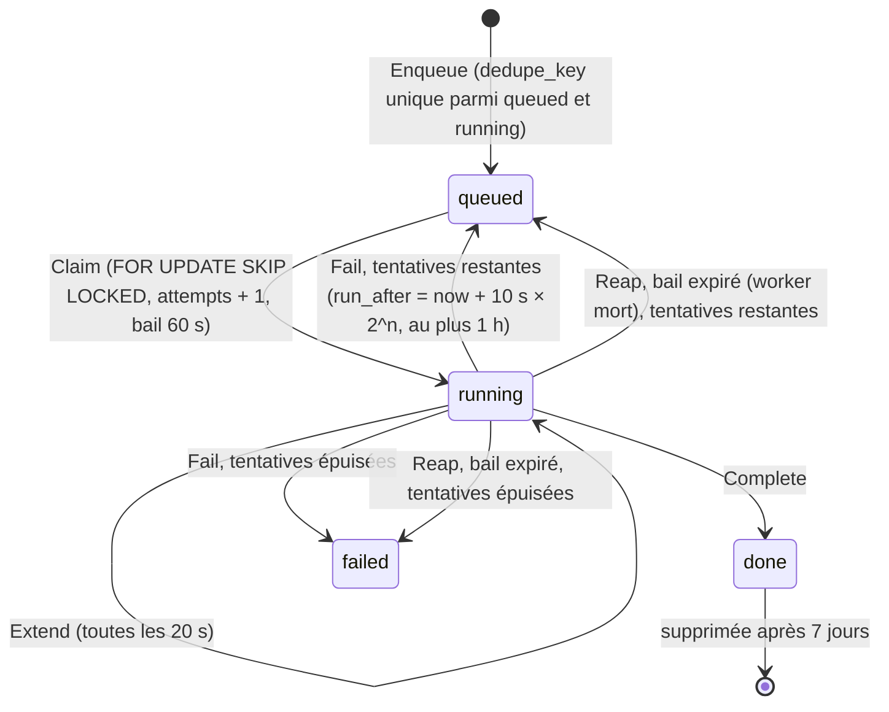

# File de tâches

Le travail de fond (miniatures, OCR, embeddings…) passe par une file de tâches dans Postgres, partagée par le cœur (Go) et les workers (Python), sans Redis.
Issue : #8.

## Contrat

Le contrat, c'est le SQL : `core/internal/tasks/tasks.go` et `worker/src/worker/tasks.py` exécutent les mêmes requêtes, et chaque côté a les mêmes tests, concurrence comprise.

Table `tasks` : `kind`, `payload` (JSON), `priority` (plus haut d'abord), `state` (`queued`, `running`, `done`, `failed`), `attempts`, `max_attempts` (5 par défaut), `run_after`, `locked_by`, `locked_until`, `last_error`, `dedupe_key`.

| Opération | Ce qu'elle fait |
|---|---|
| `Enqueue` | Ajoute une tâche ; ne fait rien si une tâche avec le même `dedupe_key` est en attente ou en cours |
| `Claim` | `UPDATE … WHERE id = (SELECT … FOR UPDATE SKIP LOCKED LIMIT 1)` : la tâche prête la plus prioritaire, puis la plus ancienne, passe en `running` avec un bail de 60 s ; deux workers ne prennent jamais la même |
| `Extend` | Repousse le bail ; le worker le fait toutes les 20 s pendant le travail |
| `Complete` | `done` |
| `Fail` | Repart en file après 10 s × 2^(tentative − 1), au plus 1 h ; `failed` une fois `max_attempts` atteint |
| `Reap` | Le cœur, toutes les 30 s : une tâche dont le bail a expiré (worker mort) repart en file, ou passe en `failed` si elle a épuisé ses tentatives |
| `Prune` | Le cœur supprime les tâches `done` de plus de 7 jours (des lignes, jamais des fichiers) |

`Extend`, `Complete` et `Fail` ne valent que pour le worker qui tient la tâche (`locked_by`) : un worker dont la tâche a été reprise reçoit `ErrLost` / `Lost`, et ne peut pas la terminer à la place d'un autre.

## Priorités

`PriorityNew` (10) pour ce qui touche un fichier qui vient d'arriver, `PriorityBackfill` (0) pour le rattrapage d'un fonds existant : un nouveau fichier n'attend pas que toute la photothèque soit traitée.

## Worker Python

Le worker fait tourner deux fils d'exécution, chacun avec sa propre connexion et sa reconnexion automatique : le battement de vie, et la boucle des tâches (`tasks.work`).
- **Boucle :** elle prend une tâche des types qu'il sait faire (`HANDLERS`), l'exécute en repoussant son bail, puis la termine ou enregistre l'échec. Une exception dans une tâche est enregistrée, et n'arrête jamais le worker.
- **Ajouter un type de tâche :** écrire sa fonction et l'ajouter à `HANDLERS`.

## Santé et preuve de bout en bout

- **Santé :** `/api/health` renvoie `tasks: {queued, running, failed}`, et la page Comptes l'affiche, en rouge s'il y a des échecs.
- **Preuve de bout en bout :** `core selftest [N]` met en file N tâches `selftest` et attend que les workers les terminent. Elle prouve que les deux côtés parlent le même contrat.
