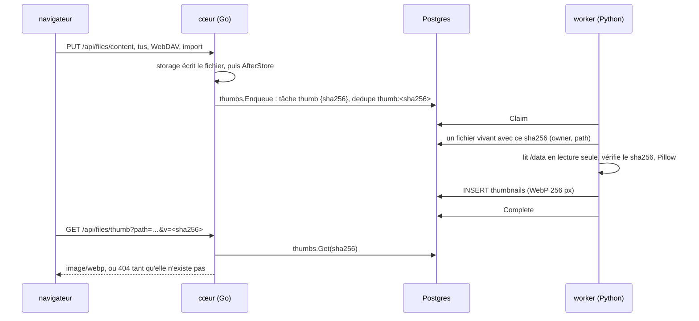

# Miniatures

Les images du drive ont une miniature, faite en tâche de fond par les workers et stockée en base. Les originaux ne sont jamais modifiés.
Issue : #14 (HEIC : #30).

## Parcours

## Mise en file

- **Quand :** `storage.Store.AfterStore` est appelé après chaque fichier enregistré : envoi, envoi reprenable, WebDAV, import, remplacement, version restaurée. Le cœur y branche `thumbs.Enqueue`.
- **Formats :** une image JPEG, PNG ou WebP, reconnue par son type MIME ou par ses premiers octets (un fichier sans extension compte).
- **Doublons :** rien n'est mis en file si le contenu a déjà sa miniature, ou si une tâche est déjà en attente pour lui (`dedupe_key`).
- **Priorités :** `PriorityNew` pour un envoi, `PriorityBackfill` pour un import de bibliothèque, qui ne doit pas retarder les nouveaux fichiers.
- **Rattrapage :** `core thumbs backfill` met en file, à priorité de rattrapage, chaque contenu vivant sans miniature : fonds stocké avant #14, fichiers adoptés par l'import, tâche perdue (la mise en file est faite au mieux, sans faire échouer l'écriture). Une image illisible y est retentée une fois.

## Génération (worker)

`worker/src/worker/thumbs.py`, avec Pillow (licence HPND, permissive) :
- **Lecture :** le worker cherche un fichier vivant avec cette empreinte, le lit depuis `/data`, monté **en lecture seule**, et vérifie son SHA-256 avant de s'en servir.
- **Rendu :** l'orientation EXIF est appliquée, puis la miniature WebP fait 256 px sur le grand côté (qualité 80), en gardant la transparence.
- **Erreurs définitives (`Permanent`, la tâche passe en `failed` au premier essai, la file continue) :** image illisible, format non couvert, plus de 100 mégapixels, fichier de plus de 200 Mo.
- **Erreurs passagères (nouvel essai avec le délai de la file) :** le fichier a bougé ou changé pendant la lecture.
- **Rien à faire (`done`) :** aucun fichier vivant n'a plus ce contenu.

## Stockage

Table `thumbnails (sha256, size, mime, width, height, bytes)`, clé `(sha256, size)` : deux fichiers identiques partagent leur miniature, et une nouvelle version a la sienne. Environ 15 Ko par image : 100 000 photos font à peu près 1,5 Go dans Postgres.

Pas de clé étrangère vers `files` : toutes les 30 s, avec `Reap`, le cœur fait `thumbs.Prune`, qui supprime les miniatures dont aucune ligne de `files` (vivante ou en corbeille) n'a l'empreinte. Une image restaurée de la corbeille retrouve donc la sienne.

## API et web

- **API :** `GET /api/files/thumb?path=` exige une session et ne sert que l'espace du compte connecté. Elle renvoie 404 pour un dossier, un fichier absent, ou une image sans miniature (encore). Elle envoie `ETag` (l'empreinte), `Cache-Control: private, max-age=86400` et répond 304 à la revalidation.
- **Web :** le drive affiche la miniature à la place de l'icône (`thumbURL` dans `web/src/drive/files.ts`), chargée paresseusement, avec `?v=` tiré de l'empreinte pour qu'une nouvelle version ne soit jamais servie depuis le cache. Si la miniature n'existe pas encore, l'icône reste.
