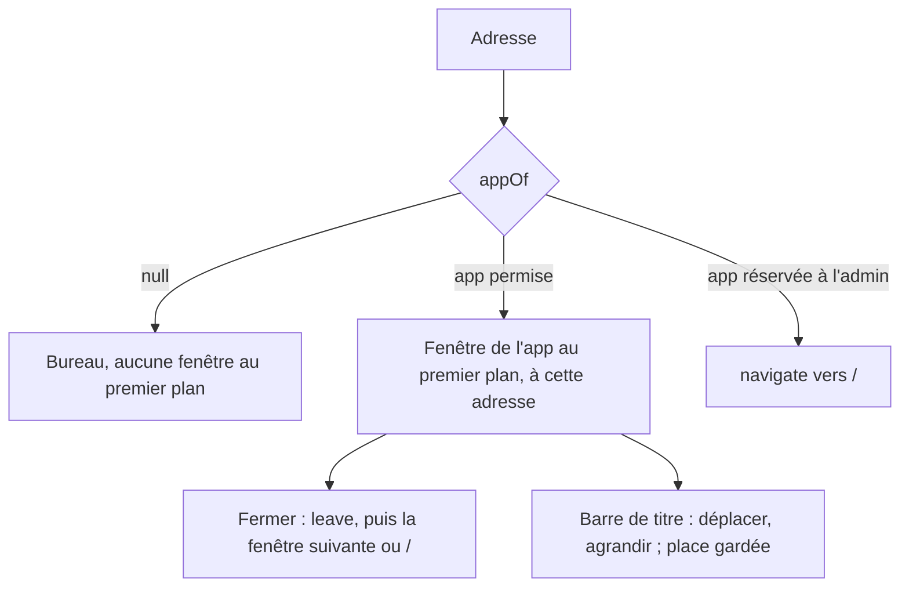
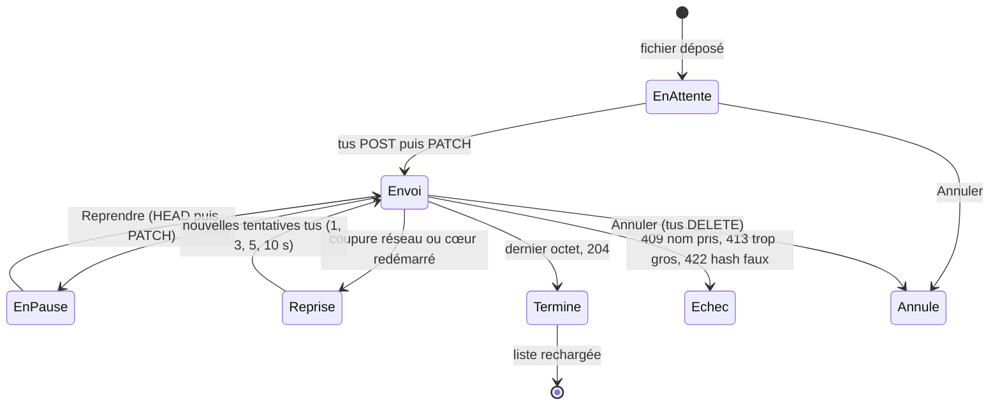
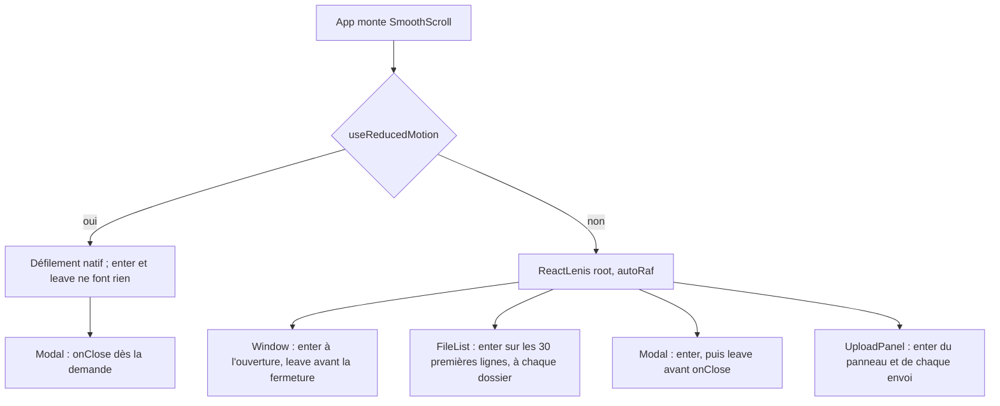

# Interface web

Le front React (Vite, TypeScript) que le cœur sert en fichiers statiques : `web/src/`.
Issues : #6 (assistant, connexion, comptes), #11 (drive), #10 (corbeille), #24 (versions), #13 (partage par lien), #31 (animations et défilement), #46 (le bureau), #48 (la palette Demander), #49 (les widgets du bureau).

## Écrans et adresses

`App.tsx` affiche d'abord la page de l'invité si l'adresse est celle d'un lien de partage (`/s/<jeton>`), sans rien demander au cœur sur la session (voir [share.md](share.md)). Sinon, avant la connexion, il choisit l'écran selon l'état du cœur : l'assistant de premier démarrage si `GET /api/setup` répond `needed`, sinon la connexion si `GET /api/me` répond 401. Une fois connecté, `desktop/Desktop.tsx` affiche le bureau, et chaque app dans sa fenêtre à l'adresse qui la nomme (voir Bureau ci-dessous) :

| Adresse | Fenêtre | Pour |
|---|---|---|
| `/` | Aucune : le bureau | Tout compte |
| `/drive`, `/drive/<dossier>` | Fichiers, sur ce dossier | Tout compte |
| `/partages` | Partages : ses liens, avec Révoquer | Tout compte |
| `/corbeille` | Corbeille | Tout compte |
| `/s/<jeton>` | Hors du bureau : la page de l'invité d'un lien de partage | Sans compte |
| `/comptes` | Comptes : la santé de la box et la gestion des comptes | Admin |
| Toute autre adresse, ou une app réservée à l'admin | Remplacée par `/` | |

- **Routage :** `router.ts` s'appuie sur l'API History, sans bibliothèque. Précédent et Suivant marchent, et un lien vers un dossier se partage tel quel. Le cœur renvoie `index.html` pour toute adresse qu'il ne connaît pas.
- **Adresses des dossiers :** chaque segment d'un dossier est encodé à part dans l'URL (`/drive/Photos/%C3%89t%C3%A9%202024`).

## Bureau

Le compte connecté arrive sur un bureau : fond d'écran vivant, barre de menus, fenêtres en verre et dock. Code : `web/src/desktop/`. Maquettes : <https://claude.ai/artifact/CfYsYH4YrN4fkV2bacriWf> (page Bureau). Issue : #46, Feature #45.

| Fichier | Rôle |
|---|---|
| `apps.ts` | Les apps (Fichiers, Partages, Corbeille, Comptes) : titre, icône, couleur du dock, adresse d'ouverture ; `appOf(adresse)` |
| `windows.ts` | `useWindows` : les fenêtres ouvertes, de l'arrière vers l'avant, et `useGeometries` : leurs places, gardées dans `localStorage` (`cloudos.windows.v1`) |
| `Window.tsx` | Une fenêtre : barre de titre (Fermer, Agrandir), déplacement au pointeur, double-clic pour agrandir |
| `Desktop.tsx` | Le bureau : fond, barre de menus, horloge, fenêtres, dock, raccourci ⌘K |
| `Palette.tsx`, `search.ts` | La palette Demander ([search.md](search.md)) |
| `Widgets.tsx`, `widgets.ts` | Les widgets Reprendre et Ce qui s'est passé |

- **L'adresse fait foi :** aller à l'adresse d'une app l'ouvre, ou la met au premier plan à cette adresse. Les autres fenêtres restent ouvertes, chacune à l'adresse qu'elle montrait (Fichiers garde son dossier). Fermer la fenêtre du premier plan donne la main à la suivante, ou au bureau (`/`). Précédent et Suivant marchent comme avant.
- **Fenêtres :** elles se déplacent par la barre de titre, sans pouvoir passer sous la barre de menus ni sortir de l'écran (`clampPosition`). Le double-clic ou le bouton agrandit la fenêtre à tout le bureau. Une place se garde par app dans ce navigateur ; sans stockage (navigation privée), elle dure jusqu'à la fermeture de la page. Le contenu d'une fenêtre défile seul (`data-lenis-prevent`), la page jamais.
- **Widgets** (sous l'horloge, en verre, en colonne sur téléphone) : relus toutes les 30 s et quand l'onglet redevient visible. Un widget garde sa dernière valeur si le cœur ne répond pas.
  - **Reprendre :** `GET /api/files/recent` (`storage.Recent`) donne les 8 fichiers vivants les plus récemment ajoutés ou modifiés, selon la plus tardive des deux dates, avec leur miniature. Un clic ouvre leur dossier dans Fichiers.
  - **Ce qui s'est passé :** `GET /api/activity?days=7&tz=<fuseau du navigateur>` lit le journal d'activité, regroupé par jour (dans ce fuseau, UTC s'il est inconnu), par type et par dossier. Par exemple « 46 fichiers ajoutés dans Photos », ou « Lien « Vacances » ouvert 3 fois ». Un clic ouvre le dossier, la corbeille ou les partages.
- **Journal d'activité** (`core/internal/activity`, table `activity`, migration 0013) :
  - **Ce qu'il retient :** `storage.Store.Notify` signale `added` et `replaced` (fichier enregistré, version gardée ou non), `trashed` et `restored`. La page d'un invité signale `share_opened` à chaque visite (`GET /api/s/{jeton}`).
  - **Ce qu'il ne retient pas :** les téléchargements, qui compteraient chaque morceau d'une vidéo lue.
  - **Garanties :** des lignes, jamais des fichiers. Une écriture ratée dans le journal est notée dans les logs et ne fait jamais échouer l'opération. Le cœur purge les lignes de plus de 90 jours toutes les 30 s, avec `Reap`.
  - **Regroupement :** fait en SQL, pour qu'un import de 50 000 photos donne une ligne, pas 50 000.
- **Barre de menus :** l'app au premier plan, l'état des tâches lu dans `/api/health` toutes les 20 s (« Sauvegarde à jour » ou « N tâches en cours »), l'heure, le compte et la déconnexion.
- **Dock :** Bureau, puis les apps de ce compte, avec un point sous celles qui sont ouvertes, puis Demander. Demander ouvre la palette de recherche, comme ⌘K ou Ctrl+K et la pilule de la barre de menus (voir [search.md](search.md)).
- **Téléphone (moins de 768 px) :** une seule fenêtre, celle du premier plan, en plein écran entre la barre de menus et le dock. Ni déplacement ni agrandissement.
- **Verre :** fond `--surface` à 86 % et `backdrop-filter`, dans les thèmes clair et sombre. Le fond d'écran a sa version sombre. N'écrire que `backdrop-filter` : le minifieur (lightningcss) ajoute lui-même le préfixe `-webkit-`, et supprime les deux quand on écrit les deux.
- **Éléments fixes dans une fenêtre :** le verre (`backdrop-filter`) fait de la fenêtre le conteneur de ses enfants en `position: fixed`. Le panneau d'envoi et les messages restent donc dans la fenêtre Fichiers, ce qui est voulu. La boîte de dialogue (`Modal`) est dessinée sur `document.body` (`createPortal`) pour passer au-dessus de tout. Le bureau et les fenêtres sont en `overflow: clip`, pour que même un `focus()` ne les fasse pas défiler.
- **Polices :** celles du système. Une police chargée depuis Google Fonts ferait sortir une requête de la box.

## Drive

`web/src/drive/` :

| Fichier | Rôle |
|---|---|
| `Drive.tsx` | La page |
| `Breadcrumb.tsx` | Le fil d'Ariane |
| `FileList.tsx` | La liste, triable par nom, taille ou date ; dossiers d'abord, noms comparés comme on les lit (« 2 » avant « 10 ») |
| `Dialogs.tsx` | Nouveau dossier, Renommer, et Déplacer vers… avec un sélecteur qui parcourt les dossiers |
| `UploadPanel.tsx` | Le panneau d'envoi |
| `uploads.ts` | La file d'envoi |
| `files.ts` | Les appels à `/api/files` et les formats français |

- **Actions :**
  - **Renommer** est un déplacement dans le même dossier (`POST /api/files/move`).
  - **Télécharger** est un lien vers `/api/files/content`, avec le cookie de session.
  - **Partager** ouvre `ShareDialog` : expiration, mot de passe en option, puis le lien à copier, affiché une seule fois.
  - **Supprimer** met à la corbeille sans confirmation, puisque c'est réversible. Un message « mis à la corbeille » propose Annuler, qui restaure aussitôt.
- **Versions :** l'action Versions d'un fichier ouvre son historique (date, taille, date de remplacement), avec Télécharger et Restaurer. Restaurer garde le contenu remplacé comme version.
- **Mobile :** en largeur mobile, les colonnes Taille et Modifié passent sous le nom, et les actions restent visibles.

## Corbeille

`drive/TrashPage.tsx` liste la corbeille : nom, dossier d'origine, taille, date de suppression et date d'effacement.
- **Restaurer :** l'élément revient, et le message dit où, et sous quel nom si le nom d'origine était pris.
- **Supprimer définitivement et Vider la corbeille :** chacun passe par une confirmation (`ConfirmDialog`) qui dit ce qui sera effacé et que c'est sans retour. L'API exige de toute façon `{"confirm": true}`.

## File d'envoi

Les fichiers déposés sur la liste, ou choisis avec « Envoyer », partent dans le dossier courant par tus (voir [storage.md](storage.md), « Envoi reprenable »).

- **Parallélisme :** deux fichiers à la fois, en morceaux de 8 Mo.
- **En-tête :** chaque requête porte `X-Cloudos-Client: web`.
- **Nouvelles tentatives :** à 1, 3, 5 puis 10 s après une coupure.

- **Reprise après rechargement :** `tus-js-client` garde l'adresse de chaque envoi en cours dans le `localStorage`, sous une empreinte propre au dossier de destination (`cloudos:<chemin>:<taille>:<date>`). Si l'utilisateur recharge la page et redépose le même fichier au même endroit, `findPreviousUploads` reprend au bon octet.
- **Annuler :** l'annulation envoie un `DELETE` tus, qui ne supprime que le fichier partiel côté cœur.
- **Erreurs :** elles s'affichent en français dans le panneau. Quand le nom est déjà pris (409), le panneau propose **Remplacer** : le fichier repart avec la métadonnée `replace`, et l'ancien contenu devient une version. Le panneau s'efface une fois tous les envois terminés.
- **Testabilité :** `UploadQueue` reçoit une fabrique de clients tus, ce qui permet aux tests de piloter les envois sans réseau (`drive/drive.test.tsx`).

## Animations et défilement

Motion anime l'interface et Lenis fait défiler la page, tous deux sous MIT ; GSAP et React Bits sont écartés pour leur licence ([ADR 003](../decisions/003-front-motion.md)). Le code est dans `web/src/motion/` :

| Fichier | Rôle |
|---|---|
| `reducedMotion.ts` | `prefersReducedMotion()` et le hook `useReducedMotion()`, qui suit le réglage du système. Sans `matchMedia` (les tests), la réponse est oui |
| `animate.ts` | `enter()` et `leave()`, les deux seules animations, sur `animate()` de `motion/mini` (l'API Web Animations du navigateur) : opacité et transformation, 0,2 s à l'entrée, 0,14 s à la sortie, sans style inline laissé après une entrée. Elles ne font rien quand le mouvement est réduit |
| `SmoothScroll.tsx` | Lenis à la racine (`ReactLenis root`, `autoRaf`), monté une fois par `App.tsx` |

Ce qui s'anime :

- **Fenêtres du bureau** (`desktop/Window.tsx`) : une fenêtre entre en grandissant de 0,97 à 1, avec une montée de 8 px, et sort en rétrécissant avant d'être retirée. Pas d'animation d'un dossier à l'autre. Le fond d'écran dérive et change de teinte en CSS, et s'arrête avec le mouvement réduit.
- **Liste du drive** (`FileList.tsx`) : quand le dossier affiché change, les `animatedRows` (30) premières lignes entrent l'une après l'autre (6 px, 15 ms d'écart). Les suivantes s'affichent telles quelles, si bien qu'un dossier de milliers de fichiers ne coûte pas plus cher qu'un petit. Un tri, un renommage ou un envoi ne relance rien : `Drive.tsx` passe à `FileList` le dossier auquel appartient la liste reçue (`listing.folder`), pas celui de l'adresse.
- **Fenêtres** (`Modal`, `Dialogs.tsx`) : le fond entre en fondu et le panneau grandit de 0,96 à 1. Échap, un clic sur le fond ou un `DismissButton` (Annuler, Fermer) lancent la sortie, puis appellent `onClose` une seule fois, même après plusieurs demandes. Une fenêtre qui se ferme après une action réussie appelle `onClose` directement.
- **Panneau d'envoi** (`UploadPanel.tsx`) : il monte de 16 px quand le premier envoi commence, et chaque nouvel envoi entre en fondu. La progression ne relance rien.

- **Défilements imbriqués :** le corps d'une fenêtre du bureau, la boîte de dialogue et le panneau d'envoi, qui défilent seuls, portent `data-lenis-prevent` pour que Lenis leur laisse la molette.
- **Mouvement réduit :** avec « Réduire les animations » du système (`prefers-reduced-motion: reduce`), Lenis n'est pas monté, aucune animation ne part et les fenêtres se ferment sans attendre. Le réglage est relu à chaque animation : le changer s'applique sans recharger.
- **Tests :** jsdom n'a pas l'API Web Animations : sans `matchMedia`, tout le reste des tests passe par le chemin réduit. `motion/motion.test.tsx` simule l'API et couvre les deux chemins : le mouvement réduit (pas de Lenis, des lignes sans style, une fenêtre fermée aussitôt) et le mouvement permis (Lenis monté, 30 lignes animées sur 500 et seulement au changement de dossier, `onClose` appelé une fois après la sortie).
