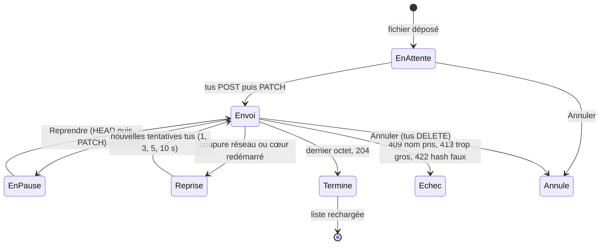

# Interface web

Le front React (Vite, TypeScript) que le cœur sert en fichiers statiques : `web/src/`.
Issues : #6 (assistant, connexion, comptes), #11 (drive).

## Écrans et adresses

Avant la connexion, `App.tsx` choisit l'écran selon l'état du cœur : l'assistant de premier démarrage si `GET /api/setup` répond `needed`, sinon la connexion si `GET /api/me` répond 401. Une fois connecté, `Shell.tsx` affiche la barre du haut et la page que nomme l'adresse :

| Adresse | Page | Pour |
|---|---|---|
| `/drive`, `/drive/<dossier>` | Le drive, sur ce dossier | Tout compte |
| `/comptes` | La santé de la box et la gestion des comptes | Admin |
| Toute autre adresse | Remplacée par `/drive` | |

- **Routage :** `router.ts` s'appuie sur l'API History, sans bibliothèque. Précédent et Suivant marchent, et un lien vers un dossier se partage tel quel. Le cœur renvoie `index.html` pour toute adresse qu'il ne connaît pas.
- **Adresses des dossiers :** chaque segment d'un dossier est encodé à part dans l'URL (`/drive/Photos/%C3%89t%C3%A9%202024`).

## Drive

`web/src/drive/` :

| Fichier | Rôle |
|---|---|
| `Drive.tsx` | La page |
| `Breadcrumb.tsx` | Le fil d'Ariane |
| `FileList.tsx` | La liste, triable par nom, taille ou date ; dossiers d'abord, noms comparés comme on les lit (« 2 » avant « 10 ») |
| `Dialogs.tsx` | Nouveau dossier, Renommer, et Déplacer vers… avec un sélecteur qui parcourt les dossiers |
| `UploadPanel.tsx` | Le panneau d'envoi |
| `uploads.ts` | La file d'envoi |
| `files.ts` | Les appels à `/api/files` et les formats français |

- **Actions :**
  - **Renommer** est un déplacement dans le même dossier (`POST /api/files/move`).
  - **Télécharger** est un lien vers `/api/files/content`, avec le cookie de session.
  - **Pas de suppression :** la suppression vers la corbeille vient avec #10.
- **Mobile :** en largeur mobile, les colonnes Taille et Modifié passent sous le nom, et les actions restent visibles.

## File d'envoi

Les fichiers déposés sur la liste, ou choisis avec « Envoyer », partent dans le dossier courant par tus (voir [storage.md](storage.md), « Envoi reprenable »).

- **Parallélisme :** deux fichiers à la fois, en morceaux de 8 Mo.
- **En-tête :** chaque requête porte `X-Cloudos-Client: web`.
- **Nouvelles tentatives :** à 1, 3, 5 puis 10 s après une coupure.

- **Reprise après rechargement :** `tus-js-client` garde l'adresse de chaque envoi en cours dans le `localStorage`, sous une empreinte propre au dossier de destination (`cloudos:<chemin>:<taille>:<date>`). Si l'utilisateur recharge la page et redépose le même fichier au même endroit, `findPreviousUploads` reprend au bon octet.
- **Annuler :** l'annulation envoie un `DELETE` tus, qui ne supprime que le fichier partiel côté cœur.
- **Erreurs :** elles s'affichent en français dans le panneau. Le panneau s'efface une fois tous les envois terminés.
- **Testabilité :** `UploadQueue` reçoit une fabrique de clients tus, ce qui permet aux tests de piloter les envois sans réseau (`drive/drive.test.tsx`).
